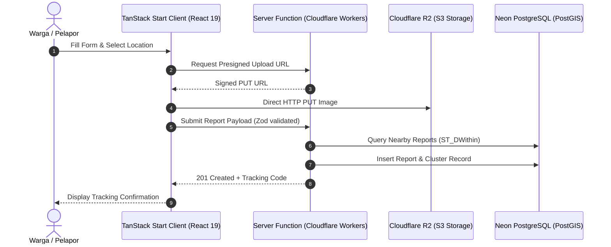

# /write-plan (create-plan)

Create a detailed, actionable, and rigorously architected implementation plan file for a SiagaWarga feature.

## Usage

```
/write-plan $ARGUMENTS
```

**Examples:**
```
/write-plan 00-workspace-setup
/write-plan 01-landing-and-emergency-banner
/write-plan 02-report-form-and-r2-upload
/write-plan 03-postgis-spatial-clustering
/write-plan 04-nasa-firms-hotspots
/write-plan 05-moderator-triage-dashboard
/write-plan 06-public-tracking-timeline
```

---

## Step 1 — Read Sources Before Writing Anything

Read all of the following core documents before writing any plan content:

1. **`PRD.md`** → The source of truth for product requirements, validation layers, PostGIS schema, status state machine, and user flows.
2. **`AGENTS.md`** → The technical operating manual for architecture rules (server functions, direct R2 presigned URLs, zero PII leakage, PostGIS spatial queries, Bun commands, code conventions, team anti-conflict rules).
3. **`DESIGN.md`** → Design tokens (OKLCH, zero gradients, zero emojis), semantic color mappings, emergency visual hierarchy, mobile-first layouts, and typography.
4. **`bahasa-skills` (`.agents/skills/bahasa-inti/` & `bahasa-website/`)** → **MANDATORY:** Must be loaded before writing any UI text, button labels, form placeholders, error notices, or empty states. All Indonesian copy must be free of AI slop and strictly follow natural, human phrasing.
5. **Existing Plans in `docs/plans/`** → Ensure sequence numbers and dependencies are properly resolved.

---

## Step 2 — Determine Plan Metadata

1. **Path:** `docs/plans/NN-<feature-name>.md` (e.g. `01-landing-and-education.md`)
2. **Dependencies:** What preceding plans must be completed first? (e.g. `00-workspace-setup` must precede all feature plans).
3. **Layers Affected:**
   - [ ] Schema & Zod Types (`src/lib/schema/`)
   - [ ] Database & PostGIS Drizzle Migrations (`src/server/db/`)
   - [ ] Server Functions & Cloudflare Services (`src/server/functions/`, `src/server/services/`)
   - [ ] UI Primitives & Domain Components (`src/components/`, `src/routes/`)
   - [ ] Tests (`tests/` or `src/**/*.test.ts` via `bun test`)

---

## Step 3 — Plan File Template

Use this exact structure. Never omit required sections.

```markdown
# Plan NN — Feature Name

## 1. Scope & Objectives
- **Target:** Clear 1-2 paragraph description of what is built.
- **Out of Scope:** Explicitly what is deferred to subsequent plans.
- **Competition Alignment:** How this feature contributes to WIA 2026 scoring (Fungsionalitas 25%, Desain 20%, Konten 20%, Orisinalitas 20%, Kesesuaian Tema 15%).

## 2. PRD Reference & Dependencies
- **PRD Section:** e.g. Section 5.1 & FR-2
- **Preceding Plan Dependencies:** e.g. `00-workspace-setup`
- **Target Route(s):** e.g. `/lapor`, `/pantau`, `/admin/triase`

## 3. Use Cases & Sequence Diagrams
Provide a Mermaid sequence diagram for each primary use case.



## 4. Data Models, Schemas & Server Functions

### 4.1 Zod Schemas (`src/lib/schema/`)
Define exact Zod validation schemas and TypeScript types.

### 4.2 Drizzle Schema & PostGIS (`src/server/db/`)
Define Drizzle tables, enum mappings, and spatial column definitions.

### 4.3 Server Functions (`src/server/functions/`)
Specify every `createServerFn` with its validator, context, and handler.
Include exact error handling and rate-limiting behavior.

## 5. UI/UX Design & Microcopy Specification (DESIGN.md & bahasa-skills)
- **Surface Mode:** Persuade (Landing) / Operate (Form & Admin) / Experience (Tracking)
- **Key Components:** shadcn/ui Base UI primitives, responsive overlays (`responsive-overlay.tsx`), dual-layer map.
- **States:** Loading skeletons, empty states, error boundaries, mobile responsiveness (<768px vs ≥768px).
- **Safety Disclaimers:** Visible emergency 112/113 banners and photo safety warnings.
- **Microcopy & UI Text (bahasa-skills verified):** List exact button labels, form placeholders, and status text. Verify zero AI-slop, no em-dash styling, zero emojis, and human phrasing.

## 6. Implementation File List
- **New Files:** Path and purpose (respecting modular Drizzle schemas and vertical slicing)
- **Modified Files:** Path and exact modification

## 7. Testing & Quality Gates (TDD with Bun)
- Unit tests for validation schemas and spatial distance functions.
- Integration tests for server functions using mock DB / mock R2.
- Quality Gates to verify:
  1. `bun test` passes 100%
  2. `bun run lint` (ESLint) passes with zero errors
  3. `bun run typecheck` passes with zero TypeScript errors
  4. `bun run build` succeeds
```

---

## Step 4 — Verification Before Saving

Before saving the plan into `docs/plans/`:
1. Check that all database queries use Drizzle ORM and spatial queries use PostGIS.
2. Check that direct uploads use Cloudflare R2 presigned URLs.
3. Check that no client-side code directly queries the database or exposes secret tokens.
4. Check that personal identifiable information (PII) of citizens is shielded on public endpoints.
5. Check that all Indonesian copy has been audited against `bahasa-inti` and `bahasa-website`.
