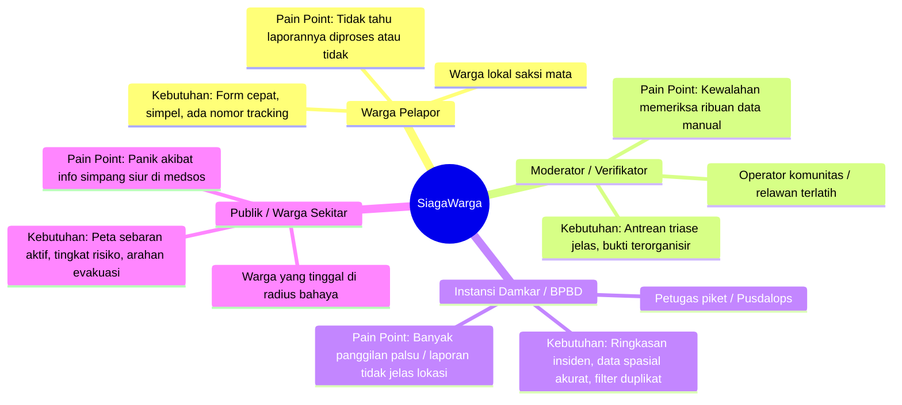
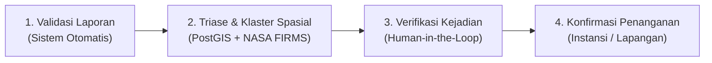
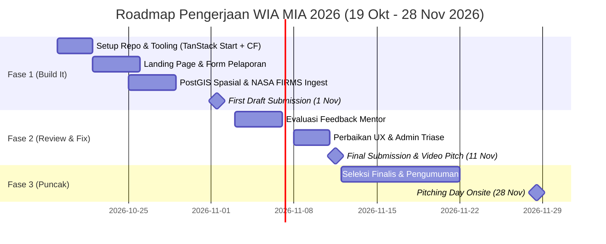

# 📄 Product Requirements Document (PRD): SiagaWarga

> **Status:** Draft v1.0 (Untuk Pengembangan Web In Action 2026)  
> **Tema Kompetisi:** *From Visionaries to Architects of Change*  
> **Subtema:** **Public Service Tracking**  
> **Fokus Utama:** Pelaporan Kebakaran Hutan & Lahan (Karhutla) serta Permukiman dengan Pelacakan Transparan dan Verifikasi Spasial

---

## 1. Executive Summary

**SiagaWarga** adalah platform *civic reporting & public service tracking* yang menghubungkan masyarakat dengan instansi penanganan kebakaran (Damkar, BPBD, Manggala Agni). Platform ini memecahkan masalah klasik pada pelaporan kedaruratan di Indonesia: **ketidakjelasan status laporan, banjir laporan duplikat, dan keterbatasan verifikasi manual**.

Berbeda dengan solusi pelaporan konvensional yang mengklaim status sepihak ("petugas sedang meluncur"), SiagaWarga mengusung filosofi **System Honesty**:
1. Memvalidasi kelayakan data secara teknis (input & media) tanpa langsung mengklaim kebenaran peristiwa.
2. Melakukan triase prioritas dan klastering deduplikasi spasial secara otomatis menggunakan **PostGIS**.
3. Memvalidasi silang keberadaan titik panas satelit real-time (**NASA FIRMS API**).
4. Melibatkan verifikasi manusia (*Human-in-the-Loop*) untuk menilai kelayakan bukti.
5. Menampilkan linimasa penanganan publik secara transparan dengan tetap menjaga keselamatan dan privasi pelapor (*zero PII leakage*).

---

## 2. Problem Statement & Latar Belakang

### 2.1 Konteks Masalah di Indonesia
- Setiap tahun, bencana karhutla di Sumatra, Kalimantan, dan wilayah lainnya menyebabkan kabut asap lintas batas, kerugian ekonomi hingga triliunan rupiah, dan ancaman ISPA.
- Di perkotaan, kebakaran permukiman padat sering terlambat ditangani karena akses informasi yang terfragmentasi.

### 2.2 Kesenjangan pada Sistem Saat Ini
1. **Black-box Tracking:** Warga yang melapor lewat telepon/kanal darurat tidak memiliki akses untuk mengetahui apakah laporannya sudah diterima, diverifikasi, atau sedang dalam penanganan.
2. **Duplicate Storm:** Satu titik kebakaran besar menghasilkan puluhan laporan serupa di media sosial yang membingungkan operator dan menyita waktu penanganan.
3. **Bahaya Laporan Palsu / Hoaks:** Foto kebakaran lama sering didaur ulang untuk memicu kepanikan warga.
4. **Resiko Keselamatan Warga:** Warga sering terdorong mendekati titik api berbahaya hanya untuk mengambil foto dokumentasi.

---

## 3. Visi & Tujuan Produk (Goals)

| Kategori | Target / Sasaran |
|---|---|
| **Tujuan Produk** | Menyediakan platform tracking layanan publik pelaporan kebakaran yang transparan, terpercaya, dan aman bagi warga dan instansi. |
| **Metrik Keberhasilan MVP** | • Validasi laporan < 30 detik sejak dikirim.<br>• Akurasi deteksi duplikat spasial (radius 2 km) berjalan 100%.<br>• Waktu muat awal (FCP) di mobile < 1.2 detik di jaringan Edge Cloudflare.<br>• Zero kebocoran data pribadi (nomor kontak / koordinat rumah) pada tampilan publik. |
| **Batas Ruang Lingkup (Non-Goals)** | Platform ini **bukan** pengganti jalur telepon darurat resmi (112/113). Platform ini berfungsi sebagai lapisan pelaporan digital, transparansi publik, dan pendukung keputusan triase. |

---

## 4. Persona Pengguna & User Journey

### 4.1 Persona



### 4.2 User Journey Ringkas

1. **Warga Saksi:** Mengakses web $\rightarrow$ Membaca instruksi keselamatan $\rightarrow$ Menandai lokasi di peta $\rightarrow$ Mengunggah foto (opsional) $\rightarrow$ Submit $\rightarrow$ Memperoleh ID Laporan & Link Tracking.
2. **Mesin Triase Otomatis:** Memeriksa batasan wilayah Indonesia $\rightarrow$ Cek duplikat spasial (PostGIS) $\rightarrow$ Cek hotspot satelit NASA FIRMS $\rightarrow$ Menentukan prioritas antrean.
3. **Moderator:** Membuka antrean prioritas tinggi $\rightarrow$ Meninjau konsistensi foto & data satelit $\rightarrow$ Memberikan status verifikasi beserta catatan alasan.
4. **Publik & Warga Sekitar:** Membuka peta interaktif publik $\rightarrow$ Melihat klaster insiden aktif $\rightarrow$ Membaca linimasa tindak lanjut resmi.

---

## 5. Pendekatan Validasi (Validation Approach Architecture)

Sistem membedakan secara tegas tiga fase proses independen:



### 5.1 Lapisan 1: Validasi Laporan (Otomatis & Isomorphic)
* **Aturan Input (Zod):**
  * Koordinat wajib berada dalam Bounding Box wilayah Indonesia (Lat: -11.0 s/d 6.0, Lon: 95.0 s/d 141.0).
  * `observed_at` tidak boleh berada di masa depan dan tidak lebih lampau dari 7 hari.
  * Deskripsi minimal 15 karakter, sanitasi terhadap tag berbahaya (XSS-safe).
* **Integritas Bukti Media & Direct Upload:**
  * Foto bersifat **opsional** (tidak memaksa warga mendekat ke api demi mengambil foto).
  * **Direct Presigned URL ke Cloudflare R2:** Browser meminta signed PUT URL ke server function TanStack Start, lalu mengunggah berkas langsung ke R2. Ini menghemat memori dan batas CPU waktu eksekusi Cloudflare Workers saat memproses foto berukuran besar.
  * Pemeriksaan hashing (SHA-256) pada file gambar untuk mendeteksi *re-upload* foto identik dari akun berbeda.
  * Ekstraksi metadata waktu (`DateTimeOriginal` via `exifr` di sisi client sebelum upload) untuk membandingkan timestamp kamera dengan waktu pengamatan yang diklaim.

### 5.2 Lapisan 2: Triase Cerdas & Klaster Spasial
* **Deduplikasi Spasial (PostGIS):**
  * Jika ditemukan laporan lain dalam radius $\le 2.000$ meter dan selisih waktu $\le 4$ jam, laporan baru ditandai `is_potential_duplicate = true` dan dikaitkan ke `cluster_id` yang sama.
  * Laporan duplikat **tidak dihapus**, melainkan dikelompokkan sebagai bukti penguat.
* **Korelasi Data Satelit (NASA FIRMS):**
  * Sistem mengambil koordinat hotspot aktif sensor VIIRS/MODIS.
  * Jika koordinat laporan berada dalam radius 5 km dari hotspot satelit aktif, tambahkan indikator otomatis: `satellite_correlated = true` (meningkatkan keyakinan moderator).
* **Penentuan Prioritas (`priority`):**
  * `high`: Indikasi kebakaran berdekatan dengan permukiman/fasilitas umum atau intensitas api besar.
  * `normal`: Laporan kebakaran lahan terbuka standar.
  * `low`: Laporan asap tipis atau sisa pembakaran terkendali.

### 5.3 Lapisan 3: Verifikasi Kejadian (Human-in-the-Loop)
Moderator meninjau laporan di antrean triase. Status verifikasi (`verification_status`):
- `pending`: Laporan baru masuk, menunggu giliran review.
- `needs_review`: Data kurang jelas atau terdapat anomali metadata.
- `verified`: Bukti foto konsisten, dikonfirmasi beberapa saksi, atau selaras dengan hotspot satelit.
- `insufficient_evidence`: Bukti belum memadai untuk menyimpulkan kejadian nyata.
- `rejected`: Terbukti spam, hoaks, atau salah kategori.

> Setiap perubahan status **wajib menyertakan catatan alasan** (`reason_note`) yang tercatat dalam tabel riwayat imutabel.

### 5.4 Lapisan 4: Konfirmasi Penanganan (`handling_status`)
Menggambarkan tindak lanjut fisik:
- `not_forwarded`: Belum diteruskan ke pihak eksternal.
- `forwarded`: Telah diteruskan ke Damkar/BPBD setempat (dilengkapi timestamp dan instansi tujuan).
- `acknowledged`: Dikonfirmasi telah diterima oleh petugas jaga instansi.
- `in_progress`: Tindak lanjut pemadaman/pengecekan lapangan sedang berlangsung.
- `resolved`: Operasi pemadaman/pendinginan dinyatakan tuntas.

---

## 6. Spesifikasi Skema Data & ORM (Neon PostgreSQL + Drizzle ORM)

Arsitektur data menggunakan **Neon Serverless PostgreSQL** dengan ekstensi **PostGIS**, diakses melalui **Drizzle ORM** (`@neondatabase/serverless`) untuk memastikan koneksi optimal di Cloudflare Workers dengan *type-safety* 100%.

### 6.1 Skema SQL DDL PostGIS

```sql
-- Ekstensi Geospasial
CREATE EXTENSION IF NOT EXISTS postgis;

-- Tipe ENUM
CREATE TYPE incident_type_enum AS ENUM ('karhutla', 'permukiman', 'industri', 'lainnya');
CREATE TYPE verification_status_enum AS ENUM ('pending', 'needs_review', 'verified', 'insufficient_evidence', 'rejected');
CREATE TYPE priority_enum AS ENUM ('high', 'normal', 'low');
CREATE TYPE handling_status_enum AS ENUM ('not_forwarded', 'forwarded', 'acknowledged', 'in_progress', 'resolved', 'unknown');

-- Tabel Utama: reports
CREATE TABLE reports (
    id UUID PRIMARY KEY DEFAULT gen_random_uuid(),
    tracking_code VARCHAR(12) UNIQUE NOT NULL, -- Contoh: SW-2026-X89B
    incident_type incident_type_enum NOT NULL,
    description TEXT NOT NULL,
    observed_at TIMESTAMPTZ NOT NULL,
    submitted_at TIMESTAMPTZ NOT NULL DEFAULT NOW(),
    
    -- Geospasial
    latitude DOUBLE PRECISION NOT NULL,
    longitude DOUBLE PRECISION NOT NULL,
    location_geom GEOMETRY(Point, 4326) NOT NULL,
    address_display TEXT,
    
    -- Status multi-tier
    verification_status verification_status_enum NOT NULL DEFAULT 'pending',
    priority priority_enum NOT NULL DEFAULT 'normal',
    handling_status handling_status_enum NOT NULL DEFAULT 'not_forwarded',
    
    -- Klastering & Korelasi
    cluster_id UUID,
    is_potential_duplicate BOOLEAN DEFAULT FALSE,
    satellite_hotspot_matched BOOLEAN DEFAULT FALSE,
    
    -- Privasi & Anonimitas
    reporter_name VARCHAR(100),
    reporter_phone VARCHAR(20),
    is_anonymous BOOLEAN DEFAULT FALSE,
    
    created_at TIMESTAMPTZ NOT NULL DEFAULT NOW(),
    updated_at TIMESTAMPTZ NOT NULL DEFAULT NOW()
);

-- Indeks Spasial & Query Cepat
CREATE INDEX idx_reports_geom ON reports USING GIST (location_geom);
CREATE INDEX idx_reports_verification ON reports (verification_status, priority);
CREATE INDEX idx_reports_tracking ON reports (tracking_code);

-- Tabel Bukti Media: report_evidence
CREATE TABLE report_evidence (
    id UUID PRIMARY KEY DEFAULT gen_random_uuid(),
    report_id UUID NOT NULL REFERENCES reports(id) ON DELETE CASCADE,
    r2_object_key TEXT NOT NULL,
    media_url TEXT NOT NULL,
    file_hash_sha256 VARCHAR(64) NOT NULL,
    exif_capture_time TIMESTAMPTZ,
    file_size_bytes INTEGER NOT NULL,
    mime_type VARCHAR(50) NOT NULL,
    created_at TIMESTAMPTZ NOT NULL DEFAULT NOW()
);

-- Tabel Riwayat Status Imutabel: report_status_history
CREATE TABLE report_status_history (
    id UUID PRIMARY KEY DEFAULT gen_random_uuid(),
    report_id UUID NOT NULL REFERENCES reports(id) ON DELETE CASCADE,
    status_type VARCHAR(30) NOT NULL, -- 'verification' | 'handling' | 'priority'
    previous_value VARCHAR(50),
    new_value VARCHAR(50) NOT NULL,
    changed_by VARCHAR(100) NOT NULL, -- ID / Nama Moderator
    reason_note TEXT NOT NULL,
    created_at TIMESTAMPTZ NOT NULL DEFAULT NOW()
);

-- Cache Titik Panas Satelit: satellite_hotspots
CREATE TABLE satellite_hotspots (
    id UUID PRIMARY KEY DEFAULT gen_random_uuid(),
    source VARCHAR(20) NOT NULL, -- 'VIIRS_SNPP', 'MODIS', dll.
    latitude DOUBLE PRECISION NOT NULL,
    longitude DOUBLE PRECISION NOT NULL,
    geom GEOMETRY(Point, 4326) NOT NULL,
    brightness DOUBLE PRECISION,
    confidence VARCHAR(20),
    acquired_at TIMESTAMPTZ NOT NULL,
    fetched_at TIMESTAMPTZ NOT NULL DEFAULT NOW()
);
CREATE INDEX idx_hotspots_geom ON satellite_hotspots USING GIST (geom);
```

---

## 7. Kebutuhan Fungsional (Functional Requirements)

### FR-1: Portal Edukasi & Pengaduan Cepat (Landing Page)
- Menampilkan pesan keselamatan mencolok: *"Jika dalam bahaya mendesak, segera hubungi 112 atau 113"*.
- Peta sebaran ringkas insiden terkonfirmasi aktif 24 jam terakhir.
- Tombol aksi utama: **"Laporkan Kejadian"** dan **"Lacak Laporan Saya"** (via Tracking Code).

### FR-2: Formulir Pelaporan Berbasis Lokasi (Warga)
- Menggunakan **TanStack Form + Zod** untuk validasi real-time yang ramah mobile.
- Tombol auto-detect GPS perangkat + opsi geser pin pada peta interaktif.
- Pilihan jenis insiden, tanggal & waktu terlihat, estimasi tingkat keparahan.
- Upload foto bukti bersifat opsional via **Presigned URL langsung ke Cloudflare R2** (client meminta temporary signed upload URL ke server function, kemudian upload langsung via HTTP PUT).
- Setelah submit, pelapor langsung mendapatkan `tracking_code` unik (misal: `SW-2026-X89B`).

### FR-3: Spatial Deduplication & Triage Engine (Server)
- Dijalankan via Server Function TanStack Start saat ada laporan baru.
- Menjalankan kueri spasial `ST_DWithin` untuk memeriksa apakah ada laporan serupa dalam jarak 2 km dalam 4 jam terakhir.
- Menghubungi tabel cache `satellite_hotspots` (NASA FIRMS) untuk memeriksa korelasi titik panas dalam radius 5 km.
- Memberi bobot skor urgensi otomatis (`priority = high` jika terindikasi dekat pemukiman).

### FR-4: Moderator Command Center (Admin/Verifikator)
- Tampilan antrean terurut berdasarkan prioritas dan waktu masuk.
- Panel detail laporan:
  - Viewer foto bukti berdampingan dengan perbandingan waktu pengamatan vs EXIF kamera.
  - Kartu indikasi klaster laporan warga sekitar.
  - Kartu indikasi hotspot satelit terdekat.
- Modal pengubah status dengan kolom wajib: `Alasan & Catatan Verifikasi`.

### FR-5: Halaman Pelacakan Publik & Linimasa Audit
- Halaman detail laporan berbasis kode pelacakan (`/lacak/SW-2026-X89B`).
- Menampilkan status verifikasi dan status penanganan dalam bentuk stepper/linimasa.
- Menampilkan riwayat perubahan status dari `report_status_history` secara kronologis.
- **Kebijakan Privasi Ketat:** Nomor telepon dan nama lengkap pelapor tidak ditampilkan kepada publik. Koordinat titik peta pada tampilan publik diburamkan (jitter) ke radius kelurahan untuk melindungi privasi lokasi tempat tinggal saksi.

---

## 8. Kebutuhan Non-Fungsional (Non-Functional Requirements)

1. **Kecepatan & Performa Edge:**
   - Deployed di Cloudflare Workers dengan SSR rendering TanStack Start. Target respons time awal < 100ms di wilayah Indonesia.
2. **Keamanan & Validasi Input:**
   - Perlindungan CSRF pada mutasi formulir.
   - Pembatasan ukuran file bukti (maksimal 5 MB per foto, hanya menerima `image/jpeg` dan `image/png`).
   - Rate limiting pengiriman laporan per IP di level Cloudflare.
3. **Aksesibilitas & Tampilan:**
   - Desain responsif (Mobile First, breakpoint 375px s/d 1440px).
   - Memenuhi standar kontras warna WCAG AA.
   - Komponen UI menggunakan shadcn/ui dengan navigasi keyboard yang aksesibel.
4. **Tooling, Runtime & Package Manager:**
   - Menggunakan **Bun** sebagai JavaScript/TypeScript runtime dan package manager utama untuk instalasi dependensi, scripting migrasi database Drizzle, serta build pipeline yang cepat dan andal.

---

## 9. Rencana Rilis & Milestone Kompetisi WIA 2026



---

## 10. Strategi Menghadapi Q&A Dewan Juri

| Topik Pertanyaan | Jawaban Strategis Berdasarkan PRD |
|---|---|
| *"Kenapa tidak menggunakan AI saja untuk menentukan kebakaran?"* | Model AI visi komputer rawan bias dan *false positive* (misal: debu atau awan dikira asap). SiagaWarga menggabungkan AI/rule-based triase dengan verifikasi spasial data satelit NASA dan validasi manusia agar setiap keputusan dapat dipertanggungjawabkan secara hukum. |
| *"Bagaimana jika warga iseng mengirim laporan hoaks?"* | Sistem menggunakan deteksi hash gambar kembar, validasi koordinat batas wilayah, korelasi laporan independen warga sekitar, dan pelacakan audit trail. Laporan tanpa bukti pendukung akan berstatus `insufficient_evidence` dan tidak langsung diumumkan ke publik. |
| *"Apakah sistem ini siap menangani lonjakan trafik saat bencana besar?"* | Sangat siap. Frontend dan API berjalan di edge serverless Cloudflare Workers yang auto-scale secara global tanpa cold start, serta penyimpanan aset foto di Cloudflare R2 dengan nol biaya transfer data (*zero egress*). |


"Kelamin Kuda Jantan"