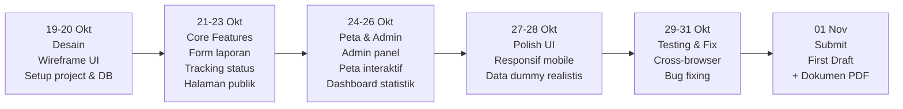

# Panduan WIA — Web In Action, Multimedia In Action 2026

> **Penyelenggara:** KSM Multimedia UPN Veteran Jakarta
> **Tema:** _"From Visionaries to Architects of Change"_
> **Subtema Tim:** Public Service Tracking — Pelaporan Kebakaran
> **Hadiah Juara 1:** Rp 3.500.000 + E-Sertifikat + Plakat

---

## 1. Kriteria Penilaian Resmi (Baca Ini Dulu!)

### Babak Penyisihan

| Kriteria                      | Deskripsi                                                       | Bobot   |
| ----------------------------- | --------------------------------------------------------------- | ------- |
| **Fungsionalitas Website**    | Navigasi mudah, semua fitur berjalan, responsif multi-perangkat | **25%** |
| **Orisinalitas Ide & Konsep** | Keunikan ide, tidak meniru, relevan dengan tema                 | 20%     |
| **Desain & Estetika**         | Layout, warna, tipografi harmonis, UX menarik                   | 20%     |
| **Konten & Informasi**        | Informasi jelas, relevan, akurat, mudah dipahami                | 20%     |
| **Kesesuaian Tema & Subtema** | Seberapa pas dengan Public Service Tracking                     | 15%     |

### Babak Final

| Kriteria                             | Deskripsi                                                           | Bobot   |
| ------------------------------------ | ------------------------------------------------------------------- | ------- |
| **Fungsionalitas & User Experience** | Semua fitur berjalan lancar, responsif, navigasi mudah              | **25%** |
| **Desain & Kreativitas Visual**      | Layout, warna, tipografi, daya tarik visual                         | 20%     |
| **Presentasi & Komunikasi**          | Ide jelas, kontribusi tiap anggota, penguasaan materi, tepat durasi | 20%     |
| **Orisinalitas & Konsep Website**    | Keunikan ide, inovasi fitur & desain, relevansi tema                | 15%     |

> [!IMPORTANT]
> **Fungsionalitas adalah kriteria bobot tertinggi (25%) di dua babak.** Prioritaskan website yang _benar-benar berfungsi_ di atas tampilan mewah yang tidak stabil.

---

## 2. Timeline Resmi yang Harus Dipatuhi

| Fase                           | Tanggal              | Yang Harus Dilakukan Tim                         |
| ------------------------------ | -------------------- | ------------------------------------------------ |
| ~~Pendaftaran~~                | ~~24 Sep – 16 Okt~~  | Sudah lewat                                      |
| **Technical Meeting**          | 17 Oktober 2026      | Pastikan hadir, catat semua arahan               |
| **Learn It: Mentoring**        | 18 Oktober 2026      | Hadir, catat feedback mentor, siapkan pertanyaan |
| **Build It (Mulai hari ini!)** | **19 Okt – 01 Nov**  | Periode pengerjaan karya                         |
| **First Draft Submission**     | **01 November 2026** | Kumpulkan draft + dokumen PDF (maks 10 hal)      |
| **Review It: Feedback Mentor** | 03 – 06 November     | Mentor evaluasi karya                            |
| **Laporan Evaluasi**           | 07 November          | Terima feedback mentor                           |
| **Consultation Session**       | 08 November          | Konsultasi terbatas — manfaatkan!                |
| **Fix It: Revisi**             | 08 – 10 November     | Perbaikan berdasarkan feedback                   |
| **Final Submission**           | **11 November 2026** | Kumpulkan karya final + video pitch YouTube      |
| **Seleksi Finalis**            | 12 – 20 November     | Juri menilai, tim istirahat/prepare              |
| **Pengumuman Finalis**         | 21 November          | 10 tim terbaik diumumkan                         |
| **Mentoring Public Speaking**  | 22 November          | Wajib hadir jika lolos final                     |
| **Final & Acara Puncak**       | **28 November 2026** | Pitching _onsite_, max 10 menit + 5 menit Q&A    |

> [!WARNING]
> Saat ini **19 Oktober** — Build It baru mulai hari ini. Hanya ada **13 hari** hingga First Draft Submission (1 November). Bagi waktu dengan ketat!

---

## 3. Deliverable Wajib Per Fase

### A. First Draft Submission — 01 November 2026

Submit melalui **mia2026.com**:

**1. Link Repository Publik (GitHub/GitLab)**
README.md wajib berisi:

- [ ] Judul project + deskripsi singkat (1–2 kalimat)
- [ ] Tech stack yang digunakan
- [ ] Cara menjalankan project (`clone` → `install` → `run`)
- [ ] Progress saat ini (contoh: "Landing page + halaman pelaporan sudah selesai")

**2. Dokumen PDF** — format: `WIA_FDSMIA2025_NamaTim` (maks 10 hal, maks 10 MB):

- [ ] Konsep singkat website (latar belakang, tujuan, masalah yang diselesaikan)
- [ ] Sitemap struktur halaman website
- [ ] Wireframe/mockup tampilan utama
- [ ] Penjelasan fitur utama yang direncanakan
- [ ] Screenshot minimal 2 halaman (**WAJIB: landing page + 1 halaman lain**)

---

### B. Final Submission — 11 November 2026

Submit link **Google Drive (Public Access)** berisi:

**1. Dokumen Proposal** — `WIA_PenyisihanMIA2026_NamaTim` (PDF, maks 30 hal):

- Template dari: [bit.ly/ProposalMIA2026](https://bit.ly/ProposalMIA2026)

**2. Surat Keterangan Orisinalitas Karya**

- Bermaterai Rp 10.000
- Template dari: [bit.ly/SuratOrisinalitasKaryaMIA2026](https://bit.ly/SuratOrisinalitasKaryaMIA2026)

**3. Video Pitching YouTube (Publik, max 5 menit)**
Konten wajib:

- [ ] Perkenalan anggota tim (nama & peran)
- [ ] Demo fitur utama website
- [ ] Rencana pengembangan website ke depan
- [ ] Deskripsi YouTube yang menarik

---

### C. Babak Final — 28 November 2026 (Onsite)

**Pitch Deck** — `.pptx` atau `.pdf`, **maks 15 halaman**:

| Slide                    | Konten Wajib                                                 |
| ------------------------ | ------------------------------------------------------------ |
| Cover                    | Nama tim, nama anggota, nama website/produk, tagline         |
| Latar Belakang & Masalah | Fakta/data studi kasus, 2–3 masalah inti, _pain points_      |
| Tujuan & Manfaat         | Tujuan pengembangan, manfaat nyata bagi pengguna             |
| Solusi / Fitur Utama     | Deskripsi website, fitur unggulan, keunggulan vs solusi lain |
| Demo Website             | Link website live + alur utama                               |
| Rencana Pengembangan     | Roadmap fitur & strategi ke depan                            |
| Kesimpulan               | _Value proposition_ + alasan kenapa website ini layak menang |

**Durasi:** Max 10 menit presentasi + 5 menit Q&A juri

---

## 4. Strategi Fitur Berdasarkan Bobot Nilai

### Fungsionalitas (25%) — Prioritas Mutlak

Fitur yang **WAJIB berjalan sempurna** saat demo:

```
1. Form Pelaporan Kebakaran
   ├── Input lokasi (manual/GPS)
   ├── Upload foto
   ├── Pilihan tingkat keparahan
   └── Nomor kontak pelapor

2. Tracking Status Laporan
   └── Laporan Masuk → Diverifikasi → Petugas Dikirim → Selesai

3. Halaman Publik / Dashboard
   ├── Daftar laporan aktif
   └── Status masing-masing laporan

4. Admin Panel (Operator Damkar)
   ├── Lihat laporan masuk
   └── Update status laporan

5. Responsif Mobile + Desktop
   └── Test di Chrome DevTools minimal 375px & 1440px
```

### Orisinalitas & Desain (20% + 20%) — Pembeda

```
⭐ Peta interaktif kejadian (Leaflet.js/Mapbox)
⭐ Heatmap area rawan berdasarkan historis laporan
⭐ Panduan evakuasi mandiri terintegrasi di halaman laporan
⭐ Skor risiko wilayah per kelurahan
⭐ Notifikasi update status (email/in-app)
```

### Konten & Informasi (20%) — Jangan Sepelekan

```
Semua teks dalam Bahasa Indonesia yang baik dan benar
Data statistik kebakaran nyata (dari BPS/BNPB)
Foto tidak lorem ipsum — gunakan foto relevan (Unsplash)
FAQ / Panduan penggunaan website
Halaman "Tentang" yang menjelaskan misi platform
```

### Kesesuaian Tema — Public Service Tracking (15%)

Pastikan website secara eksplisit menunjukkan:

- Transparansi status layanan publik dari sisi pengguna
- Instansi terkait (Damkar/BPBD) sebagai _stakeholder_ utama
- Tracking yang bisa dipantau masyarakat secara real-time

---

## 5. Timeline Pengerjaan 13 Hari (19 Okt – 01 Nov)



---

## 6. Tech Stack Rekomendasi (Cepat & Stabil untuk Lomba)

| Layer                           | Rekomendasi                   | Catatan / Keunggulan                                                                                                |
| ------------------------------- | ----------------------------- | ------------------------------------------------------------------------------------------------------------------- |
| **Runtime & Package Manager**   | **Bun**                       | Runtime JavaScript/TypeScript dan package manager ultra-cepat untuk development dan build                           |
| **Frontend Framework**          | **TanStack Start** (React)    | Fullstack SSR/Streaming, routing tipe aman tingkat tinggi (TanStack Router)                                         |
| **UI Components & Styling**     | **shadcn/ui + Tailwind CSS**  | Komponen modern, aksesibel, mudah dikustomisasi                                                                     |
| **Form Handling & Validasi**    | **TanStack Form + Zod**       | Validasi skema tipe aman end-to-end, performa render tinggi pada form pelaporan                                     |
| **Peta & Visualisasi**          | **MapLibre GL JS** / Leaflet  | Ringan, gratis, performa render klaster GeoJSON & titik panas satelit tinggi                                        |
| **Database & Spatial Engine**   | **Neon PostgreSQL + PostGIS** | Serverless Postgres dengan ekstensi PostGIS (`ST_DWithin` klastering duplikasi spasial)                             |
| **ORM & Migrasi**               | **Drizzle ORM**               | Type-safe schema, zero-overhead, koneksi cepat via `@neondatabase/serverless`                                       |
| **Object Storage (Bukti Foto)** | **Cloudflare R2**             | Zero egress S3-compatible, upload langsung dari browser via **Signed/Presigned URL**                                |
| **Deploy / Hosting**            | **Cloudflare Workers**        | Edge computing global dengan latensi rendah di seluruh Indonesia, didukung preset TanStack Start / Nitro / Wrangler |

> [!TIP]
> **Presigned URL ke Cloudflare R2** memungkinkan browser mengunggah file bukti foto langsung ke storage tanpa membebani kuota memori/waktu eksekusi Cloudflare Workers. Database **Neon PostgreSQL** dengan PostGIS memastikan deteksi duplikat laporan dapat dieksekusi secara instan di level SQL.

---

## 7. Checklist Gamifikasi (Bonus XP & Diamond)

Sistem gamifikasi MIA 2026 menggunakan **Octalysis Framework**. Aktif di sini untuk poin tambahan dan akses mentor:

- [ ] Upload **Twibbon** di Instagram pribadi, mention 3 teman, tag `@multimedia.in.action` (bonus 100 XP + 50 Diamond per anggota tim)
- [ ] Ikuti **misi harian** di platform mia2026.com
- [ ] Gunakan Diamond untuk tebus **tiket konsultasi mentor** (sangat berharga!)
- [ ] Aktif di leaderboard — konsistensi dinilai

---

## 8. Checklist Final Sebelum Submit

### First Draft (01 November)

- [ ] GitHub repo publik dengan README lengkap
- [ ] Landing page sudah jalan (bisa diakses online)
- [ ] Minimal 1 halaman lain sudah berfungsi
- [ ] PDF dokumen maks 10 hal dengan sitemap + wireframe + screenshot
- [ ] Nama file benar: `WIA_FDSMIA2025_NamaTim`

### Final Submission (11 November)

- [ ] Website live di URL HTTPS (bukan localhost)
- [ ] Semua fitur core berjalan tanpa error
- [ ] Proposal PDF sesuai template panitia, maks 30 hal
- [ ] Surat orisinalitas sudah ditandatangani & bermaterai Rp 10.000
- [ ] Video YouTube (max 5 menit) diunggah publik
- [ ] Google Drive publik berisi semua dokumen di atas

### Babak Final Onsite (28 November)

- [ ] Pitch deck maks 15 hal dalam `.pptx` dan `.pdf`
- [ ] Backup di Google Drive
- [ ] Website bisa diakses online dari laptop presentasi
- [ ] Backup offline tersedia
- [ ] Rehearsal minimal 3x dengan timer 10 menit
- [ ] Hadir 30 menit sebelum acara mulai

---

## 9. Tips Menjawab Q&A Juri

Pertanyaan yang kemungkinan besar ditanyakan:

| Pertanyaan Juri                               | Jawaban yang Kuat                                                                                                                                                     |
| --------------------------------------------- | --------------------------------------------------------------------------------------------------------------------------------------------------------------------- |
| "Bagaimana skalabilitas sistem ini?"          | Arsitektur edge serverless (Cloudflare Workers) auto-scale secara global dengan latensi sangat rendah, database PostgreSQL dengan connection pooling & indeks optimal |
| "Apakah data laporan ini aman?"               | Auth berbasis session, data sensitif tidak diekspos publik, hanya pelapor + admin yang bisa lihat detail                                                              |
| "Kenapa bukan pakai 113 saja?"                | 113 tidak punya transparansi status — warga tidak tahu apakah laporan diterima. Platform ini mengisi gap itu                                                          |
| "Bagaimana integrasinya dengan Damkar nyata?" | API-first design — siap diintegrasikan via REST API. Ini adalah proof of concept yang production-ready                                                                |
| "Apa yang membedakan dari LAPOR! atau Qlue?"  | Fokus vertikal pada kebakaran dengan informasi spesifik (ETA, unit Damkar terdekat, panduan evakuasi)                                                                 |

---

_Panduan ini disusun berdasarkan guidebook resmi WIA — Multimedia In Action 2026 dan subtema resmi Public Service Tracking._
