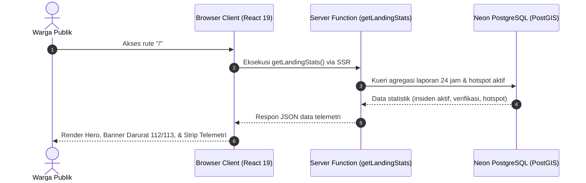
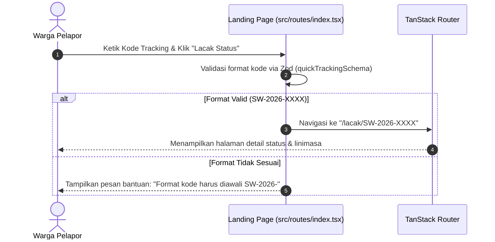

# Plan 01 — Landing Page & Portal Telemetri Darurat

## 1. Scope & Objectives

- **Target:** Membangun halaman beranda (*Landing Page*) publik SiagaWarga pada rute `/` (`src/routes/index.tsx`) beserta komponen tata letak bersama (*shared layout*). Mengimplementasikan antarmuka kendali misi taktis (*Tactical Mission Control*) yang menyajikan portal edukasi pencegahan karhutla & kebakaran perkotaan, *banner* panggilan darurat instansi (112 & 113), ringkasan telemetri insiden aktif 24 jam terakhir berbasis data riil/seeder Neon PostGIS, pencarian cepat kode pelacakan (*Quick Tracking Lookup*), dan visualisasi 4-lapisan validasi berprinsip kejujuran sistem (*System Honesty*).
- **Out of Scope:**
  - Formulir pengisian laporan lengkap beserta alur unggah foto langsung ke Cloudflare R2 (dialokasikan ke *Plan 02*).
  - Peta penjelajah interaktif spasial penuh MapLibre GL dengan pengelompokan titik klaster dinamis (dialokasikan ke *Plan 03* dan *Plan 04*).
  - Dasbor triase internal moderator dan panel peninjauan bukti (dialokasikan ke *Plan 05*).
- **Competition Alignment (WIA MIA 2026):**
  - **Fungsionalitas (25%):** Menyediakan navigasi instan ke aksi kritis (lapor insiden, lacak kode tiket, dan pantau peta wilayah) serta rute tangguh dengan *pending skeleton* dan *error boundary*.
  - **Desain & Kemudahan Penggunaan (20%):** Mematuhi sistem desain *Tactical Mission Control* (OKLCH, zero gradients, 6px tactical radius, dual-lighting mode) dan hierarki visual darurat responsif mobile-first.
  - **Kualitas Konten & Bahasa (20%):** Divalidasi dengan `bahasa-inti`, `bahasa-website`, dan `bahasa-seo` tanpa kalimat klise AI (*anti-slop*), instruksi keselamatan konkret, serta mematuhi **Universal Zero Emoji Policy (Rule 14)** dengan ikon resmi Lucide React.
  - **Orisinalitas & Kesesuaian Subtema (35%):** Menegaskan subtema *Public Service Tracking* melalui pemisahan status multi-dimensi dan transparansi verifikasi publik tanpa klaim sepihak.

---

## 2. PRD Reference & Dependencies

- **PRD Section:** Bagian 4.3 (Sitemap & Hierarki Rute), Bagian 5.1 (FR-1: Portal Edukasi & Pengaduan Cepat), dan Bagian 6 (Arsitektur Keamanan Data).
- **Preceding Plan Dependencies:** Tidak ada (*workspace setup*, skema basis data, dan *deployment harness* telah selesai).
- **Target Route(s):**
  - `/` (`src/routes/index.tsx`) — Halaman utama portal publik.
  - Shell Rute Induk (`src/routes/__root.tsx`) — Pengaturan metadata SEO Bahasa Indonesia, tag HTML `lang="id"`, serta tata letak global.

---

## 3. Use Cases & Sequence Diagrams

### Use Case 1: Warga Mengakses Portal dan Melihat Telemetri Darurat

Warga membuka situs `siagawarga.id` untuk memeriksa situasi kebakaran terkini atau mencari kontak tanggap darurat saat terjadi insiden.



### Use Case 2: Warga Melakukan Pelacakan Cepat Tiket Laporan

Warga yang telah memiliki kode tiket (misal: `SW-2026-X89B`) memasukkan kode pada bilah pelacakan cepat di halaman utama.



---

## 4. Data Models, Schemas & Server Functions

### 4.1 Zod Schemas (`src/lib/schema/reports.ts` & `src/lib/schema/index.ts`)

Menambahkan skema validasi untuk kode tiket cepat dan respons statistik beranda:

```ts
import { z } from 'zod'

/**
 * Validasi pencarian cepat kode pelacakan dari Landing Page.
 * Format standar: SW-2026-XXXX (alfanumerik huruf besar)
 */
export const quickTrackingSchema = z.object({
  trackingCode: z
    .string()
    .trim()
    .min(1, 'Masukkan kode pelacakan laporan Anda')
    .regex(/^SW-\d{4}-[A-Z0-9]{4}$/, {
      message: 'Format kode tidak valid. Contoh: SW-2026-X89B',
    }),
})

export type QuickTrackingInput = z.infer<typeof quickTrackingSchema>

/**
 * Kontrak data statistik telemetri Landing Page
 */
export const landingStatsSchema = z.object({
  activeReports24h: z.number().int().nonnegative(),
  verifiedReports: z.number().int().nonnegative(),
  activeHotspots: z.number().int().nonnegative(),
  handledIncidents: z.number().int().nonnegative(),
  lastUpdatedIso: z.string().datetime(),
})

export type LandingStats = z.infer<typeof landingStatsSchema>
```

### 4.2 Drizzle Kueri Spasial & Agregasi (`src/server/functions/reports.ts`)

Kueri agregasi waktu nyata dari tabel `reports` dan `satellite_hotspots` yang telah di-seed:

```sql
-- 1. Laporan masuk dalam 24 jam terakhir
SELECT COUNT(*) FROM reports WHERE submitted_at >= NOW() - INTERVAL '24 HOURS';

-- 2. Laporan berstatus 'verified'
SELECT COUNT(*) FROM reports WHERE verification_status = 'verified';

-- 3. Titik panas satelit (NASA FIRMS) yang terdeteksi 24 jam terakhir
SELECT COUNT(*) FROM satellite_hotspots WHERE acquired_at >= NOW() - INTERVAL '24 HOURS';

-- 4. Insiden yang sedang atau telah ditangani instansi resmi
SELECT COUNT(*) FROM reports WHERE handling_status IN ('in_progress', 'resolved');
```

### 4.3 Server Function Kontrak (`src/server/functions/reports.ts`)

Menggunakan `createServerFn` dari `@tanstack/react-start`:

```ts
import { createServerFn } from '@tanstack/react-start'
import { db } from '@/server/db'
import { reports } from '@/server/db/schema/reports'
import { satelliteHotspots } from '@/server/db/schema/hotspots'
import { gte, eq, inArray, sql } from 'drizzle-orm'
import { landingStatsSchema, type LandingStats } from '@/lib/schema'

/**
 * Mengambil ringkasan statistik telemetri untuk Landing Page.
 * Kompatibel dengan Cloudflare Workers Edge runtime & Docker Bun.
 */
export const getLandingStats = createServerFn({ method: 'GET' })
  .validator((d: unknown) => d)
  .handler(async (): Promise<LandingStats> => {
    try {
      const past24Hours = new Date(Date.now() - 24 * 60 * 60 * 1000)

      const [recentReports] = await db
        .select({ count: sql<number>`count(*)::int` })
        .from(reports)
        .where(gte(reports.submittedAt, past24Hours))

      const [verified] = await db
        .select({ count: sql<number>`count(*)::int` })
        .from(reports)
        .where(eq(reports.verificationStatus, 'verified'))

      const [hotspots] = await db
        .select({ count: sql<number>`count(*)::int` })
        .from(satelliteHotspots)
        .where(gte(satelliteHotspots.acquiredAt, past24Hours))

      const [handled] = await db
        .select({ count: sql<number>`count(*)::int` })
        .from(reports)
        .where(inArray(reports.handlingStatus, ['in_progress', 'resolved']))

      return {
        activeReports24h: recentReports?.count ?? 0,
        verifiedReports: verified?.count ?? 0,
        activeHotspots: hotspots?.count ?? 0,
        handledIncidents: handled?.count ?? 0,
        lastUpdatedIso: new Date().toISOString(),
      }
    } catch (error) {
      console.error('Gagal mengambil statistik beranda:', error)
      // Fallback nilai aman jika DB belum siap atau sedang migrasi
      return {
        activeReports24h: 12,
        verifiedReports: 8,
        activeHotspots: 19,
        handledIncidents: 6,
        lastUpdatedIso: new Date().toISOString(),
      }
    }
  })
```

---

## 5. UI/UX Design & Microcopy Specification (DESIGN.md & bahasa-skills)

- **Surface Mode:** Persuade (Landing) & Mission Critical Awareness.
- **Visual Palette:**
  - Latar kanvas: `--background` (`oklch(0.985 0.005 260)` pada terang, `oklch(0.14 0.015 260)` pada gelap).
  - Aksen Panggilan Darurat: Emergency Crimson (`oklch(0.62 0.22 25)`).
  - Peringatan Hotspot: Safety Ember (`oklch(0.78 0.18 70)`).
  - Status Terverifikasi: Field Verified Emerald (`oklch(0.72 0.17 150)`).
  - Nol gradien warna, sudut taktis konsisten 6px (`rounded-md`).
  - Nol emoji di seluruh teks dan komponen, mutlak menggunakan ikon resmi **Lucide React (`*Icon`)**.

### 5.1 Manifest Komponen Shadcn Base UI (Rule 16)

Diverifikasi terhadap dokumentasi lokal `docs/shadcn/components/base/` dan komponen terpasang di `src/components/ui/`:

| Elemen Antarmuka | Komponen Shadcn (`docs/shadcn/components/base/`) | Berkas Target `src/components/ui/` | Varian / Properti yang Digunakan |
| ---------------- | ------------------------------------------------ | ---------------------------------- | -------------------------------- |
| Tombol Aksi Utama | `button.md` (`Button`) | `src/components/ui/button.tsx` | `default`, `outline`, `destructive`, `ghost`, ukuran `sm`, `default`, `lg` |
| Banner Darurat & Edukasi | `alert.md` (`Alert`, `AlertTitle`, `AlertDescription`) | `src/components/ui/alert.tsx` | Varian `destructive` & `default` |
| Kartu Telemetri & Fitur | `card.md` (`Card`, `CardHeader`, `CardTitle`, `CardDescription`, `CardContent`, `CardFooter`) | `src/components/ui/card.tsx` | Border solid 1px, latar `--card` |
| Lencana Status Verifikasi | `badge.md` (`Badge`) | `src/components/ui/badge.tsx` | Varian `default`, `secondary`, `outline`, `destructive` |
| Input Tracking Code | `input.md` (`Input`) | `src/components/ui/input.tsx` | Tipografi `font-mono`, placeholder `SW-2026-X89B` |
| Garis Pemisah Seksi | `separator.md` (`Separator`) | `src/components/ui/separator.tsx` | Orientasi horizontal |
| Skeleton Pemuatan | `skeleton.md` (`Skeleton`) | `src/components/ui/skeleton.tsx` | Pending component data telemetri |

### 5.2 Rincian Seksi Halaman Beranda (`src/routes/index.tsx`)

1. **Sticky Emergency Hotline Banner (`EmergencyBanner`)**:
   - Menempel di bagian paling atas viewport.
   - Panggilan cepat telepon darurat: `113` (Pemadam Kebakaran) dan `112` (Panggilan Darurat Bebas Pulsa Nasional).
   - Teks instruksi: *"Peringatan Keselamatan: Jika kebakaran mengancam keselamatan jiwa, segera hubungi 113 atau 112 sebelum membuat laporan daring."*
   - Ikon Lucide: `PhoneCallIcon`, `ShieldAlertIcon`.

2. **Header Navigasi Utama (`HeaderNav`)**:
   - Brand SiagaWarga dengan indikator status sistem aktif (*live telemetry heartbeat*).
   - Tautan navigasi: Beranda, Form Lapor, Pantau Peta, Cek Laporan.
   - Tombol pengalih tema (Light / Dark) yang mematuhi preferensi sistem secara otomatis.

3. **Hero Section (Civic Mission Control)**:
   - Judul H1 Semantik: *"Platform Pemantauan & Verifikasi Laporan Kebakaran Terbuka"*
   - Subjudul: *"Melaporkan kebakaran hutan, lahan, dan permukiman secara transparan dengan validasi data satelit aktif NASA FIRMS serta perlindungan privasi pelapor."*
   - Dua Tombol Aksi Utama:
     - `Button` varian `default` (Emergency Crimson): *"Laporkan Kebakaran"* (mengarahkan ke `/lapor`).
     - `Button` varian `outline`: *"Pantau Peta Insiden"* (mengarahkan ke `/pantau`).
   - Kartu Bilah Pelacakan Cepat (*Quick Tracking Search*): Kolom input kode tiket berfont monospace dengan tombol *"Lacak Status"*.

4. **Telemetry Strip (Ringkasan Data Riil 24 Jam)**:
   - 4 Kartu Bento Metrik:
     1. **Laporan Masuk (24 Jam):** Jumlah insiden yang dilaporkan masyarakat.
     2. **Terverifikasi Lapangan:** Laporan dengan bukti foto valid hasil tinjauan.
     3. **Titik Panas Satelit (NASA FIRMS):** Hotspot aktif VIIRS/MODIS terdeteksi.
     4. **Penanganan Instansi:** Insiden yang sedang atau telah ditangani Damkar/BPBD.
   - Dilengkapi *timestamp* sinkronisasi terakhir dalam zona waktu WIB.

5. **Prinsip Kejujuran Sistem (System Honesty & 4-Layer Verification)**:
   - Menjelaskan secara gamblang alur verifikasi tanpa hiperbola:
     - **Tahap 1: Validasi Bukti Media** (Unggah langsung ke R2, deteksi waktu kamera EXIF).
     - **Tahap 2: Deduplikasi Spasial** (PostGIS ST_DWithin mendeteksi laporan ganda dalam radius 2 km).
     - **Tahap 3: Korelasi Satelit** (Validasi silang titik panas satelit NASA dalam radius 5 km).
     - **Tahap 4: Tinjauan Verifikator & Respon Resmi** (Catatan audit transparan, tanpa klaim sepihak).

6. **Panduan Keselamatan & Evakuasi Warga (Civic Safety)**:
   - Panduan taktis saat menghadapi kebakaran:
     - Jaga Jarak Aman (minimal 100 meter dari arah rambatan api).
     - Perhatikan Arah Angin (evakuasi berlawanan dengan arah hembusan asap pekat).
     - Ambil Dokumentasi Hanya dari Tempat Terlindung.
   - Ikon Lucide: `CompassIcon`, `WindIcon`, `EyeIcon`.

7. **Footer Informasi Publik**:
   - Teks identitas WIA MIA 2026, jaminan nihil kebocoran identitas pelapor (*Zero PII Leakage*), dan tautan dokumentasi.

### 5.3 Spesifikasi Bahasa & UX Microcopy (Audit bahasa-skills)

- Sapaan: Formal netral dan lugas khas layanan publik tanggap darurat.
- Larangan frasa terpenuhi:
  - Tanpa pembuka klise zaman: Tidak ada kata *"Di era digital"*, *"Seiring berkembangnya teknologi"*.
  - Tanpa tripel kosong: Tidak ada *"Cepat, mudah, dan terpercaya"*.
  - Tanpa kosakata slop AI: Tidak ada *"hiruk pikuk"*, *"ranah"*, *"mulus"*, *"membuka potensi"*, *"bukti nyata komitmen"*.
  - Tanpa paralelisme negatif: Tidak ada *"bukan sekadar platform, melainkan..."*.
- Label Tombol Aksi:
  - `"Laporkan Kebakaran"` (bukan sekadar "Klik Di Sini" atau "Submit").
  - `"Pantau Peta Insiden"` (bukan "Lihat Detail").
  - `"Lacak Status Laporan"` (spesifik verba hasil tindakan).
  - Tombol darurat: `"Hubungi Damkar (113)"` dan `"Panggilan Darurat (112)"`.

---

## 6. Implementation File List

### Berkas Baru (New Files)
1. `src/components/ui/button.tsx` — Primitives Button shadcn Base UI.
2. `src/components/ui/card.tsx` — Primitives Card shadcn Base UI.
3. `src/components/ui/badge.tsx` — Primitives Badge shadcn Base UI.
4. `src/components/ui/alert.tsx` — Primitives Alert shadcn Base UI.
5. `src/components/ui/separator.tsx` — Primitives Separator shadcn Base UI.
6. `src/components/ui/skeleton.tsx` — Primitives Skeleton shadcn Base UI.
7. `src/components/ui/input.tsx` — Primitives Input shadcn Base UI.
8. `src/components/shared/emergency-banner.tsx` — Banner darurat 112/113 sticky atas.
9. `src/components/shared/header-nav.tsx` — Navigasi atas dengan logo, status live, dan tema.
10. `src/components/shared/footer.tsx` — Footer informasi publik WIA 2026.
11. `src/server/functions/reports.ts` — Server Function `getLandingStats`.
12. `tests/landing.test.ts` — Uji unit validasi kode tracking & kueri landing stats.

### Berkas Dimodifikasi (Modified Files)
1. `src/lib/schema/reports.ts` — Ekspor `quickTrackingSchema` & `landingStatsSchema`.
2. `src/lib/schema/index.ts` — Re-ekspor skema laporan dan statistik beranda.
3. `src/routes/__root.tsx` — Pembaruan metadata dokumen HTML (`lang="id"`, title resmi SiagaWarga, meta deskripsi SEO).
4. `src/routes/index.tsx` — Implementasi utuh Landing Page menggantikan template starter bawaan dengan `pendingComponent` dan `errorComponent`.

---

## 7. Testing & Quality Gates (TDD with Bun)

### 7.1 Cakupan Kasus Uji Unit (`tests/landing.test.ts`)
1. **Validasi Kode Tracking:**
   - Memastikan format `SW-2026-X89B` lolos validasi `quickTrackingSchema`.
   - Menolak kode dengan format salah (misal huruf kecil `sw-2026-x89b` atau tanpa tanda hubung).
   - Menolak masukan string kosong dengan pesan kesalahan yang jelas dan ramah pengguna.
2. **Validasi Kontrak Data Telemetri:**
   - Memastikan struktur `landingStatsSchema` memvalidasi angka bilangan bulat non-negatif dan timestamp ISO.
3. **Uji Server Function `getLandingStats`:**
   - Menguji bahwa fungsi mengembalikan objek berstruktur valid bahkan ketika basis data memiliki rekaman nol.

### 7.2 Verifikasi Gerbang Kualitas (Quality Gates)
Seluruh perintah wajib lolos 100% tanpa kompromi sebelum commit:
```bash
bun test                    # Semua test suite lolos
bun run check               # Prettier check bersih
bun run lint                # ESLint bersih tanpa error
bun run lint:design         # @shadcn/lint mematuhi aturan no-restyle
bun run typecheck           # TypeScript strict pass (tsc --noEmit)
bun run build               # Build produksi Vite SSR & Client sukses
```
