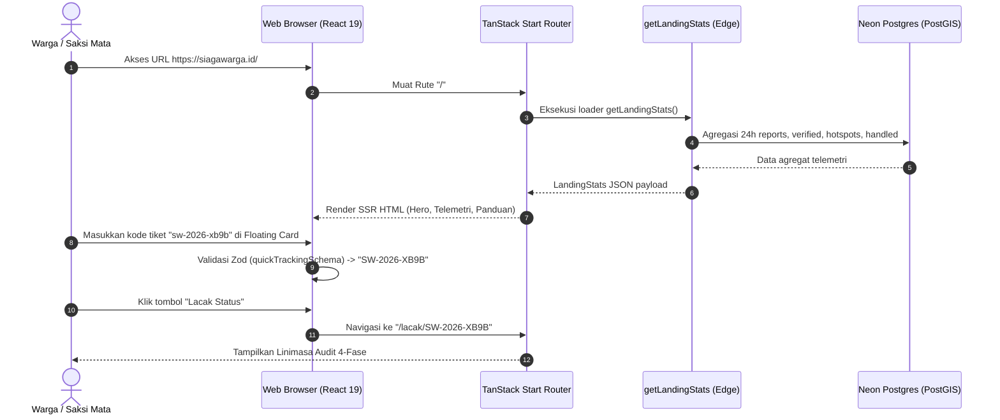
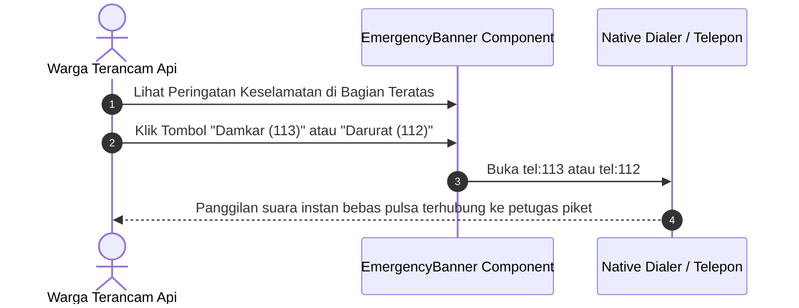

# Plan 01B — Landing Page Redesign (Warm Civic-Tech & Editorial Layout)

> **File:** `docs/plans/01-landing-page-redesign.md`  
> **Status:** Draft / Pending Review  
> **Preceding Plan:** `docs/plans/01-landing-and-emergency-banner.md` (Merged in PR #2, `4b1fdc0`)  
> **Target Delivery:** Halaman Beranda (`/`) & Shell Layout Global (`src/routes/__root.tsx`)  
> **Desain Rujukan:** `Halaman Utama Siaga Warga.png`

---

## 1. Scope & Objectives

### 1.1 Target Fitur
Mengimplementasikan perombakan visual dan tata letak (*redesign*) halaman beranda SiagaWarga berdasarkan desain rujukan **`Halaman Utama Siaga Warga.png`**. Desain ini mengadopsi pendekatan **Warm Civic-Tech & Editorial Layout** yang lebih menggugah empati warga, dengan kontras warna alam (oranye api, pasir hangat/krem, dan hijau hutan pinus), masking foto hero asimetris, kartu pencarian status tiket mengambang (*floating bridge*), panduan keselamatan visual dua kolom, serta footer bertema pelestarian lingkungan (*deep forest green*).

Pembaruan ini tetap mengintegrasikan keunggulan teknis yang disyaratkan dalam PRD dan rubrik penilaian lomba Web In Action (WIA) 2026:
1. **Banner Darurat Dismissable:** Banner darurat bagian atas bernuansa krem/oranye dengan kontak 112/113 dan tombol tutup `(X)`.
2. **Navigasi Header Terpadu:** Header dengan identitas logo SiagaWarga, tautan navigasi (`Beranda`, `Lapor Insiden`, `Pantau Peta`, `Edukasi`), tautan akses petugas (`Akses Petugas`), dan tombol tema (*ThemeToggle*).
3. **Hero Section Editorial:** Asimetris dengan kurva organik memadukan judul tegas, tombol aksi primer `Lapor Kebakaran ->`, dan fotografi nyata karhutla di kanan.
4. **Floating Quick Tracking Card:** Komponen input kode tiket mengambang dengan ikon tiket, format monospace otomatis huruf kapital, dan navigasi langsung ke `/lacak/$code`.
5. **Strip Telemetri 24 Jam Terpadu:** Mempertahankan 4 metrik agregat riil 24 jam (Laporan Masuk, Terverifikasi Lapangan, Hotspot Satelit NASA FIRMS, Penanganan Instansi).
6. **Panduan Keselamatan Taktis:** Seksi berkontainer pasir hangat dengan foto kobaran api, kartu kutipan (*quote callout*), dan 3 kartu pedoman jarak aman, arah angin, serta dokumentasi terlindung.
7. **Footer Hijau Hutan (*Deep Forest Green*):** Komitmen jaminan privasi PII, penyamaran koordinat publik ke tingkat kelurahan, kontak darurat resmi, dan atribusi WIA 2026.

### 1.2 Out of Scope
- Formulir pengisian laporan dan unggah foto R2 (dikerjakan pada Plan 02: `/lapor`).
- Peta interaktif MapLibre dual-layer dan filter hotspot (dikerjakan pada Plan 03: `/pantau`).
- Halaman linimasa audit detail laporan (dikerjakan pada Plan 04: `/lacak/$code`).
- Modul antrean triase moderator dan verifikasi bukti (dikerjakan pada Plan 05: `/admin/triase`).

### 1.3 Penyelarasan Rubrik Kompetisi WIA 2026
- **Desain (20%):** Peningkatan drastis estetika visual dari konsol teknis kaku menjadi portal warga yang modern, hangat, dan memiliki narasi bencana yang kuat tanpa mengorbankan performa (skor Lighthouse target 98+).
- **Fungsionalitas (25%):** Jalur akses cepat ke kontak darurat bebas pulsa 112/113, pelacakan tiket instan tanpa login, dan data telemetri agregat 24 jam.
- **Kesesuaian Tema (15%):** Menegaskan subtema *Public Service Tracking* melalui keterbukaan data penanganan bencana karhutla dan transparansi verifikasi multi-tahap.
- **Konten (20%):** Seluruh mikro-salinan (*microcopy*) diverifikasi bebas AI-slop mengacu pada `bahasa-inti` dan `bahasa-website`.
- **Orisinalitas (20%):** Memadukan sensor antariksa NASA FIRMS, deduplikasi spasial PostGIS, dan filosofi kejujuran sistem (*System Honesty*).

---

## 2. PRD Reference & Dependencies

- **PRD Section:** 
  - Seksi 1 (Executive Summary: Filosofi System Honesty)
  - Seksi 4.3 (Sitemap & Hierarki Rute Halaman: `/` dan Shell Layout)
  - Seksi 5 (Tiga Fase Independen: Input, Verifikasi, Penanganan)
- **Preceding Plan Dependencies:** 
  - Plan 01 (`docs/plans/01-landing-and-emergency-banner.md` - Schema & Telemetry Server Function)
- **Target Routes:**
  - `src/routes/__root.tsx` (Shell root, banner darurat, header, footer)
  - `src/routes/index.tsx` (Komposisi hero, floating search, telemetri, panduan keselamatan)

---

## 3. Use Cases & Sequence Diagrams

### 3.1 Use Case 1: Warga Mengakses Beranda & Melacak Tiket Cepat



### 3.2 Use Case 2: Warga dalam Kondisi Kritis Menghubungi Darurat



---

## 4. Data Models, Schemas & Server Functions

### 4.1 Zod Schemas (`src/lib/schema/reports.ts`)
Menggunakan skema isomorfik yang telah teruji pada Plan 01:

```ts
import { z } from 'zod'

export const quickTrackingSchema = z.object({
  trackingCode: z
    .string()
    .trim()
    .min(1, 'Kode tiket pelacakan wajib diisi.')
    .regex(
      /^SW-\d{4}-[A-Z0-9]{4}$/i,
      'Format kode tidak valid. Contoh format: SW-2026-X89B',
    )
    .transform((val) => val.toUpperCase()),
})

export const landingStatsSchema = z.object({
  activeReports24h: z.number().int().nonnegative(),
  verifiedReports: z.number().int().nonnegative(),
  activeHotspots: z.number().int().nonnegative(),
  handledIncidents: z.number().int().nonnegative(),
  lastUpdatedIso: z.string().datetime(),
})

export type QuickTrackingInput = z.infer<typeof quickTrackingSchema>
export type LandingStats = z.infer<typeof landingStatsSchema>
```

### 4.2 Server Function Telemetri (`src/server/functions/reports.ts`)
Logika bisnis `fetchLandingStats` dan server function `getLandingStats` tetap dipertahankan dengan fallback terisolasi jika DB belum terkoneksi.

---

## 5. UI/UX Design & Microcopy Specification (DESIGN.md & bahasa-skills)

- **Surface Mode:** Persuade & Mission Critical Safety.
- **Palet Warna Tambahan (Design System Integration):**
  - **Latar Seksi Panduan:** Latar pasir hangat `bg-[#FFF8F5]` (Light Mode) / `bg-[#1A1816]` dengan border `border-amber-900/40` (Dark Mode).
  - **Latar Footer:** Hijau Hutan Pinus `bg-[#0B3B2C]` (Light Mode) / `bg-[#061F17]` (Dark Mode) dengan teks putih kontras tinggi dan aksen emerald muda `text-emerald-300`.
  - **Warna Aksen Judul:** Teks oranye terakota `text-primary` (`oklch(0.62 0.22 25)`).

### 5.1 Manifest Komponen Shadcn Base UI (Rule 10 & Rule 16)
Seluruh elemen antarmuka diverifikasi terhadap dokumentasi lokal `docs/shadcn/components/base/` dan primitif yang terpasang di `src/components/ui/`:

| UI Feature / Element | Shadcn Base Component (`docs/shadcn/components/base/`) | Berkas Target `src/components/ui/` | Varian / Modifiers / Props |
|---|---|---|---|
| Tombol Aksi Utama & Lacak | `button.md` (`Button`) | `src/components/ui/button.tsx` | `variant="default"`, `size="lg"` & `size="default"` |
| Tombol Pill Panggilan Darurat | `button.md` (`Button`) | `src/components/ui/button.tsx` | `variant="outline"`, `size="sm"` |
| Kartu Floating Search & Panduan | `card.md` (`Card`, `CardHeader`, `CardTitle`, `CardDescription`, `CardContent`, `CardAction`) | `src/components/ui/card.tsx` | `size="sm"` untuk telemetri/floating; standard untuk panduan |
| Lencana Status Telemetri | `badge.md` (`Badge`) | `src/components/ui/badge.tsx` | `size="xs"`, varian `outline`, `success`, `warning`, `info` |
| Input Kode Tiket Floating | `input.md` (`Input`) | `src/components/ui/input.tsx` | `variant="mono"` dengan `placeholder="Contoh: SW-2026-X89B"` |
| Garis Pemisah Seksi & Footer | `separator.md` (`Separator`) | `src/components/ui/separator.tsx` | Orientasi horizontal |
| Skeleton Pemuatan | `skeleton.md` (`Skeleton`) | `src/components/ui/skeleton.tsx` | Dimensi terukur tanpa styling inline terlarang |

### 5.2 Rincian Desain & Struktur Seksi

#### 1. Banner Darurat Atas (`EmergencyBanner`)
- Menempel di bagian paling atas viewport (`sticky top-0 z-50`).
- Latar krem/oranye lembut (`bg-[#FFF5F1] dark:bg-[#2A1711] border-b border-orange-200/50 dark:border-orange-950`).
- Teks direktif: *"Peringatan Keselamatan: Jika kebakaran mengancam keselamatan jiwa, segera hubungi 113 atau 112 sebelum membuat laporan daring."*
- Tombol aksi panggilan: `Damkar (113)` dan `Darurat (112)`.
- Tombol tutup `(X)` dengan status dismissal sementara di session/state pengguna.

#### 2. Header & Navigasi (`HeaderNav`)
- Logo: Ikon api SiagaWarga dalam wadah oranye tumpul (`rounded-md`), teks *"Siaga"* (hitam/putih) dan *"Warga"* (`text-primary`).
- Menu Navigasi:
  - `Beranda` (`/`) dengan indikator aktif bergaris bawah.
  - `Lapor Insiden` (`/lapor`).
  - `Pantau Peta` (`/pantau`) - Mempertahankan akses rute peta spasial WIA.
  - `Edukasi Warga` (tautan jangkar `#panduan-keselamatan`).
- Aksi Kanan:
  - Tombol `Akses Petugas` (varian `outline`, mengarah ke `/admin/login`).
  - Tombol `Lapor Segera` (varian `default`, mengarah ke `/lapor`).
  - `ThemeToggle` (pengalih tema gelap/terang tanpa FOUC).

#### 3. Hero Section Asimetris & Masking Foto Karhutla
- Kolom Kiri:
  - Judul H1 Semantik: *"Pantau dan Verifikasi Laporan <span class="text-primary">Kebakaran</span>"*
  - Subjudul Humanis: *"Laporkan kebakaran hutan, lahan, atau permukiman dengan mudah dan aman. SiagaWarga membantu memeriksa laporan melalui validasi lokasi, data hotspot satelit, dan verifikasi moderator, serta menyediakan pelacakan status laporan secara transparan."*
  - Tombol Primer: `Lapor Kebakaran` dengan `ArrowRightIcon` (mengarahkan langsung ke formulir pelaporan `/lapor`).
- Kolom Kanan:
  - Kontainer foto karhutla dengan masking lengkungan organik (*curved organic wave mask*).
  - Foto resolusi tinggi karhutla nyata dari aset statis `public/images/hero-fire.webp`.
  - Lencana kaca pembesar taktis (*inspection lens overlay*).

#### 4. Floating Quick Tracking Card
- Kartu putih bersih (`bg-card text-card-foreground shadow-lg border border-border`) yang melayang menjembatani hero section dan seksi berikutnya (`-mt-12 sm:-mt-16 relative z-20 mx-auto max-w-3xl rounded-xl p-6`).
- Judul: *"Cek Cepat Status Laporan"*
- Subjudul: *"Lacak perkembangan penanganan insiden kebakaran menggunakan kode tiket unik Anda."*
- Baris Form:
  - Ikon tiket (`TicketIcon`) di dalam elemen pembungkus input.
  - Kolom teks berformat `variant="mono"` dengan placeholder `Contoh: SW-2026-X89B`.
  - Tombol Aksi: `Lacak Status` dengan ikon `SearchIcon`.

#### 5. Strip Telemetri Agregat 24 Jam
- Mempertahankan 4 kartu indikator data riil:
  1. *Laporan Masuk (24 Jam)*: Lencana Warga (varian `outline`, ukuran `xs`).
  2. *Terverifikasi Lapangan*: Lencana Valid (varian `success`, ukuran `xs`).
  3. *Titik Panas Satelit*: Lencana NASA FIRMS (varian `warning`, ukuran `xs`).
  4. *Penanganan Instansi*: Lencana Damkar/BPBD (varian `info`, ukuran `xs`).
- Menampilkan stempel waktu sinkronisasi zona WIB (*Asia/Jakarta*).

#### 6. Seksi Panduan Keselamatan Warga (`#panduan-keselamatan`)
- Kartu besar dengan latar terakota/pasir hangat (`bg-[#FFF8F5] dark:bg-[#1C1A17] border border-orange-100 dark:border-amber-900/30 rounded-2xl p-6 sm:p-8`).
- Bagian Atas (2 Kolom):
  - Kiri: H2 *"Panduan Keselamatan Warga di Lokasi Kebakaran"* dan subjudul *"Keselamatan jiwa adalah prioritas utama. Patuhi pedoman berikut saat berada di sekitar wilayah kebakaran."*
  - Kanan: Foto kebakaran hutan (`public/images/safety-fire.webp`) bertumpuk dengan kartu kutipan (*quote callout card*):
    > *"Jangan mendekati titik api. Keselamatan Anda lebih penting daripada dokumentasi."*
- Bagian Bawah (Grid 3 Kartu Taktis):
  1. **Jaga Jarak Aman:** Ikon larangan (`BanIcon` dalam badge merah), himbauan jarak minimal 100 meter dari pusat kobaran api dan lahan gambut.
  2. **Perhatikan Arah Angin:** Ikon aliran angin (`WindIcon` dalam badge oranye), instruksi evakuasi menyilang arah angin dan penggunaan masker basah.
  3. **Dokumentasi Terlindung:** Ikon mata awas (`EyeIcon` dalam badge terakota), instruksi pengambilan gambar hanya dari posisi stabil dengan jalur evakuasi terbuka.

#### 7. Seksi Prinsip Kejujuran Sistem (System Honesty)
- 4 tahap alur transparansi:
  - `01` Input Warga (Foto Asli Wajib)
  - `02` Deduplikasi Spasial (PostGIS ST_DWithin 2 km)
  - `03` Verifikasi Manusia (Moderator & Metadata EXIF)
  - `04` Konfirmasi Fisik (Damkar & BPBD)

#### 8. Footer Hijau Hutan (*Deep Forest Green*)
- Latar hijau pinus tua (`bg-[#0B3B2C] dark:bg-[#061F17] text-white`).
- Kolom 1: Logo SiagaWarga, visi platform, dan ikon media sosial (Instagram, X, YouTube, Facebook).
- Kolom 2: Jaminan Privasi & Keamanan (Prinsip PII Shield, enkripsi kontak, dan penyamaran lokasi tingkat kelurahan pada peta publik).
- Kolom 3: Kontak Darurat Resmi (113 Damkar & 112 Panggilan Darurat Nasional Bebas Pulsa).
- Baris Bawah: Atribusi *"Dikembangkan untuk Web In Action (WIA) 2026. Subtema: Public Service Tracking"*, tautan legal (*Kebijakan Privasi*, *Syarat Penggunaan*, *Pusat Bantuan*).

---

## 6. Implementation File List

### 6.1 Berkas Baru (Asset & Komponen Ekstra)
1. `public/images/hero-fire.webp` — Foto visual hero karhutla diekstrak secara presisi dari desain rujukan.
2. `public/images/safety-fire.webp` — Foto visual ilustrasi seksi panduan keselamatan.
3. `src/components/report/floating-quick-tracking.tsx` — Komponen independen kartu pencarian tiket mengambang.
4. `src/components/report/safety-guidelines.tsx` — Komponen modular seksi panduan keselamatan dua tingkat.

### 6.2 Berkas yang Dimodifikasi
1. `src/components/shared/emergency-banner.tsx` — Penyesuaian tema krem/oranye dan penambahan tombol tutup `(X)` dismissable.
2. `src/components/shared/header-nav.tsx` — Penyempurnaan tipografi logo SiagaWarga, tautan navigasi, dan tombol aksi petugas.
3. `src/components/shared/footer.tsx` — Penerapan palet hijau hutan (*deep forest green*), ikon sosial media, dan penataan ulang 3 kolom.
4. `src/components/report/landing-view.tsx` — Restrukturisasi tata letak hero asimetris, integrasi floating card, dan integrasi seksi panduan keselamatan baru.
5. `src/components/report/landing-skeleton.tsx` — Penyesuaian skeleton loader agar identik dengan geometri editorial baru.
6. `tests/landing.test.ts` — Penambahan pengujian unit untuk dismissal banner darurat dan verifikasi format form input baru.

---

## 7. Testing & Quality Gates (TDD with Bun)

### 7.1 Cakupan Pengujian
- **Unit Testing (Bun Test):**
  - Validasi schema kode tiket (`quickTrackingSchema`).
  - Validasi batas minimum dan regex pola kode tiket (`SW-YYYY-XXXX`).
  - Validasi properti `LandingStats` dan fallback nilai aman.
  - Verifikasi render komponen tanpa error saat data kosong.
- **Visual & Style Linting:**
  - Audit zero styling overrides pada primitif via `@shadcn/lint` (`shadcn/no-restyle`).
  - Pengecekan konsistensi Prettier Tailwind v4 class order.

### 7.2 Eksekusi Gerbang Kualitas Wajib
```bash
# 1. Jalankan seluruh pengujian unit
bun test

# 2. Periksa konsistensi gaya kode
bun run check

# 3. Linter kode TypeScript & React
bun run lint

# 4. Linter desain sistem shadcn
bun run lint:design

# 5. Typecheck tanpa emisi
bun run typecheck

# 6. Build produksi SSR & Client
bun run build
```
Semua gerbang wajib keluar dengan kode exit `0` sebelum membuka Pull Request.
