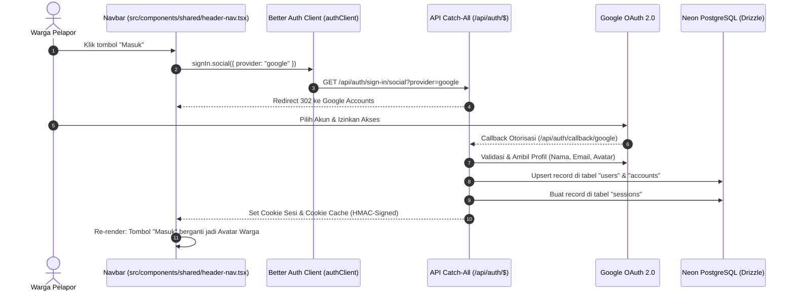
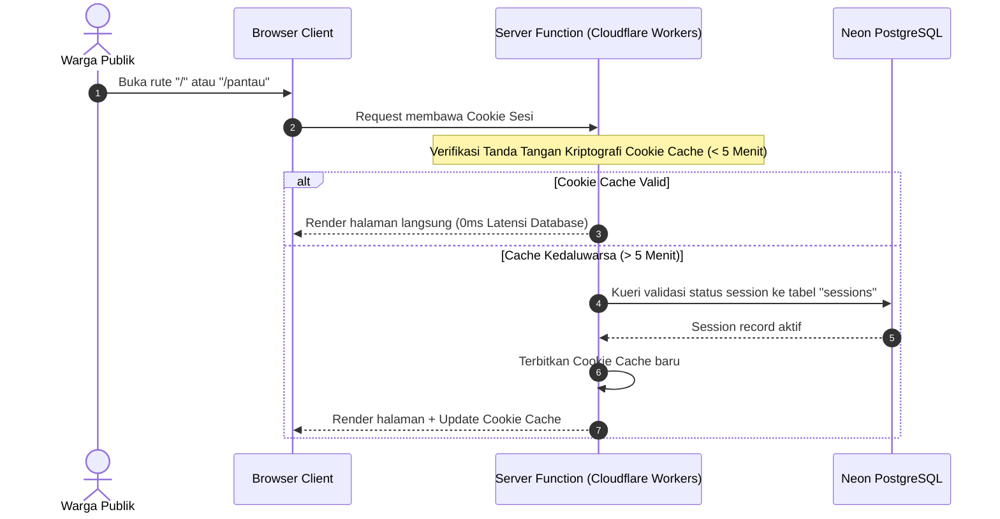
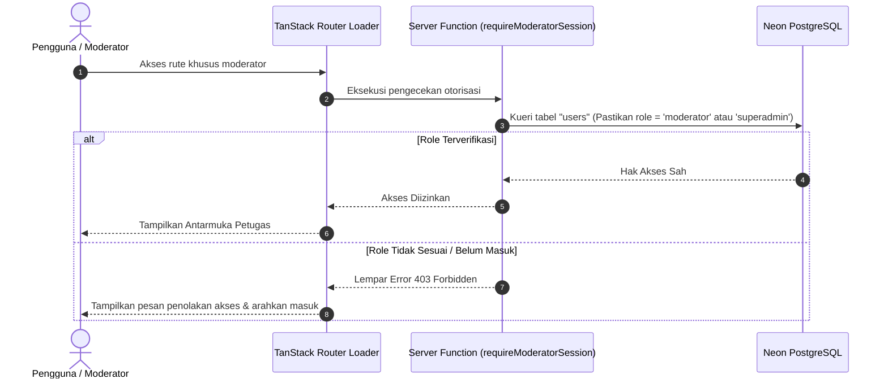

# Plan 02 — Autentikasi Pengguna & Akses Moderator (Better Auth & Google OAuth Hybrid)

## 1. Scope & Objectives

- **Target:** Mengimplementasikan autentikasi satu klik (*1-Click Direct Google OAuth*) berbasis **Better Auth** dengan **pendekatan Hybrid** (identitas dan relasi data tersimpan di Neon PostgreSQL via Drizzle ORM, sedangkan pengecekan sesi navigasi berjalan *stateless* di Cloudflare Edge melalui *cryptographic cookie cache* 5 menit).
  - **Zero New Pages:** Tidak membuat halaman login khusus (`/login`) atau modal login yang berbelit-belit. Karena hanya menggunakan Google OAuth tanpa auth manual (email/password), tombol **"Masuk"** di navbar langsung mengarahkan pengguna ke alur otorisasi Google.
  - **Refaktorisasi & Integrasi MenuDock Base UI ([`src/components/ui/menu-dock.tsx`](src/components/ui/menu-dock.tsx)):** Merefaktor komponen `MenuDock` dari ketergantungan Radix/Ark (`createPolymorphic`, `@/lib/as-child`) menjadi murni **Base UI (`@base-ui/react`)** dengan dukungan `render` prop polymorphism (`BaseButton`), animasi tactile hopping icon, dynamic indicator bergeser dengan Safety Ember token, dan navigasi keyboard ramah aksesibilitas.
  - **Penyederhanaan Navbar ([`HeaderNav`](src/components/shared/header-nav.tsx)):** Menghapus tombol "Sign In", mengganti tombol "Sign Up" dengan satu tombol aksi utama yang bersih: **"Masuk"**, serta memadukan `MenuDock` untuk menu navigasi (`Beranda`, `Lapor Insiden`, `News`) dan aksi masuk.
  - **Manajemen Akun Terotentikasi:** Saat warga telah masuk, tombol "Masuk" otomatis berganti menjadi `Avatar` foto profil Google dengan `DropdownMenu` Base UI untuk mengakses informasi profil, riwayat *"Laporan Saya"*, dasbor khusus petugas (*"Dasbor Triase"* jika role moderator), dan aksi *"Keluar"*.
  - **Otorisasi Role (RBAC):** Memvalidasi hak akses moderator (`moderator` / `superadmin`) pada server functions untuk mengamankan tindakan pengelolaan status insiden di `PRD.md`.
  - **Sinkronisasi Dokumentasi Arsitektur:** Memperbarui [`AGENTS.md`](AGENTS.md), [`PRD.md`](PRD.md), dan [`DESIGN.md`](DESIGN.md) agar selaras 100% dengan integrasi Neon PostgreSQL 17 + PostGIS 3.5, Better Auth Hybrid, penghapusan passcode statis, dan primitif Base UI.
- **Out of Scope:**
  - Halaman login manual dengan formulir email/password (ditiadakan secara permanen sesuai keputusan arsitektur).
  - Formulir pelaporan insiden warga lengkap dan unggah foto R2 (dialokasikan ke *Plan 03*).
  - Tampilan visual antarmuka triase antrean moderator penuh (dialokasikan ke *Plan 05*).
- **Competition Alignment (WIA MIA 2026):**
  - **Fungsionalitas & UX (25%):** Pengalaman masuk super ringkas tanpa friksi—warga cukup klik satu tombol untuk langsung terdaftar atau masuk.
  - **Desain & Kemudahan Penggunaan (20%):** Primitif Base UI (`MenuDock`, `Avatar`, `DropdownMenu`) yang elegan, konsisten dengan OKLCH design tokens dan lolos `@shadcn/lint`.
  - **Kualitas Konten & Bahasa (20%):** Divalidasi via `bahasa-inti` dan `bahasa-website`, bebas AI-slop, zero emoji policy (Rule 14), dan ikon resmi Lucide React.
  - **Keamanan Data & Performa (35%):** Arsitektur Hybrid mencegah latensi lambat di Edge sekaligus menjaga integritas relasional pelapor di database Neon.

---

## 2. PRD Reference & Dependencies

- **PRD Section:** Bagian 4.3 (Hierarki Rute), Bagian 5.5 (Autentikasi Hybrid, Google OAuth & RBAC), dan Bagian 6 (Spesifikasi Skema Data PostGIS & Better Auth).
- **Preceding Plan Dependencies:** [`docs/plans/01-landing-and-emergency-banner.md`](01-landing-and-emergency-banner.md) dan project Neon PostgreSQL yang telah aktif (`PostGIS 3.5` & `PostgreSQL 17.11`).
- **Target Route(s):**
  - `/api/auth/$` (`src/routes/api/auth.$.ts`) — Endpoint server Better Auth (menangani redirect ke Google dan callback penerbitan cookie sesi).
  - Shell Rute Induk (`src/routes/__root.tsx`) — Integrasi session check global.
  - Header Navigasi (`src/components/shared/header-nav.tsx`) — Integrasi `MenuDock`, tombol tunggal "Masuk", dan dropdown menu avatar akun.

---

## 3. Use Cases & Sequence Diagrams

### Use Case 1: Warga Masuk Langsung via Google (1-Click Direct OAuth)

Warga mengklik tombol "Masuk" di navbar, langsung diarahkan ke layar pemilihan akun Google, dan kembali dalam kondisi terotentikasi.



### Use Case 2: Navigasi Cepat di Edge Tanpa Menyentuh Database (*Cookie Cache*)

Saat warga yang sudah masuk membuka halaman atau menavigasi menu, server memvalidasi sesi langsung dari tanda tangan kriptografi cookie di Edge tanpa query ke Neon DB.



### Use Case 3: Proteksi Rute Kritis Moderator (Validasi Role Langsung ke DB)

Pengguna mencoba mengakses fungsi atau rute moderator (`/admin/triase`). Server function memverifikasi hak akses ke database Neon untuk memastikan akun belum dicabut/dibekukan.



---

## 4. Data Models, Schemas & Server Functions

### 4.1 Zod Schemas (`src/lib/schema/auth.ts` & `src/lib/schema/index.ts`)

Mendefinisikan tipe data kontrak sesi pengguna, role, dan respon profil:

```ts
import { z } from 'zod'

export const userRoleEnum = z.enum(['citizen', 'moderator', 'superadmin'])
export type UserRole = z.infer<typeof userRoleEnum>

export const authUserSchema = z.object({
  id: z.string().min(1),
  name: z.string().min(1),
  email: z.string().email(),
  emailVerified: z.boolean(),
  image: z.string().url().nullable().optional(),
  role: userRoleEnum.default('citizen'),
  createdAt: z.coerce.date(),
  updatedAt: z.coerce.date(),
})
export type AuthUser = z.infer<typeof authUserSchema>

export const authSessionSchema = z.object({
  id: z.string().min(1),
  userId: z.string().min(1),
  token: z.string().min(1),
  expiresAt: z.coerce.date(),
  ipAddress: z.string().nullable().optional(),
  userAgent: z.string().nullable().optional(),
})
export type AuthSession = z.infer<typeof authSessionSchema>

export const sessionResponseSchema = z
  .object({
    user: authUserSchema,
    session: authSessionSchema,
  })
  .nullable()
export type SessionResponse = z.infer<typeof sessionResponseSchema>
```

### 4.2 Drizzle Schema (`src/server/db/schema/auth.ts` & `src/server/db/schema/index.ts`)

Mendefinisikan 4 tabel bawaan Better Auth di schema database PostgreSQL:

```ts
import { pgTable, text, timestamp, boolean } from 'drizzle-orm/pg-core'

export const user = pgTable('users', {
  id: text('id').primaryKey(),
  name: text('name').notNull(),
  email: text('email').notNull().unique(),
  emailVerified: boolean('email_verified').notNull().default(false),
  image: text('image'),
  role: text('role', { enum: ['citizen', 'moderator', 'superadmin'] })
    .notNull()
    .default('citizen'),
  createdAt: timestamp('created_at', { withTimezone: true }).notNull().defaultNow(),
  updatedAt: timestamp('updated_at', { withTimezone: true }).notNull().defaultNow(),
})

export const session = pgTable('sessions', {
  id: text('id').primaryKey(),
  userId: text('user_id')
    .notNull()
    .references(() => user.id, { onDelete: 'cascade' }),
  token: text('token').notNull().unique(),
  expiresAt: timestamp('expires_at', { withTimezone: true }).notNull(),
  ipAddress: text('ip_address'),
  userAgent: text('user_agent'),
  createdAt: timestamp('created_at', { withTimezone: true }).notNull().defaultNow(),
  updatedAt: timestamp('updated_at', { withTimezone: true }).notNull().defaultNow(),
})

export const account = pgTable('accounts', {
  id: text('id').primaryKey(),
  userId: text('user_id')
    .notNull()
    .references(() => user.id, { onDelete: 'cascade' }),
  accountId: text('account_id').notNull(),
  providerId: text('provider_id').notNull(),
  accessToken: text('access_token'),
  refreshToken: text('refresh_token'),
  idToken: text('id_token'),
  accessTokenExpiresAt: timestamp('access_token_expires_at', { withTimezone: true }),
  refreshTokenExpiresAt: timestamp('refresh_token_expires_at', { withTimezone: true }),
  scope: text('scope'),
  password: text('password'),
  createdAt: timestamp('created_at', { withTimezone: true }).notNull().defaultNow(),
  updatedAt: timestamp('updated_at', { withTimezone: true }).notNull().defaultNow(),
})

export const verification = pgTable('verifications', {
  id: text('id').primaryKey(),
  identifier: text('identifier').notNull(),
  value: text('value').notNull(),
  expiresAt: timestamp('expires_at', { withTimezone: true }).notNull(),
  createdAt: timestamp('created_at', { withTimezone: true }).notNull().defaultNow(),
  updatedAt: timestamp('updated_at', { withTimezone: true }).notNull().defaultNow(),
})
```

#### Pembaruan Relasi pada `src/server/db/schema/reports.ts`:
Menambahkan kolom relasi opsional `reporterUserId`:
```ts
reporterUserId: text('reporter_user_id').references(() => user.id, { onDelete: 'set null' }),
```

### 4.3 Konfigurasi Server Better Auth (`src/server/auth.ts`)

```ts
import { betterAuth } from 'better-auth'
import { drizzleAdapter } from 'better-auth/adapters/drizzle'
import { tanstackStartCookies } from 'better-auth/tanstack-start'
import { db } from '@/server/db'
import * as schema from '@/server/db/schema'
import { getServerEnv } from '@/server/env'

const env = getServerEnv()

export const auth = betterAuth({
  database: drizzleAdapter(db, {
    provider: 'pg',
    schema,
  }),
  secret: env.BETTER_AUTH_SECRET,
  baseURL: env.BETTER_AUTH_URL || 'http://localhost:3000',
  socialProviders: {
    google: {
      clientId: env.GOOGLE_CLIENT_ID || '',
      clientSecret: env.GOOGLE_CLIENT_SECRET || '',
    },
  },
  session: {
    cookieCache: {
      enabled: true,
      maxAge: 5 * 60, // 5 menit stateless cache di Edge
      strategy: 'compact',
    },
    expiresIn: 60 * 60 * 24 * 7, // 7 hari
    updateAge: 60 * 60 * 24, // Perpanjang usia sesi setiap 1 hari
  },
  user: {
    additionalFields: {
      role: {
        type: 'string',
        defaultValue: 'citizen',
        required: false,
      },
    },
  },
  plugins: [tanstackStartCookies()],
})
```

### 4.4 Catch-All Server Route Handler (`src/routes/api/auth.$.ts`)

```ts
import { createFileRoute } from '@tanstack/react-router'
import { auth } from '@/server/auth'

export const Route = createFileRoute('/api/auth/$')({
  server: {
    handlers: {
      GET: async ({ request }) => auth.handler(request),
      POST: async ({ request }) => auth.handler(request),
    },
  },
})
```

### 4.5 Client Auth Instance (`src/lib/auth-client.ts`)

```ts
import { createAuthClient } from 'better-auth/react'

export const authClient = createAuthClient()
export const { signIn, signOut, useSession } = authClient
```

### 4.6 Server Functions (`src/server/functions/auth.ts`)

```ts
import { createServerFn } from '@tanstack/react-start'
import { getWebRequest } from '@tanstack/react-start/server'
import { auth } from '@/server/auth'
import { db } from '@/server/db'
import { user } from '@/server/db/schema/auth'
import { eq } from 'drizzle-orm'
import type { SessionResponse } from '@/lib/schema/auth'

/**
 * Mengambil sesi pengguna saat ini di server (SSR / Server Function).
 */
export const getAuthSession = createServerFn({ method: 'GET' })
  .handler(async (): Promise<SessionResponse> => {
    const request = getWebRequest()
    if (!request) return null

    const session = await auth.api.getSession({
      headers: request.headers,
    })

    if (!session) return null
    return session as unknown as SessionResponse
  })

/**
 * Memvalidasi hak akses moderator secara ketat ke database Neon.
 */
export const requireModeratorSession = createServerFn({ method: 'GET' })
  .handler(async () => {
    const request = getWebRequest()
    if (!request) throw new Error('Permintaan tidak valid.')

    const session = await auth.api.getSession({
      headers: request.headers,
    })

    if (!session || !session.user) {
      throw new Error('Autentikasi diperlukan.')
    }

    const [dbUser] = await db
      .select({ role: user.role })
      .from(user)
      .where(eq(user.id, session.user.id))
      .limit(1)

    if (!dbUser || (dbUser.role !== 'moderator' && dbUser.role !== 'superadmin')) {
      throw new Error('Akses ditolak: Anda tidak memiliki hak akses moderator.')
    }

    return session
  })
```

---

## 5. UI/UX Design & Microcopy Specification (DESIGN.md & bahasa-skills)

- **Surface Mode:** Operate (Interaksi otentikasi ringkas & menu akun).
- **Primitif Komponen:** `@base-ui/react` (shadcn Base UI standard, bukan Radix).
- **Zero Emoji Policy (Rule 14):** Bebas emoji di seluruh teks UI dan menu. Menggunakan ikon resmi Lucide React (`LogInIcon`, `LogOutIcon`, `FileTextIcon`, `ShieldCheckIcon`, `HomeIcon`, `FlameIcon`, `NewspaperIcon`).

### 5.1 Shadcn Component Mapping & Verification (Rule 16)

> *Diverifikasi langsung terhadap dokumentasi lokal `docs/shadcn/components/base/` dan komponen terpasang di `src/components/ui/`.*

| UI Feature / Element | Shadcn Component (`docs/shadcn/components/base/`) | Status di `src/components/ui/` | Variants / Modifiers / Props |
| -------------------- | ------------------------------------------------- | ------------------------------ | ---------------------------- |
| Navigasi Taktis      | `MenuDock` (`src/components/ui/menu-dock.tsx`)    | Refaktorisasi ke Base UI Selesai | Size `default`, token OKLCH ember, hopping icon |
| Avatar Pengguna      | `avatar.md` (`Avatar`, `AvatarImage`, `AvatarFallback`) | Perlu Ditambahkan via Base UI  | Ukuran `size="sm"` (h-9 w-9), ring border |
| Dropdown Menu Akun   | `dropdown-menu.md` (`DropdownMenu`, `DropdownMenuTrigger`, `DropdownMenuContent`, `DropdownMenuItem`, `DropdownMenuSeparator`) | Perlu Ditambahkan via Base UI  | Align `end`, offset 8px, animasi transisi |
| Tombol Masuk Navbar  | `button.md` (`Button`)                            | Sudah Tersedia                 | Variant `ember`, Size `sm` / `default` |
| Indikator Memuat     | `skeleton.md` (`Skeleton`)                        | Sudah Tersedia                 | Lingkaran 36px untuk avatar |

### 5.2 Alur Komponen Navigasi ([`src/components/shared/header-nav.tsx`](src/components/shared/header-nav.tsx))

1. **Pemisahan Navigasi Tablet/Desktop vs Smartphone:**
   - **Tablet & Desktop (`md:flex`):** Mengembalikan navigasi navbar atas klasik dengan tautan teks datar (*Beranda*, *Lapor Insiden*, *News*) dan garis indikator aktif di bawahnya (berwarna `#173b32` / *Forest Green*).
   - **Smartphone Mobile (`md:hidden`):** Menggunakan komponen `MenuDock` Base UI yang mengambang di bawah layar (*bottom floating dock*) dengan Safety Ember active indicator dan icon hop animation agar mudah dijangkau satu tangan.
2. **Pembersihan Tombol Sign In / Sign Up:**
   - Menghapus tombol "Sign In".
   - Menggantikan "Sign Up" dengan satu tombol aksi utama di kanan atas: **"Masuk"** (`Button variant="ember"`).
3. **Kondisi Belum Masuk (*Unauthenticated State*):**
   - Menampilkan tombol **"Masuk"** dengan ikon `LogInIcon`.
   - Ketika diklik, langsung memanggil:
     ```ts
     await signIn.social({ provider: 'google', callbackURL: window.location.href })
     ```
   - Pengguna langsung diarahkan ke Google OAuth tanpa membuka formulir atau modal perantara.
4. **Kondisi Sudah Masuk (*Authenticated State*):**
   - Tombol "Masuk" digantikan oleh `Avatar` bulat dengan gambar profil Google.
   - Bila gambar tidak ada, tampilkan inisial nama warga (*Fallback*).
   - Mengklik avatar membuka `DropdownMenu` Base UI:
     - **Header Akun:** Nama lengkap dan alamat surel warga.
     - **Badge Role:** Khusus role `moderator` atau `superadmin`, tampilkan badge "Petugas Penanganan".
     - **Menu Aksi:**
       - *"Laporan Saya"* (ikon `FileTextIcon`)
       - *"Dasbor Triase"* (ikon `ShieldCheckIcon`, hanya untuk petugas)
     - **Pemisah:** `DropdownMenuSeparator`
     - **Aksi Keluar:** *"Keluar"* (ikon `LogOutIcon` dengan styling teks *destructive*).

### 5.3 Mikrocopy & Wording UI (`bahasa-skills` Verified)

- **Label Tombol Masuk:** *"Masuk"*
- **Menu Profil:** *"Laporan Saya"*
- **Menu Petugas:** *"Dasbor Triase"*
- **Label Keluar:** *"Keluar"*
- **Badge Petugas:** *"Petugas"*
- **Fallback Inisial:** Huruf kapital pertama dari nama (contoh: "Ahmad" -> "A")

---

## 6. Implementation File List

### File Baru:
1. `src/server/db/schema/auth.ts` — Skema tabel Drizzle untuk `users`, `sessions`, `accounts`, dan `verifications`.
2. `src/lib/schema/auth.ts` — Skema Zod untuk sesi, user, dan hak akses.
3. `src/server/auth.ts` — Inisialisasi engine Better Auth dengan konfigurasi Hybrid (`cookieCache` + `drizzleAdapter` + `tanstackStartCookies`).
4. `src/routes/api/auth.$.ts` — Catch-all API endpoint TanStack Start untuk menangani alur Google OAuth.
5. `src/lib/auth-client.ts` — Client SDK Better Auth untuk React.
6. `src/server/functions/auth.ts` — Server functions `getAuthSession` dan `requireModeratorSession`.
7. `src/components/ui/avatar.tsx` — Primitif Avatar berbasis `@base-ui/react`.
8. `src/components/ui/dropdown-menu.tsx` — Primitif DropdownMenu berbasis `@base-ui/react`.
9. `tests/auth.test.ts` — Unit & integration test untuk validasi skema dan alur autentikasi.

### File yang Dimodifikasi:
1. `src/components/ui/menu-dock.tsx` — **Refaktorisasi Selesai:** Dikonversi dari Radix/Ark ke Base UI (`@base-ui/react` `BaseButton`), disesuaikan dengan token OKLCH Ember/Forest, micro-interaction hop, dan lolos typecheck & Prettier.
2. `AGENTS.md` — Diperbarui: Menambahkan Better Auth ke tech stack, merinci Rule 10 Base UI polymorphism, mencatat Rule 21 Zero Login Page 1-Click OAuth, dan memperbarui struktur pohon file.
3. `PRD.md` — Diperbarui: Menghapus rute `/admin/login`, mengganti passcode auth dengan Better Auth Google OAuth Hybrid, merinci RBAC (`citizen`, `moderator`, `superadmin`), dan menambahkan tabel auth ke DDL PostGIS.
4. `DESIGN.md` — Diperbarui: Menyelaraskan token kanvas murni (`#ffffff`), mendokumentasikan standar `MenuDock` navigation component, dan merinci interaksi 1-Click "Masuk" tanpa modal.
5. `package.json` — Menambahkan dependensi `better-auth`.
6. `src/server/db/schema/index.ts` — Mengekspor skema `auth.ts`.
7. `src/server/db/schema/reports.ts` — Menambahkan kolom `reporterUserId` sebagai foreign key ke tabel `users`.
8. `src/lib/schema/index.ts` — Mengekspor skema validasi dari `auth.ts`.
9. `src/server/env.ts` — Menambahkan variabel environment `BETTER_AUTH_SECRET`, `BETTER_AUTH_URL`, `GOOGLE_CLIENT_ID`, dan `GOOGLE_CLIENT_SECRET`.
10. `src/components/shared/header-nav.tsx` — Mengintegrasikan `MenuDock` untuk tautan navigasi, menghapus "Sign In", menyatukan tombol jadi satu tombol "Masuk" yang langsung memicu OAuth Google, dan merender avatar akun saat login.
11. `.env.example` — Mencantumkan variabel konfigurasi Google OAuth dan Better Auth.

---

## 7. Testing & Quality Gates (TDD with Bun)

### Test Suite (`tests/auth.test.ts`):
- **Validasi Skema Zod:**
  - Memastikan `authUserSchema` menerima payload profil Google yang valid.
  - Memastikan `authUserSchema` menolak format email yang tidak valid.
  - Memastikan `userRoleEnum` membatasi role hanya pada `citizen`, `moderator`, dan `superadmin`.
- **Pengujian Logika Server Function:**
  - Memastikan `getAuthSession` mengembalikan `null` saat tidak ada header cookie sesi.
  - Memastikan `requireModeratorSession` melempar *error exception* saat pengguna tidak memiliki role moderator.
- **Pengujian Database & Migrasi:**
  - Menjalankan `bun run db:generate` dan `bun run db:migrate` untuk memverifikasi pembuatan tabel `users`, `sessions`, `accounts`, dan `verifications` di Neon PostgreSQL.

### Verifikasi Tahapan Quality Gates:
1. **Gate 1 (Testing):** `bun test` lulus 100% (termasuk 15 pengujian yang sudah ada + pengujian auth baru).
2. **Gate 2 (Formatting):** `bun run check` (Prettier) lulus tanpa error gaya kode.
3. **Gate 3 (Linting & Desain):** `bun run lint` dan `bun run lint:design` (`@shadcn/lint`) lulus dengan 0 error dan 0 warning.
4. **Gate 4 (Type Safety):** `bun run typecheck` (`tsc --noEmit`) lulus tanpa error tipe TypeScript.
5. **Gate 5 (Build):** `bun run build` sukses menghasilkan bundel produksi client dan SSR Cloudflare.
