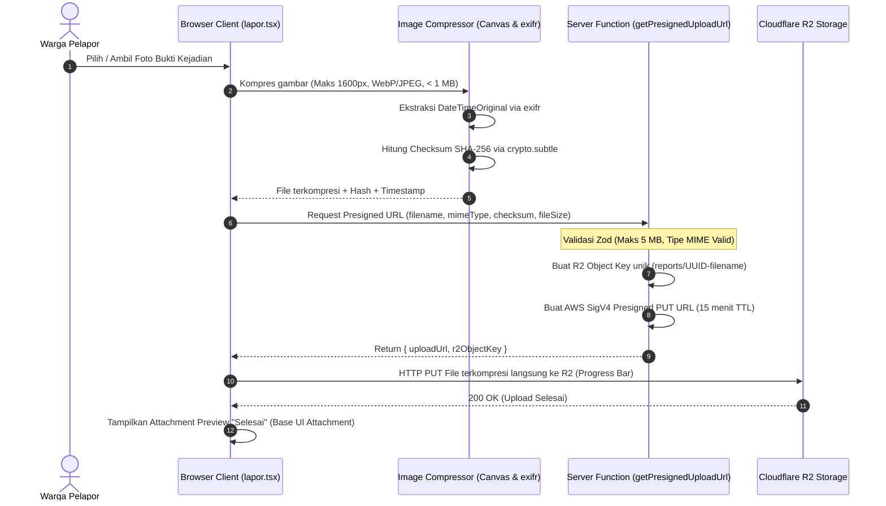
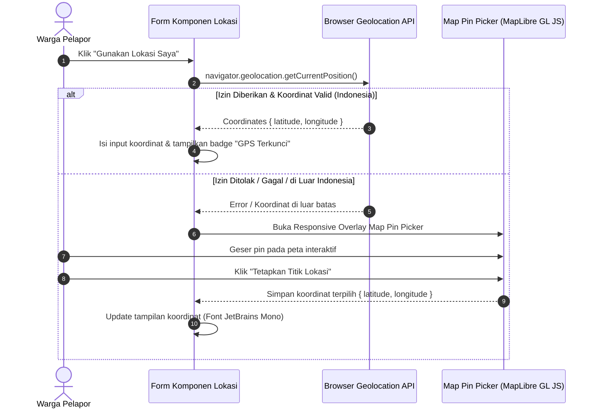
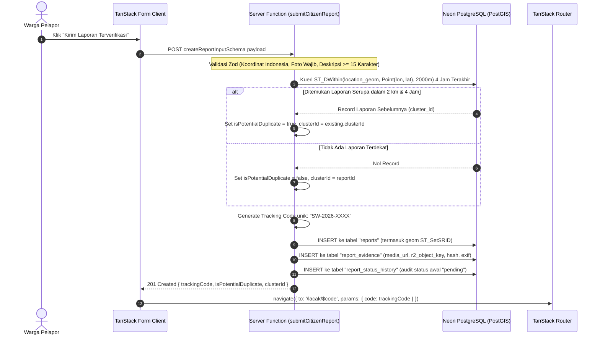

# Plan 03 — Formulir Pelaporan Warga, Unggah Bukti R2 & Deduplikasi Spasial PostGIS

## 1. Scope & Objectives

- **Target:** Mengimplementasikan fitur inti pelaporan insiden kebakaran oleh warga (*Citizen Incident Reporting*) pada rute [`/lapor`](src/routes/lapor.tsx). Fitur ini merupakan **hulu data utama** (*upstream data producer*) dari seluruh ekosistem SiagaWarga:
  1. **Kompresi Gambar Sisi Peramban & Ekstraksi Metadata (Rules 4, 17, 20):** Foto bukti bersifat **wajib** untuk menekan laporan palsu/spam. Sebelum diunggah, foto dikompresi di sisi klien via Canvas API (maksimal dimensi 1600px, WebP/JPEG, target ukuran 500 KB–1 MB, *hard cap* 5 MB). Perekaman metadata waktu pemotretan (`DateTimeOriginal` via `exifr`) dan kalkulasi *hash* SHA-256 untuk mendeteksi unggahan ulang (*re-upload* foto identik dari akun berbeda).
  2. **Direct Presigned URL ke Cloudflare R2 (Rule 3):** Unggahan foto bukti tidak melalui atau membebani memori Cloudflare Workers. Klien meminta URL bertanda tangan kriptografi (PUT signed URL via `getPresignedUploadUrl`) lalu mengunggah langsung ke *bucket* R2 dengan penanganan *progress* waktu nyata.
  3. **Peringatan Keselamatan Warga (Rule 4 & DESIGN.md Section 4.3):** Zona unggah dilengkapi banner peringatan keselamatan non-intrusif: *"Ambil foto dari jarak aman dan lokasi terlindung! Dilarang mendekati titik api aktif demi mengambil dokumentasi."*
  4. **Penentuan Lokasi Geospasial Fleksibel (Rule 5):** Menggunakan Geolocation API peramban dengan validasi *bounding box* wilayah Indonesia (Lintang -11 s/d 6, Bujur 95 s/d 141). Jika GPS dimatikan, ditolak, atau tidak akurat, disediakan modal/sheet interaktif *Map Pin Picker* (berbasis MapLibre GL JS) sebagai *fallback* responsif agar warga tetap dapat menentukan titik kejadian.
  5. **Deduplikasi Spasial Cerdas PostGIS (Rule 5 & PRD Section 5.2):** Server function `submitCitizenReport` mengeksekusi kueri PostGIS `ST_DWithin` (radius 2.000 meter dan rentang waktu 4 jam) untuk mendeteksi apakah laporan merupakan insiden baru atau bagian dari kebakaran yang sedang berlangsung. Jika terdapat insiden serupa, laporan ditandai `is_potential_duplicate = true` dan ditautkan ke `cluster_id` yang sama sebagai bukti penguat tanpa menghapus data warga.
  6. **Generasi Kode Pelacakan Unik & Audit Awal (Rule 8):** Menghasilkan kode pelacakan publik standar `SW-YYYY-XXXX` (misalnya `SW-2026-X89B`) dengan font *JetBrains Mono*, mencatat entri riwayat audit perdana di `report_status_history` (`verification = 'pending'`), dan mengarahkan warga ke halaman pelacakan [`/lacak/$code`](src/routes/lacak.$code.tsx).
  7. **Perlindungan Privasi Warga (Rule 7):** Warga dapat melapor secara anonim atau terhubung otomatis dengan akun Google (jika telah masuk). Data pribadi (nomor kontak dan koordinat detail) hanya dapat diakses oleh verifikator/moderator resmi.
- **Out of Scope:**
  - Peta publik multi-layer titik panas satelit NASA FIRMS (dialokasikan ke *Plan 04*).
  - Tampilan linimasa audit detail pada halaman pelacakan `/lacak/$code` (dialokasikan ke *Plan 06*).
  - Antarmuka verifikasi triase moderator di `/admin/triase` (dialokasikan ke *Plan 05*).
- **Competition Alignment (WIA MIA 2026):**
  - **Fungsionalitas (25%):** Alur pelaporan cepat tanpa hambatan, kompresi otomatis untuk area minim sinyal (*rural areas*), dan deduplikasi spasial otomatis berbasis PostGIS.
  - **Desain & Interaksi (20%):** Primitif Base UI (`Attachment`, `Field`, `RadioGroup`, `Textarea`), zero gradients, visual keselamatan taktis, dan adaptif mobile-first.
  - **Kualitas Konten & Bahasa (20%):** Divalidasi ketat via `bahasa-inti` dan `bahasa-website`, bebas frasa klise, zero emoji policy (Rule 14), dan ikon resmi Lucide React (`*Icon`).
  - **Orisinalitas & Nilai Sosial (20%):** Filosofi *System Honesty* yang mengedepankan keselamatan warga (*safety disclaimer*) dan kejujuran pemrosesan laporan tanpa klaim sepihak.
  - **Kesesuaian Tema (15%):** Mengatasi *duplicate storm* dan kepanikan warga dalam pelacakan layanan kedaruratan publik.

---

## 2. PRD Reference & Dependencies

- **PRD Section:**
  - Bagian 4.2 & 4.3 (User Journey Pelapor & Hierarki Rute `/lapor`).
  - Bagian 5.1 (Lapisan 1: Validasi Laporan Isomorphic, Aturan Input Zod, Direct Upload R2, Hashing SHA-256, EXIF).
  - Bagian 5.2 (Lapisan 2: Triase Cerdas & Deduplikasi Spasial PostGIS `ST_DWithin`).
  - Bagian 6.1 (Skema Data `reports`, `report_evidence`, dan `report_status_history`).
- **Preceding Plan Dependencies:**
  - [`01-landing-and-emergency-banner.md`](01-landing-and-emergency-banner.md) (Landing page, Telemetry stats, Emergency Hotline Banner).
  - [`02-google-oauth-better-auth.md`](02-google-oauth-better-auth.md) (Better Auth session, tabel `users`, Navbar & MenuDock navigation).
- **Target Route(s):**
  - `/lapor` ([`src/routes/lapor.tsx`](src/routes/lapor.tsx)) — Halaman formulir pelaporan insiden kebakaran warga.

---

## 3. Use Cases & Sequence Diagrams

### Use Case 1: Warga Mengunggah Foto Bukti Langsung ke Cloudflare R2 (Direct Presigned Upload)

Warga memilih foto dari kamera atau galeri ponsel. Sistem mengompresi gambar, menghitung checksum SHA-256, mengekstrak EXIF, meminta signed PUT URL dari server, dan mengunggah langsung ke R2.



### Use Case 2: Warga Menentukan Titik Lokasi Kejadian (GPS Browser + Fallback Map Pin Picker)

Warga memencet tombol deteksi lokasi. Jika GPS tersedia dan berada di Indonesia, koordinat terisi otomatis. Jika GPS tidak tersedia, ditolak, atau di luar jangkauan, modal Map Pin Picker dibuka untuk memilih titik secara visual.



### Use Case 3: Pengiriman Laporan & Deduplikasi Spasial Otomatis PostGIS

Warga menekan tombol "Kirim Laporan". Server function memvalidasi payload, mengeksekusi PostGIS `ST_DWithin` untuk memeriksa insiden duplikat dalam radius 2 km / 4 jam, membuat kode pelacakan unik, menyimpan data ke database, dan mengarahkan ke halaman pelacakan.



---

## 4. Data Models, Schemas & Server Functions

### 4.1 Zod Schemas (`src/lib/schema/`)

Memanfaatkan skema yang telah ada dan menambahkan skema respon pembuatan laporan serta presigned upload URL:

```typescript
// src/lib/schema/evidence.ts
import { z } from 'zod'

export const getUploadUrlInputSchema = z.object({
  filename: z.string().min(1, 'Nama berkas wajib diisi'),
  mimeType: z.enum(['image/jpeg', 'image/png', 'image/webp'], {
    message: 'Format foto harus berupa JPEG, PNG, atau WebP',
  }),
  checksum: z
    .string()
    .length(64, 'SHA-256 checksum foto tidak valid')
    .optional(),
  fileSize: z
    .number()
    .max(5 * 1024 * 1024, 'Ukuran foto maksimal 5 MB setelah kompresi'),
})

export const getUploadUrlOutputSchema = z.object({
  uploadUrl: z.string().url(),
  r2ObjectKey: z.string(),
  publicUrl: z.string().url().optional(),
})

export type GetUploadUrlInput = z.infer<typeof getUploadUrlInputSchema>
export type GetUploadUrlOutput = z.infer<typeof getUploadUrlOutputSchema>
```

```typescript
// src/lib/schema/reports.ts (Respon Hasil Pengiriman Laporan)
export const submitReportResponseSchema = z.object({
  reportId: z.string().uuid(),
  trackingCode: z.string(),
  clusterId: z.string().uuid(),
  isPotentialDuplicate: z.boolean(),
  submittedAtIso: z.string().datetime(),
})

export type SubmitReportResponse = z.infer<typeof submitReportResponseSchema>
```

### 4.2 Drizzle Schema & PostGIS (`src/server/db/`)

Tabel `reports`, `report_evidence`, dan `report_status_history` telah terdefinisi di migrasi awal. Kueri PostGIS memanfaatkan kolom `locationGeom` bertipe `geometry('location_geom', { type: 'point', srid: 4326 })` dengan indeks spasial GiST (`idx_reports_geom`).

Kueri deduplikasi spasial:
```typescript
// Pencarian duplikat spasial via SQL template Drizzle
const nearbyReports = await db.execute(sql`
  SELECT 
    id, 
    cluster_id, 
    ST_Distance(
      location_geom::geography, 
      ST_SetSRID(ST_MakePoint(${longitude}, ${latitude}), 4326)::geography
    ) AS distance_meters
  FROM reports
  WHERE 
    submitted_at >= NOW() - INTERVAL '4 hours'
    AND ST_DWithin(
      location_geom::geography, 
      ST_SetSRID(ST_MakePoint(${longitude}, ${latitude}), 4326)::geography, 
      2000
    )
  ORDER BY distance_meters ASC
  LIMIT 1;
`)
```

### 4.3 Server Functions (`src/server/functions/`)

#### 1. `getPresignedUploadUrl` ([`src/server/functions/evidence.ts`](src/server/functions/evidence.ts))
- **Method:** `POST`
- **Validator:** `getUploadUrlInputSchema`
- **Behavior:**
  - Mengambil kredensial R2 dari `getServerEnv(process.env)`.
  - Membuat *object key* yang aman dan terisolasi: `evidence/${crypto.randomUUID()}.${ext}`.
  - Membangun URL PUT presigned S3 SigV4 (kedaluwarsa dalam 15 menit).
  - Jika variabel environment R2 belum diisi (lingkungan pengujian lokal), menghasilkan *fallback safe mock URL* sehingga pengembang tetap dapat menguji formulir tanpa hambatan kredensial.

#### 2. `submitCitizenReport` ([`src/server/functions/reports.ts`](src/server/functions/reports.ts))
- **Method:** `POST`
- **Validator:** `createReportInputSchema`
- **Behavior:**
  - Memeriksa sesi pengguna via `getAuthSession` (opsional: jika pengguna sudah login dengan Google, tautkan `reporterUserId`).
  - Menjalankan kueri spasial PostGIS deduplikasi (radius 2 km, 4 jam).
  - Menghasilkan kode pelacakan acak 4 karakter berformat `SW-${tahun}-${4chars}` (contoh: `SW-2026-F7A9`).
  - Menjalankan transaksi Drizzle (`db.transaction`):
    1. Menyisipkan entri ke tabel `reports` (termasuk kalkulasi `locationGeom = ST_SetSRID(ST_MakePoint(lon, lat), 4326)`).
    2. Menyisipkan berkas media ke tabel `report_evidence`.
    3. Menyisipkan rekaman audit awal ke tabel `report_status_history` (`statusType: 'verification'`, `newValue: 'pending'`).
  - Mengembalikan objek `SubmitReportResponse`.

---

## 5. UI/UX Design & Microcopy Specification (DESIGN.md & bahasa-skills)

- **Surface Mode:** *Operate* (Formulir Taktis, Padat Informasi, Ramah Gawai Ponsel).
- **Visual Palette:**
  - Primary Action / Submit: Safety Ember (`var(--color-ember)`)
  - Safety Alert Callout: Emergency Crimson border & tinted surface (`var(--color-danger)`)
  - Telemetry & Coordinates: Monospace *JetBrains Mono* (`font-mono`)
  - Typography: *Plus Jakarta Sans* (`font-sans`)

### 5.1 Shadcn Base UI Component Mapping & Verification (Rule 16)

> *Diaudit terhadap `docs/shadcn/components/base/` dan `src/components/ui/` untuk memaksimalkan penggunaan ulang komponen yang ada dan mencegah pembuatan komponen buatan sendiri (synthetic primitives).*

| UI Feature / Element | Shadcn Base UI Component (`docs/shadcn/components/base/`) | Status di `src/components/ui/` | Rincian Props / Varian |
| -------------------- | --------------------------------------------------------- | ------------------------------ | ---------------------- |
| **Peringatan Keselamatan** | `alert.md` (`Alert`, `AlertTitle`, `AlertDescription`) | Tersedia (`alert.tsx`) | Variant `destructive`, border crimson solid, tanpa emoji |
| **Card Pembungkus Form** | `card.md` (`Card`, `CardHeader`, `CardTitle`, `CardContent`) | Tersedia (`card.tsx`) | Border 1px tactical, rounded 6px (`--radius`) |
| **Field Kontrol Form** | `field.md` (`Field`, `FieldLabel`, `FieldDescription`, `FieldError`, `FieldSet`) | **Perlu Dibuat** (`field.tsx`) | Dukungan Base UI accessible group & status `data-invalid` |
| **Tipe Insiden** | `radio-group.md` (`RadioGroup`, `RadioGroupItem`) | **Perlu Dibuat** (`radio-group.tsx`) | Pilihan 4 kategori insiden dengan kartu interaktif |
| **Area Deskripsi** | `textarea.md` (`Textarea`) | **Perlu Dibuat** (`textarea.tsx`) | Min 15 karakter, counter teks, auto-resize |
| **Unggah Foto Bukti** | `attachment.md` (`Attachment`, `AttachmentMedia`, `AttachmentContent`, `AttachmentActions`) | **Perlu Dibuat** (`attachment.tsx`) | Status `uploading`, `done`, `error`, preview thumbnail |
| **Tombol Aksi & GPS** | `button.md` (`Button`) | Tersedia (`button.tsx`) | Ukuran `lg`, varian `default` (Safety Ember), state loading spinner |
| **Status Badge** | `badge.md` (`Badge`) | Tersedia (`badge.tsx`) | Varian `outline`, font monospace untuk koordinat GPS |
| **Modal Peta Lokasi** | `dialog.md` / `drawer.md` (`ResponsiveOverlay`) | **Perlu Dibuat** (`responsive-overlay.tsx`) | Drawer pada layar ponsel (<768px), Dialog pada desktop (≥768px) |
| **Indikator Loading** | `spinner.md` (`Spinner`) | **Perlu Dibuat** (`spinner.tsx`) | Tampilan animasi saat kompresi dan pengiriman laporan |
| **Pemisah Bagian** | `separator.md` (`Separator`) | Tersedia (`separator.tsx`) | Garis pemisah 1px border neutral |

### 5.2 Tata Letak Formulir & Struktur Visual (`/lapor`)

```
┌─────────────────────────────────────────────────────────────────┐
│ Breadcrumb: Beranda / Laporkan Kebakaran                        │
│ Heading H1: Laporkan Kebakaran Hutan atau Permukiman            │
│ Subtitle: Bantu penanganan cepat melalui laporan terverifikasi. │
├─────────────────────────────────────────────────────────────────┤
│ [!] ALERT KESELAMATAN (Warna Crimson Solid, Ikon AlertTriangle)  │
│ "Ambil foto dari jarak aman dan lokasi terlindung! Dilarang     │
│ mendekati titik api aktif demi mengambil dokumentasi."          │
├─────────────────────────────────────────────────────────────────┤
│ [ CARD 1: FOTO BUKTI KEJADIAN (WAJIB) ]                         │
│ • Area Unggah / Drag-and-Drop Foto                              │
│ • Progress Bar Kompresi Gambar Otomatis                         │
│ • Primitif Base UI Attachment (Preview, Ukuran, Tombol Ganti)   │
├─────────────────────────────────────────────────────────────────┤
│ [ CARD 2: RINCIAN KEJADIAN ]                                    │
│ • Pilihan Jenis Insiden: Karhutla | Permukiman | Industri | Lain│
│ • Waktu Pengamatan: Hari ini / Waktu kejadian teramati          │
│ • Deskripsi Situasi: Textarea (Min 15 Karakter)                 │
├─────────────────────────────────────────────────────────────────┤
│ [ CARD 3: TITIK KOORDINAT & LOKASI ]                            │
│ • Tombol: [Deteksi Lokasi Saya (GPS)]                           │
│ • Tampilan Koordinat: -6.2088, 106.8456 (Font JetBrains Mono)   │
│ • Alamat / Patokan: Input teks deskriptif                       │
│ • Tombol: [Pilih Manual di Peta] -> Membuka Map Pin Picker      │
├─────────────────────────────────────────────────────────────────┤
│ [ CARD 4: DATA PELAPOR (OPSIONAL) ]                             │
│ • Informasi Privasi: "Identitas dan kontak Anda terlindungi."    │
│ • Nama Pelapor & Nomor Telepon (Opsional)                       │
│ • Checkbox: Kirim sebagai Laporan Anonim                        │
├─────────────────────────────────────────────────────────────────┤
│ [ TOMBOL AKSI UTAMA ]                                           │
│ [  KIRIM LAPORAN TERVERIFIKASI  ] (Safety Ember, Ukuran Besar)  │
└─────────────────────────────────────────────────────────────────┘
```

### 5.3 Spesifikasi Salinan UI & Mikro (bahasa-skills Terverifikasi)

- **Judul Halaman (H1):** `Laporkan Kebakaran Hutan atau Permukiman`
- **Deskripsi Sub-Heading:** `Sampaikan data kejadian terverifikasi dengan bukti foto dan koordinat lokasi presisi untuk mempercepat tindakan petugas penanggulangan.`
- **Peringatan Keselamatan:**
  - *Judul:* `Prioritaskan Keselamatan Diri Anda`
  - *Deskripsi:* `Ambil foto dari jarak aman dan lokasi terlindung. Dilarang mendekati titik api aktif hanya demi mengambil dokumentasi. Jika kebakaran mengancam permukiman atau keselamatan jiwa, segera hubungi 112 atau 113.`
- **Label Tombol & Aksi:**
  - `Pilih Foto Kejadian`
  - `Gunakan Lokasi Saat Ini`
  - `Pilih Titik di Peta`
  - `Kirim Laporan Terverifikasi`
  - `Mengompresi Gambar...`
  - `Mengunggah Foto Bukti...`
  - `Mendaftarkan Laporan...`
- **Pemberitahuan Galat (Solutif & Human-Centered):**
  - Foto belum diunggah: `Unggah minimal satu foto bukti kebakaran dari jarak aman sebelum mengirim laporan.`
  - Deskripsi terlalu pendek: `Jelaskan kondisi kebakaran minimal 15 karakter agar petugas memahami situasi lapangan.`
  - Koordinat di luar batas: `Titik koordinat berada di luar wilayah Indonesia. Periksa kembali lokasi yang Anda pilih.`
  - GPS tidak diizinkan: `Izin lokasi peramban dinonaktifkan. Anda dapat menandai lokasi kebakaran secara manual melalui peta.`
- **Pemberitahuan Duplikasi Positif (System Honesty):**
  - `Laporan Anda terhubung dengan insiden aktif di sekitar lokasi ini. Bukti foto yang Anda kirimkan telah ditambahkan sebagai data penguat verifikasi.`

---

## 6. Implementation File List

### 6.1 Berkas Baru (New Files)
1. `src/components/ui/field.tsx` — Primitif form field Base UI (`Field`, `FieldLabel`, `FieldDescription`, `FieldError`, `FieldSet`).
2. `src/components/ui/textarea.tsx` — Primitif textarea Base UI dengan styling tactical.
3. `src/components/ui/radio-group.tsx` — Primitif radio group Base UI untuk opsi kategori insiden.
4. `src/components/ui/attachment.tsx` — Primitif attachment Base UI untuk menampilkan foto yang diunggah.
5. `src/components/ui/spinner.tsx` — Primitif indikator pemuatan taktis Base UI.
6. `src/components/ui/responsive-overlay.tsx` — Pembungkus modal responsif (Drawer ponsel, Dialog desktop).
7. `src/lib/image-compression.ts` — Helper kompresi gambar klien (Canvas API, WebP, kalkulasi SHA-256, ekstraksi EXIF).
8. `src/server/services/r2.ts` — Layanan penerbitan presigned PUT URL AWS S3 SigV4 untuk Cloudflare R2 dengan Web Crypto.
9. `src/server/services/spatial.ts` — Helper kueri PostGIS deduplikasi spasial `ST_DWithin`.
10. `src/server/functions/evidence.ts` — Server function `getPresignedUploadUrl`.
11. `src/components/report/photo-upload-zone.tsx` — Komponen pengunggah foto bukti dengan kompresi dan peringatan keselamatan.
12. `src/components/report/map-pin-picker.tsx` — Komponen dialog pemilih pin koordinat peta manual berbasis MapLibre GL JS.
13. `src/components/report/report-form.tsx` — Komponen formulir utama pelaporan insiden kebakaran.
14. `tests/report-submission.test.ts` — Rangkaian pengujian unit & integrasi untuk kompresi, skema, presigned URL, dan server functions.

### 6.2 Berkas yang Dimodifikasi (Modified Files)
1. `src/routes/lapor.tsx` — Mengganti halaman placeholder dengan halaman pelaporan lengkap, metadata SEO, `pendingComponent`, dan `errorComponent`.
2. `src/lib/schema/evidence.ts` — Menambahkan `getUploadUrlOutputSchema`.
3. `src/lib/schema/reports.ts` — Menambahkan `submitReportResponseSchema`.
4. `src/lib/schema/index.ts` — Mengekspor skema dan tipe baru.
5. `src/server/functions/reports.ts` — Menambahkan server function `submitCitizenReport`.

---

## 7. Testing & Quality Gates (TDD with Bun)

### 7.1 Cakupan Pengujian (`tests/report-submission.test.ts`)
1. **Validasi Input & Bounding Box Indonesia:**
   - Memastikan koordinat valid di Sumatra, Jawa, Kalimantan, Sulawesi, dan Papua diterima.
   - Memastikan koordinat di luar Indonesia (misalnya koordinat 0,0 atau Singapura) ditolak dengan pesan kesalahan yang jelas.
2. **Kewajiban Bukti Foto (Rule 4):**
   - Menolak kiriman tanpa `r2ObjectKey`.
   - Menerima kiriman yang memuat `r2ObjectKey`, `fileHashSha256`, dan waktu `observedAt` valid.
3. **Logika Bisnis Presigned URL (`getPresignedUploadUrl`):**
   - Memastikan struktur URL bertanda tangan memuat parameter keamanan SigV4.
   - Menolak ekstensi berkas berbahaya (misal `.exe`, `.sh`).
4. **Logika Deduplikasi Spasial PostGIS (Mock / Live DB):**
   - Simulasi 2 laporan dalam radius 500 meter dalam waktu 1 jam $\rightarrow$ Laporan kedua ditandai `isPotentialDuplicate = true` dan mengadopsi `clusterId` yang sama.
   - Simulasi laporan berjarak 10 km $\rightarrow$ Menjadi klaster baru mandiri (`isPotentialDuplicate = false`).

### 7.2 Eksekusi Quality Gates Wajib (100% Lolos)
```bash
bun test tests/report-submission.test.ts   # Pengujian modul pelaporan
bun test                                  # Seluruh rangkaian pengujian proyek
bun run check                             # Pengecekan pemformatan Prettier
bun run lint                              # ESLint
bun run lint:design                       # @shadcn/lint zero-restyle check
bun run typecheck                         # TypeScript strict check (tsc --noEmit)
bun run build                             # Build produksi Client & Cloudflare Worker SSR
```
