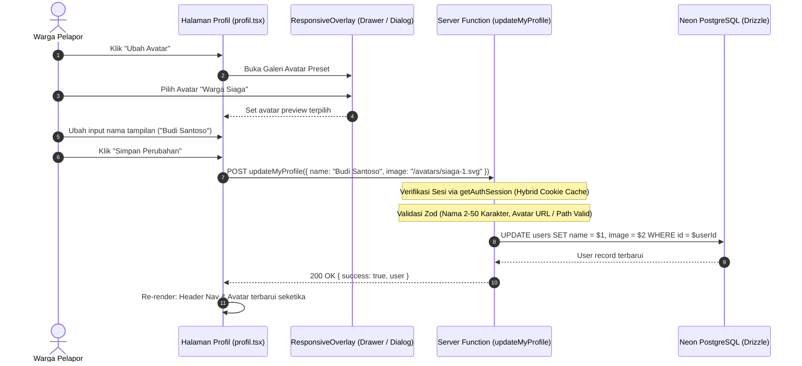
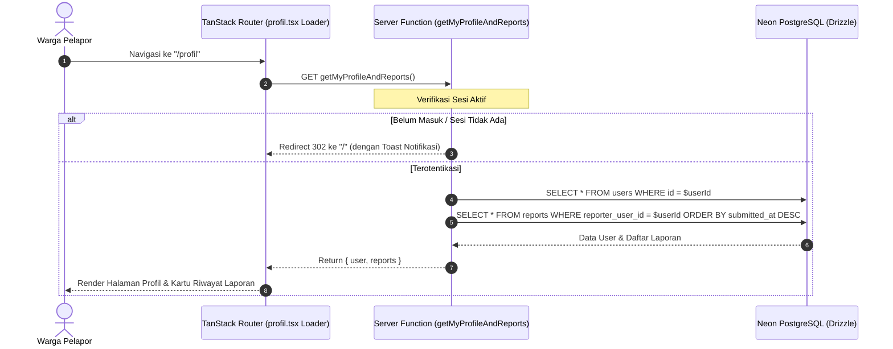
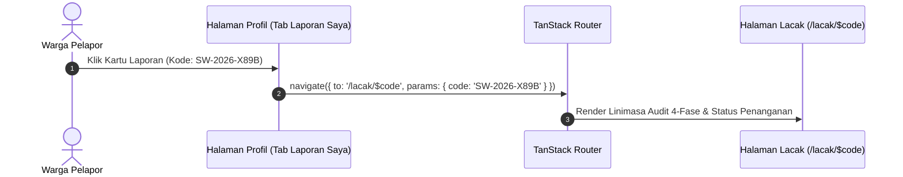

# Plan 04 — Halaman Profil Warga, Avatar Taktis & Riwayat Laporan Saya

## 1. Scope & Objectives

- **Target:** Mengimplementasikan halaman manajemen identitas warga dan pelacakan riwayat laporan insiden pribadi (*Citizen Profile & My Reports Tracking*) pada rute [`/profil`](src/routes/profil.tsx). Fitur ini menjawab kebutuhan transparansi publik (*Public Service Tracking*) bagi warga yang telah masuk menggunakan akun Google:
  1. **Informasi Akun Terotentikasi & Perlindungan Privasi (Rule 7 & PRD Section 5.5):** Menampilkan ringkasan akun (Nama Tampilan, Email terverifikasi Google, Badge Peran `citizen` / `moderator`, serta tanggal bergabung). Email bersifat *read-only* untuk menjaga integritas akun OAuth.
  2. **Pengubahan Nama Tampilan (*Display Name Update*):** Formulir pengubahan nama dengan validasi Zod (2–50 karakter) yang ramah pengguna.
  3. **Pemilih Foto Profil Taktis / Preset Avatar (Rule 12 & DESIGN.md):**
     - Alih-alih mengizinkan unggahan foto bebas tanpa kurasi yang berisiko disalahgunakan, sistem menyediakan **8 koleksi avatar preset taktis/netral** bertema kedaruratan & penjaga lingkungan (*Warga Siaga, Relawan Hijau, Pengawas Lahan, Satgas Bencana, Warga Peduli, Pemerhati Gambut, Patroli Udara, dan Penjaga Permukiman*).
     - Menyediakan opsi *"Gunakan Foto Asli Google"* untuk mengembalikan avatar ke gambar profil bawaan Google OAuth.
     - Pemilih avatar menggunakan komponen **`ResponsiveOverlay`** (Drawer dari bawah pada ponsel `< 768px`, Dialog terpusat pada desktop `≥ 768px`).
  4. **Dasbor "Laporan Saya" (*Civic Tracking History*):**
     - Mengagregasi seluruh laporan kebakaran yang pernah dikirimkan oleh warga (`reporter_user_id = user.id`) diurutkan dari yang terbaru.
     - Setiap item menampilkan kode pelacakan unik berformat *JetBrains Mono* (misal: `SW-2026-X89B`), jenis kebakaran (Karhutla, Permukiman, dll.), waktu pelaporan, badge status verifikasi (`pending`, `needs_review`, `verified`, `insufficient_evidence`, `rejected`), dan badge status penanganan lapangan (`not_forwarded`, `forwarded`, `acknowledged`, `in_progress`, `resolved`).
     - Tautan langsung menuju halaman pelacakan detail [`/lacak/$code`](src/routes/lacak.$code.tsx).
     - State kosong interaktif (*Actionable Empty State* via primitif `Empty` Base UI) saat warga belum memiliki riwayat laporan, dilengkapi tombol aksi *"Laporkan Insiden Baru"* yang mengarah ke `/lapor`.
  5. **Aksi Keluar Akun Terpadu:** Tombol keluar akun yang memicu pembersihan sesi Better Auth dan mengembalikan status UI secara reaktif.
  6. **Integrasi Navigasi Dropdown:** Memperbarui menu avatar pada [`HeaderNav`](src/components/shared/header-nav.tsx) desktop dan mobile dock agar item "Profil" dan "Laporan Saya" mengarah ke `/profil`.
- **Out of Scope:**
  - Pengubahan peran pengguna (role `moderator` / `superadmin` dikelola langsung oleh administrator melalui basis data Neon).
  - Unggahan avatar gambar bebas kustom ke Cloudflare R2 (dihindari demi mitigasi moderasi konten).
- **Competition Alignment (WIA MIA 2026):**
  - **Fungsionalitas (25%):** Transparansi pelacakan laporan pribadi secara waktu nyata (*citizen empowerment*).
  - **Desain & Kemudahan Penggunaan (20%):** Primitif Base UI (`ResponsiveOverlay`, `Empty`, `Tabs`, `Card`, `Avatar`), mobile-first drawer, dan zero gradients.
  - **Kualitas Konten & Bahasa (20%):** Divalidasi via `bahasa-inti` dan `bahasa-website`, bebas frasa klise, zero emoji policy (Rule 14), dan ikon resmi Lucide React (`*Icon`).
  - **Orisinalitas & Keselarasan Tema (35%):** Memberikan identitas taktis bagi warga pelapor tanpa mengorbankan privasi pribadi di ruang publik.

---

## 2. PRD Reference & Dependencies

- **PRD Section:**
  - Bagian 4.3 (Hierarki Rute & Sitemap: Rute `/profil`).
  - Bagian 5.5 (Autentikasi Hybrid, Google OAuth & RBAC: Hak Akses `citizen` untuk Laporan Saya).
  - Bagian 6.1 (Tabel `users` dan foreign key `reporter_user_id` pada tabel `reports`).
- **Preceding Plan Dependencies:**
  - [`01-landing-and-emergency-banner.md`](01-landing-and-emergency-banner.md) (Landing page & Design tokens).
  - [`02-google-oauth-better-auth.md`](02-google-oauth-better-auth.md) (Better Auth session, skema `users`, Navbar & MenuDock).
  - [`03-citizen-incident-reporting.md`](03-citizen-incident-reporting.md) (Skema pembuatan laporan & relasi `reporter_user_id`).
- **Target Route(s):**
  - `/profil` ([`src/routes/profil.tsx`](src/routes/profil.tsx)) — Halaman profil dan pelacakan riwayat laporan warga.

---

## 3. Use Cases & Sequence Diagrams

### Use Case 1: Warga Mengubah Nama Tampilan & Memilih Avatar Taktis

Warga membuka halaman profil, menekan tombol "Ubah Avatar", memilih salah satu avatar preset dari ResponsiveOverlay, mengedit nama tampilan, dan menyimpan perubahan.



### Use Case 2: Warga Membuka Halaman Profil dan Memantau Seluruh Laporan Pribadi ("Laporan Saya")

Warga yang telah masuk mengakses menu "Profil". Server memvalidasi sesi dan memuat seluruh laporan yang dikirimkan oleh warga tersebut.



### Use Case 3: Warga Mengklik Salah Satu Laporan untuk Pelacakan Detail

Warga melihat laporan kebakaran yang pernah dikirimnya dan ingin memantau perkembangan tindakan petugas.



---

## 4. Data Models, Schemas & Server Functions

### 4.1 Zod Schemas (`src/lib/schema/profile.ts`)

```typescript
import { z } from 'zod'
import {
  incidentTypeEnum,
  verificationStatusEnum,
  handlingStatusEnum,
} from './reports'

/**
 * Daftar avatar taktis preset yang disediakan oleh SiagaWarga.
 */
export const PRESET_AVATARS = [
  {
    id: 'siaga-warga',
    name: 'Warga Siaga',
    path: '/avatars/preset-siaga.svg',
    description: 'Warga tanggap bencana lingkungan',
  },
  {
    id: 'relawan-hijau',
    name: 'Relawan Hijau',
    path: '/avatars/preset-relawan.svg',
    description: 'Relawan aksi mitigasi karhutla',
  },
  {
    id: 'pengawas-lahan',
    name: 'Pengawas Lahan',
    path: '/avatars/preset-pengawas.svg',
    description: 'Pemerhati kelestarian gambut & hutan',
  },
  {
    id: 'satgas-bencana',
    name: 'Satgas Tanggap',
    path: '/avatars/preset-satgas.svg',
    description: 'Kesiapsiagaan penanganan kedaruratan',
  },
  {
    id: 'penjaga-permukiman',
    name: 'Penjaga Wilayah',
    path: '/avatars/preset-penjaga.svg',
    description: 'Pemantau keamanan permukiman warga',
  },
  {
    id: 'patroli-udara',
    name: 'Pengamat Titik Panas',
    path: '/avatars/preset-patroli.svg',
    description: 'Pemantau citra satelit dan sebaran asap',
  },
] as const

export const updateProfileInputSchema = z.object({
  name: z
    .string()
    .trim()
    .min(2, 'Nama minimal 2 karakter')
    .max(50, 'Nama maksimal 50 karakter'),
  image: z
    .string()
    .url('Tautan foto profil tidak valid')
    .or(z.string().regex(/^\/avatars\/preset-[a-z-]+\.svg$/, 'Pilihan avatar tidak valid'))
    .optional(),
})

export type UpdateProfileInput = z.infer<typeof updateProfileInputSchema>

/**
 * Kontrak data ringkas laporan untuk daftar "Laporan Saya".
 */
export const myReportItemSchema = z.object({
  id: z.string().uuid(),
  trackingCode: z.string(),
  incidentType: incidentTypeEnum,
  description: z.string(),
  submittedAtIso: z.string().datetime(),
  addressDisplay: z.string().nullable(),
  verificationStatus: verificationStatusEnum,
  handlingStatus: handlingStatusEnum,
  isPotentialDuplicate: z.boolean(),
})

export type MyReportItem = z.infer<typeof myReportItemSchema>

export const myProfileAndReportsSchema = z.object({
  user: z.object({
    id: z.string(),
    name: z.string(),
    email: z.string().email(),
    image: z.string().nullable(),
    role: z.enum(['citizen', 'moderator', 'superadmin']),
    createdAtIso: z.string().datetime(),
  }),
  reports: z.array(myReportItemSchema),
})

export type MyProfileAndReports = z.infer<typeof myProfileAndReportsSchema>
```

### 4.2 Drizzle Schema & Relasi Basis Data

- **Tabel `users` ([`src/server/db/schema/auth.ts`](src/server/db/schema/auth.ts)):**
  Menyimpan data identitas warga: `id`, `name`, `email`, `emailVerified`, `image`, `role`, `createdAt`.
- **Tabel `reports` ([`src/server/db/schema/reports.ts`](src/server/db/schema/reports.ts)):**
  Kolom `reporterUserId` bertindak sebagai foreign key menuju `users.id` dengan onDelete `set null`.
- **Kueri Relasional:**
  ```typescript
  const userReports = await db
    .select({
      id: reports.id,
      trackingCode: reports.trackingCode,
      incidentType: reports.incidentType,
      description: reports.description,
      submittedAt: reports.submittedAt,
      addressDisplay: reports.addressDisplay,
      verificationStatus: reports.verificationStatus,
      handlingStatus: reports.handlingStatus,
      isPotentialDuplicate: reports.isPotentialDuplicate,
    })
    .from(reports)
    .where(eq(reports.reporterUserId, userId))
    .orderBy(desc(reports.submittedAt))
  ```

### 4.3 Server Functions (`src/server/functions/profile.ts`)

#### 1. `getMyProfileAndReports`
- **Method:** `GET`
- **Behavior:**
  - Mengambil sesi aktif via `getAuthSession`.
  - Jika sesi tidak ditemukan atau tidak valid, melempar redirect atau galat 401 Unauthorized.
  - Mengambil record pengguna dari tabel `users`.
  - Mengambil daftar laporan dari tabel `reports` di mana `reporterUserId = session.user.id`.
  - Mengembalikan objek `MyProfileAndReports`.

#### 2. `updateMyProfile`
- **Method:** `POST`
- **Validator:** `updateProfileInputSchema`
- **Behavior:**
  - Memverifikasi sesi aktif via `getAuthSession`.
  - Memperbarui kolom `name`, `image`, dan `updatedAt` pada tabel `users`.
  - Mengembalikan data pengguna terbaru `{ success: true, user }`.

---

## 5. UI/UX Design & Microcopy Specification (DESIGN.md & bahasa-skills)

- **Surface Mode:** *Operate* (Dasbor Taktis Warga, Elegan, dan Mudah Dinavigasi).
- **Visual Tokens:**
  - Aksen Utama: Safety Ember (`var(--color-ember)`)
  - Aksen Netral & Border: Border neutral 1px (`var(--border)`), Radius compact 6px (`--radius`)
  - Font Data Teknis: *JetBrains Mono* (`font-mono`) untuk Kode Pelacakan
  - Font Antarmuka: *Plus Jakarta Sans* (`font-sans`)
  - Universal Zero Emoji Policy (Rule 14): Zero emojis, menggunakan ikon resmi Lucide React (`*Icon`).

### 5.1 Shadcn Base UI Component Mapping & Verification (Rule 16)

> *Diaudit terhadap `docs/shadcn/components/base/` dan `src/components/ui/` untuk memastikan keselarasan arsitektur.*

| UI Feature / Element | Shadcn Base UI Component (`docs/shadcn/components/base/`) | Status di `src/components/ui/` | Rincian Props / Varian |
| -------------------- | --------------------------------------------------------- | ------------------------------ | ---------------------- |
| **Kartu Profil & Laporan** | `card.md` (`Card`, `CardHeader`, `CardTitle`, `CardContent`) | Tersedia (`card.tsx`) | Border 1px tactical, background card flat |
| **Avatar Pengguna** | `avatar.md` (`Avatar`, `AvatarImage`, `AvatarFallback`) | Tersedia (`avatar.tsx`) | Size `lg` (h-16 w-16) dan `default` |
| **Badge Peran & Status** | `badge.md` (`Badge`) | Tersedia (`badge.tsx`) | Varian `outline`, `default`, dan semantic status colors |
| **Field Edit Nama** | `field.md` (`Field`, `FieldLabel`, `FieldError`, `FieldDescription`) | Tersedia / Dibuat di Plan 03 | Validasi `data-invalid`, accessible group |
| **Input Teks** | `input.md` (`Input`) | Tersedia (`input.tsx`) | Input nama tampilan |
| **Tombol Aksi** | `button.md` (`Button`) | Tersedia (`button.tsx`) | Varian `ember`, `outline`, `destructive` |
| **Modal Avatar Picker** | `dialog.md` / `drawer.md` (`ResponsiveOverlay`) | Tersedia / Dibuat di Plan 03 | Drawer di ponsel (<768px), Dialog di desktop (≥768px) |
| **Tab Navigasi Halaman** | `tabs.md` (`Tabs`, `TabsList`, `TabsTrigger`, `TabsContent`) | **Perlu Dibuat** (`tabs.tsx`) | Tab: *Profil Akun* dan *Riwayat Laporan* |
| **State Laporan Kosong** | `empty.md` (`Empty`, `EmptyHeader`, `EmptyTitle`, `EmptyDescription`, `EmptyContent`, `EmptyMedia`) | **Perlu Dibuat** (`empty.tsx`) | Actionable empty state dengan CTA lapor |
| **Pemisah Konten** | `separator.md` (`Separator`) | Tersedia (`separator.tsx`) | Divider 1px |

### 5.2 Tata Letak Visual Wireframe (ASCII)

```
┌─────────────────────────────────────────────────────────────────┐
│ Breadcrumb: Beranda / Profil Saya                               │
│ Heading H1: Profil & Riwayat Laporan Warga                      │
│ Subtitle: Kelola identitas tampilan Anda dan pantau laporan.    │
├─────────────────────────────────────────────────────────────────┤
│ [ TABS:  [Profil Akun]  |  [Riwayat Laporan Saya (3)] ]        │
├─────────────────────────────────────────────────────────────────┤
│ TAB 1: PROFIL AKUN                                              │
│ ┌─────────────────────────────────────────────────────────────┐ │
│ │ [ FOTO PROFIL ]                                             │ │
│ │ [Avatar Besar]  Budi Santoso                                │ │
│ │                 budi.santoso@gmail.com (Terverifikasi)       │ │
│ │                 [Badge: Warga Aktif]  Bergabung: Okt 2026   │ │
│ │ [Tombol: Ubah Avatar Preset] -> Membuka ResponsiveOverlay   │ │
│ ├─────────────────────────────────────────────────────────────┤ │
│ │ FORM PENGATURAN IDENTITAS                                   │ │
│ │ • Nama Tampilan: [ Budi Santoso                           ] │ │
│ │ • Email Akun:    [ budi.santoso@gmail.com ] (Read-only)     │ │
│ │                                                             │ │
│ │ [ Tombol: Simpan Perubahan ] (Safety Ember)                 │ │
│ └─────────────────────────────────────────────────────────────┘ │
├─────────────────────────────────────────────────────────────────┤
│ TAB 2: RIWAYAT LAPORAN SAYA                                     │
│ ┌─────────────────────────────────────────────────────────────┐ │
│ │ ITEM LAPORAN 1:                                             │ │
│ │ Kode: SW-2026-X89B  •  Karhutla  •  2 jam lalu              │ │
│ │ Status: [Terverifikasi]  •  Penanganan: [Dalam Penanganan]  │ │
│ │ Lokasi: Jl. Lintas Sumatra KM 42, Riau                      │ │
│ │ [Tombol: Pantau Linimasa Detail] -> /lacak/SW-2026-X89B     │ │
│ ├─────────────────────────────────────────────────────────────┤ │
│ │ ITEM LAPORAN 2:                                             │ │
│ │ Kode: SW-2026-K12A  •  Permukiman  •  Kemarin               │ │
│ │ Status: [Menunggu Review]  •  Penanganan: [Belum Diteruskan]│ │
│ │ [Tombol: Pantau Linimasa Detail] -> /lacak/SW-2026-K12A     │ │
│ └─────────────────────────────────────────────────────────────┘ │
│                                                                 │
│ (JIKA KOSONG: Komponen Empty.* dengan ilustrasi taktis & CTA)   │
│ "Belum ada laporan yang Anda kirimkan."                         │
│ [ Tombol: Laporkan Insiden Baru ]                               │
└─────────────────────────────────────────────────────────────────┘
```

### 5.3 Spesifikasi Salinan UI & Mikro (bahasa-skills Terverifikasi)

- **Judul Halaman (H1):** `Profil Akun & Riwayat Laporan`
- **Sub-Judul Deskripsi:** `Kelola identitas tampilan akun Anda dan pantau seluruh perkembangan penanganan insiden yang pernah Anda laporkan.`
- **Label Tab:**
  - `Profil Akun`
  - `Laporan Saya`
- **Pemberitahuan & Label Akun:**
  - `Nama Tampilan`
  - `Alamat Email Terdaftar`
  - `Akun Google Terverifikasi`
  - `Ubah Avatar`
  - `Gunakan Foto Asli Google`
  - `Simpan Perubahan`
  - `Menyimpan Perubahan...`
- **Empty State "Laporan Saya":**
  - *Judul:* `Belum Ada Laporan Terkirim`
  - *Deskripsi:* `Anda belum pernah mengirimkan laporan kebakaran. Setiap laporan yang Anda kirimkan melalui SiagaWarga akan tercatat dan dapat dipantau di sini secara transparan.`
  - *Label Tombol:* `Laporkan Insiden Kebakaran`
- **Konfirmasi Sukses & Galat:**
  - Sukses: `Profil Anda berhasil diperbarui.`
  - Gagal: `Gagal memperbarui profil. Periksa kembali koneksi internet Anda dan coba lagi.`

---

## 6. Implementation File List

### 6.1 Berkas Baru (New Files)
1. `src/lib/schema/profile.ts` — Skema validasi Zod untuk pembaruan profil, daftar avatar preset, dan kontrak riwayat laporan saya.
2. `src/server/functions/profile.ts` — Server functions: `getMyProfileAndReports` dan `updateMyProfile`.
3. `src/components/ui/tabs.tsx` — Primitif tabs Base UI (`Tabs`, `TabsList`, `TabsTrigger`, `TabsContent`) dari `docs/shadcn/components/base/tabs.md`.
4. `src/components/ui/empty.tsx` — Primitif empty state Base UI (`Empty`, `EmptyHeader`, `EmptyTitle`, `EmptyDescription`, `EmptyContent`, `EmptyMedia`) dari `docs/shadcn/components/base/empty.md`.
5. `src/components/profile/avatar-picker-overlay.tsx` — Komponen galeri avatar preset dalam `ResponsiveOverlay`.
6. `src/components/profile/edit-profile-form.tsx` — Formulir pengubahan nama dan pemilihan avatar.
7. `src/components/profile/my-reports-list.tsx` — Komponen daftar riwayat laporan pribadi warga beserta empty state informatif.
8. `src/components/profile/my-report-card.tsx` — Kartu individual ringkasan laporan dengan status badges dan tautan pelacakan.
9. `src/routes/profil.tsx` — Halaman rute `/profil` lengkap dengan loader, pending skeleton, dan error boundary.
10. `public/avatars/` — 6-8 berkas SVG avatar taktis preset (*preset-siaga.svg*, *preset-relawan.svg*, dll.).
11. `tests/profile.test.ts` — Pengujian unit skema profil, validasi nama, dan logika server function.

### 6.2 Berkas yang Dimodifikasi (Modified Files)
1. `src/lib/schema/index.ts` — Mengekspor skema dan tipe profil baru.
2. `src/components/shared/header-nav.tsx` — Memperbarui tautan menu *"Laporan Saya"* dan menu profil agar mengarah ke `/profil`.

---

## 7. Testing & Quality Gates (TDD with Bun)

### 7.1 Cakupan Pengujian (`tests/profile.test.ts`)
1. **Validasi Input Pembaruan Profil:**
   - Memastikan nama dengan panjang 2–50 karakter diterima.
   - Menolak nama kurang dari 2 karakter atau lebih dari 50 karakter.
   - Memvalidasi path avatar preset yang sah atau URL foto profil yang valid.
2. **Otorisasi Sesi (Auth Guard):**
   - Menolak akses kueri profil jika tidak ada sesi aktif (401 Unauthorized / Redirect).
   - Memastikan kueri `getMyProfileAndReports` hanya mengambil laporan yang dimiliki oleh pengguna (`reporter_user_id = user.id`), bukan laporan pengguna lain.
3. **Pembaruan Basis Data (Neon DB Integration):**
   - Menguji pembaruan nama pengguna dan foto avatar di tabel `users`.

### 7.2 Eksekusi Quality Gates Wajib (100% Lolos)
```bash
bun test tests/profile.test.ts            # Pengujian unit modul profil
bun test                                  # Seluruh pengujian proyek
bun run check                             # Pengecekan pemformatan Prettier
bun run lint                              # ESLint
bun run lint:design                       # @shadcn/lint zero-restyle check
bun run typecheck                         # TypeScript strict check (tsc --noEmit)
bun run build                             # Build produksi Client & Cloudflare Worker SSR
```
