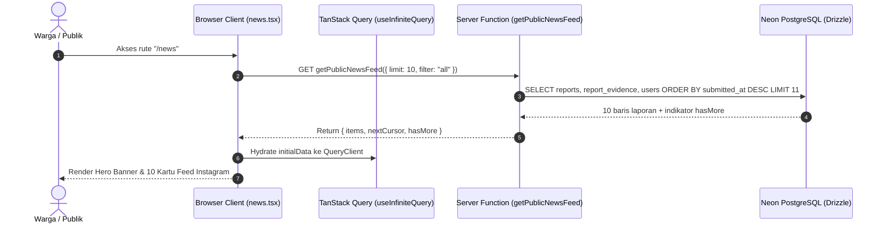
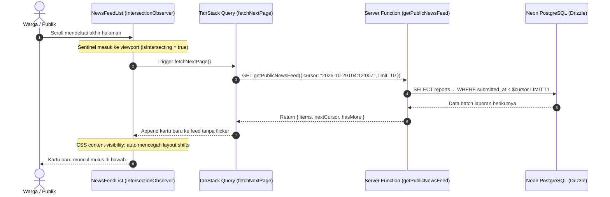

# Plan 05 — Halaman Kabar Warga (News Feed) & Laporan Insiden Publik

## 1. Scope & Objectives

- **Target:** Mengimplementasikan halaman kabar publik (*Public Incident News Feed*) pada rute [`/news`](src/routes/news.tsx) dengan tata letak kartu ala Instagram yang menyajikan aliran laporan kebakaran faktual dari warga secara tak terbatas (*infinite feed*).
  1. **Feed Kartu Gaya Instagram (*Instagram-Style Incident Card*):**
     - Desain terpusat (`max-w-xl mx-auto`) berorientasi mobile-first yang bersih dan mudah dipindai (*scannable*).
     - **Header Kartu:** Avatar pelapor menggunakan [`UserAvatar`](src/components/shared/user-avatar.tsx) dengan pita status peran (`#WARGA` / `#PETUGAS`), nama pengguna, label kelurahan/kecamatan, dan waktu relatif (misal *"12 menit lalu"*).
     - **Media Foto Bukti:** Kontainer gambar berasio tetap (`aspect-[4/3]`) dengan penanda tipe kebakaran (Karhutla / Permukiman), badge status verifikasi (`verified`, `needs_review`, `pending`), dan kode pelacakan transparan.
     - **Aksi Cepat:** Tombol *"Lacak Detail"* (`/lacak/$code`), tombol *"Buka di Peta"* (`/pantau`), dan tombol *"Bagikan"* (salin tautan langsung).
     - **Teks Deskripsi & Caption:** Nama pelapor tebal diikuti deskripsi faktual kejadian dari lapangan, dilengkapi tombol ekspansi teks (*"selengkapnya"* / *"lebih sedikit"*).
  2. **Paginasi Tanpa Batas Tanpa Jitter (*Infinite Scroll* via TanStack Query):**
     - Menggunakan `useInfiniteQuery` dari TanStack Query v5 dengan *cursor-based pagination* (`limit: 10`).
     - Menggunakan *sentinel element* dengan `IntersectionObserver` untuk memicu pemuatan batch berikutnya secara otomatis saat pengguna mendekati akhir feed.
     - **Optimasi CSS Modern (`content-visibility: auto` & `contain-intrinsic-size: 550px`):** Memastikan performa 60 FPS dan konsumsi memori stabil hingga ratusan kartu tanpa efek samping *scroll jumping / layout jitter* dari virtualizer.
  3. **Filter Kategori Cepat:**
     - Tab filter berbasis status insiden: *Semua*, *Terverifikasi*, *Sedang Ditangani*, dan *Selesai*.
  4. **Perlindungan Privasi & Data Publik (Rule 7 & System Honesty):**
     - Nomor telepon dan data EXIF mentah tidak pernah diekspos ke klien.
     - Koordinat geospasial pada feed publik disamarkan/dibulatkan ke tingkat kelurahan demi privasi pemukiman warga.
  5. **Integrasi Navigasi Global:**
     - Memperbarui tautan pada [`HeaderNav`](src/components/shared/header-nav.tsx) (desktop nav dan mobile dock) dari *hash dummy* `#news` menjadi rute aktif `/news`.

- **Out of Scope:**
  - Fitur komentar warga atau tombol "Like" (fokus utama adalah pelacakan layanan publik faktual, bukan media sosial rekreasi).
  - Pengubahan status laporan langsung dari feed (tindakan verifikasi status tetap diisolasi pada dasbor petugas `/admin/triase`).

- **Competition Alignment (WIA MIA 2026):**
  - **Fungsionalitas (25%):** Transparansi pelaporan publik waktu nyata dengan penanganan *infinite stream* yang andal.
  - **Desain & Kemudahan Penggunaan (20%):** Tata letak feed familiar ala Instagram dengan rasio visual presisi dan tipografi semantik.
  - **Kualitas Konten & Bahasa (20%):** Divalidasi menggunakan panduan `bahasa-inti`, `bahasa-website`, dan `bahasa-seo` (judul H1 semantik, zero AI-slop, zero emoji).
  - **Orisinalitas & Keselarasan Tema (35%):** Mentransformasi laporan darurat bencana menjadi kabar warga yang transparan dan dapat dipantau bersama (*Civic Tracking & Social Accountability*).

---

## 2. PRD Reference & Dependencies

- **PRD Section:**
  - Bagian 4.3 (Hierarki Rute & Sitemap: Rute Publik `/news`).
  - Bagian 5.1 & FR-3 (Akses Transparansi Publik & Pelacakan Status Penanganan).
  - Bagian 5.5 (Tampilan Identitas Publik & Peran Akun Warga/Petugas).
  - Bagian 6.1 (Tabel `reports`, `report_evidence`, dan `users`).
- **Preceding Plan Dependencies:**
  - [`01-landing-and-emergency-banner.md`](01-landing-and-emergency-banner.md) (Design tokens, layout dasar).
  - [`02-google-oauth-better-auth.md`](02-google-oauth-better-auth.md) (Skema `users`, sesi, identitas pelapor).
  - [`03-citizen-incident-reporting.md`](03-citizen-incident-reporting.md) (Penyimpanan laporan dan bukti foto `report_evidence`).
  - [`04-citizen-profile-and-my-reports.md`](04-citizen-profile-and-my-reports.md) (Komponen `UserAvatar` dengan pita status peran).
- **Target Route(s):**
  - `/news` ([`src/routes/news.tsx`](src/routes/news.tsx)) — Halaman publik feed kabar insiden warga.

---

## 3. Use Cases & Sequence Diagrams

### Use Case 1: Pemuatan Awal Halaman News (SSR Hydration & Feed Pertama)

Pengguna mengunjungi rute `/news`. TanStack Router loader memanggil server function untuk memuat 10 laporan publik terbaru melalui SSR sehingga halaman langsung ter-render tanpa layar putih.



### Use Case 2: Infinite Scrolling saat Pengguna Menelusuri Feed ke Bawah

Pengguna menggulir layar ke bawah melintasi kartu laporan. Ketika *sentinel element* di akhir daftar masuk ke dalam viewport, `IntersectionObserver` memicu pengambilan batch 10 laporan berikutnya secara otomatis.



---

## 4. Data Models, Schemas & Server Functions

### 4.1 Zod Schemas (`src/lib/schema/news.ts`)

```typescript
import { z } from 'zod'
import {
  handlingStatusEnum,
  incidentTypeEnum,
  verificationStatusEnum,
} from './reports'

export const newsFilterEnum = z.enum([
  'all',
  'verified',
  'in_progress',
  'resolved',
])
export type NewsFilter = z.infer<typeof newsFilterEnum>

export const getNewsFeedInputSchema = z.object({
  cursor: z.string().optional(),
  limit: z.number().int().min(1).max(30).default(10),
  filter: newsFilterEnum.default('all'),
})
export type GetNewsFeedInput = z.infer<typeof getNewsFeedInputSchema>

export const newsFeedItemSchema = z.object({
  id: z.string().uuid(),
  trackingCode: z.string(),
  incidentType: incidentTypeEnum,
  description: z.string(),
  submittedAtIso: z.string(),
  addressDisplay: z.string().nullable(),
  verificationStatus: verificationStatusEnum,
  handlingStatus: handlingStatusEnum,
  latitude: z.number(),
  longitude: z.number(),
  primaryImageUrl: z.string().nullable(),
  reporter: z.object({
    id: z.string().nullable(),
    name: z.string(),
    image: z.string().nullable(),
    role: z.string(),
  }),
})
export type NewsFeedItem = z.infer<typeof newsFeedItemSchema>

export const newsFeedResponseSchema = z.object({
  items: z.array(newsFeedItemSchema),
  nextCursor: z.string().nullable(),
  hasMore: z.boolean(),
})
export type NewsFeedResponse = z.infer<typeof newsFeedResponseSchema>
```

### 4.2 Server Query & Service (`src/server/services/news.ts`)

```typescript
import { and, desc, eq, inArray, lt } from 'drizzle-orm'
import type { GetNewsFeedInput, NewsFeedResponse } from '@/lib/schema/news'
import { db } from '@/server/db'
import { user } from '@/server/db/schema/auth'
import { reportEvidence } from '@/server/db/schema/evidence'
import { reports } from '@/server/db/schema/reports'

export async function fetchPublicNewsFeed(
  input: GetNewsFeedInput,
): Promise<NewsFeedResponse> {
  const limit = input.limit ?? 10
  const conditions = []

  // Filter status
  if (input.filter === 'verified') {
    conditions.push(eq(reports.verificationStatus, 'verified'))
  } else if (input.filter === 'in_progress') {
    conditions.push(eq(reports.handlingStatus, 'in_progress'))
  } else if (input.filter === 'resolved') {
    conditions.push(eq(reports.handlingStatus, 'resolved'))
  }

  // Cursor pagination berbasis submittedAt
  if (input.cursor) {
    conditions.push(lt(reports.submittedAt, new Date(input.cursor)))
  }

  const queryConditions = conditions.length > 0 ? and(...conditions) : undefined

  // Ambil limit + 1 untuk menentukan hasMore
  const rows = await db
    .select({
      id: reports.id,
      trackingCode: reports.trackingCode,
      incidentType: reports.incidentType,
      description: reports.description,
      submittedAt: reports.submittedAt,
      addressDisplay: reports.addressDisplay,
      verificationStatus: reports.verificationStatus,
      handlingStatus: reports.handlingStatus,
      latitude: reports.latitude,
      longitude: reports.longitude,
      reporterId: user.id,
      reporterName: user.name,
      reporterImage: user.image,
      reporterRole: user.role,
      evidenceMediaUrl: reportEvidence.mediaUrl,
    })
    .from(reports)
    .leftJoin(user, eq(reports.reporterUserId, user.id))
    .leftJoin(reportEvidence, eq(reports.id, reportEvidence.reportId))
    .where(queryConditions)
    .orderBy(desc(reports.submittedAt))
    .limit(limit + 1)

  const hasMore = rows.length > limit
  const slicedRows = hasMore ? rows.slice(0, limit) : rows

  const items = slicedRows.map((row) => ({
    id: row.id,
    trackingCode: row.trackingCode,
    incidentType: row.incidentType,
    description: row.description,
    submittedAtIso: row.submittedAt.toISOString(),
    addressDisplay: row.addressDisplay,
    verificationStatus: row.verificationStatus,
    handlingStatus: row.handlingStatus,
    // Jitter / penyamaran koordinat publik (Rule 7)
    latitude: Math.round(row.latitude * 100) / 100,
    longitude: Math.round(row.longitude * 100) / 100,
    primaryImageUrl: row.evidenceMediaUrl ?? null,
    reporter: {
      id: row.reporterId ?? null,
      name: row.reporterName || 'Warga Siaga',
      image: row.reporterImage ?? null,
      role: row.reporterRole ?? 'citizen',
    },
  }))

  const nextCursor =
    hasMore && slicedRows.length > 0
      ? slicedRows[slicedRows.length - 1].submittedAt.toISOString()
      : null

  return {
    items,
    nextCursor,
    hasMore,
  }
}
```

### 4.3 Server Function (`src/server/functions/news.ts`)

```typescript
import { createServerFn } from '@tanstack/react-start'
import { getNewsFeedInputSchema } from '@/lib/schema/news'
import { fetchPublicNewsFeed } from '@/server/services/news'

export const getPublicNewsFeed = createServerFn({ method: 'GET' })
  .validator((data: unknown) => getNewsFeedInputSchema.parse(data))
  .handler(async ({ data }) => {
    return fetchPublicNewsFeed(data)
  })
```

---

## 5. UI/UX Design & Microcopy Specification (DESIGN.md & bahasa-skills)

- **Surface Mode:** Persuade & Experience (Kabar publik transparan & interaktif).
- **Format Kartu:** Komposisi ala Instagram Feed dengan rasio foto teratur, interaksi sentuh nyaman (*touch target* minimal 44px), dan tipografi berjenjang.

### 5.1 Shadcn Component Mapping & Verification (Rule 16)

| UI Feature / Element | Shadcn Component (`docs/shadcn/components/base/`) | Status di `src/components/ui/` | Modifiers / Props |
| -------------------- | ------------------------------------------------- | ------------------------------ | ----------------- |
| Kartu Feed Utama     | `card.md` (`Card`, `CardContent`, dll.)           | Available (`card.tsx`)         | Variant `canvas` / `default` |
| Avatar Pelapor       | `avatar.md` (`UserAvatar`)                        | Available (`user-avatar.tsx`)  | Size `default`, `role="true"` |
| Status & Tipe Badge  | `badge.md` (`Badge`)                              | Available (`badge.tsx`)        | Variants `ember`, `info`, `secondary` |
| Filter Kategori Tab  | `tabs.md` (`Tabs`, `TabsList`, `TabsTrigger`)     | Available (`tabs.tsx`)         | Responsive horizontal scroll |
| Tombol Aksi Cepat    | `button.md` (`Button`)                            | Available (`button.tsx`)       | Variants `outline`, `ghost`, Size `sm` |
| Loading Skeleton     | `skeleton.md` (`Skeleton`)                        | Available (`skeleton.tsx`)     | Rasio kartu & teks terduplikasi |
| Indikator Infinite   | `spinner.md` (`Spinner`)                          | Available (`spinner.tsx`)      | Size `default` di bagian bawah feed |
| Pemisah Kartu        | `separator.md` (`Separator`)                      | Available (`separator.tsx`)    | Garis batas tipis antar seksi |

### 5.2 Anatomi Kartu Feed Instagram (`NewsReportCard`)

1. **Header Bar:**
   - Kiri: `<UserAvatar user={item.reporter} role="true" size="default" />`.
   - Nama Pelapor: Font tebal 14px (`font-semibold text-foreground`).
   - Lokasi & Waktu: Teks 12px `text-muted-foreground` memuat ikon `MapPinIcon` dan waktu relatif (misal: *"25 mnt lalu"*).
   - Kanan: Badge Status Verifikasi (`Terverifikasi` hijau pinus / `Triase` kuning).
2. **Kontainer Media Foto Bukti:**
   - Ukuran penuh kartu berbingkai melengkung: `relative aspect-[4/3] w-full overflow-hidden bg-muted`.
   - Gambar: `object-cover size-full transition-transform duration-300 hover:scale-102`.
   - Floating Chip Kiri Atas: Badge Jenis Kejadian (`Karhutla` / `Permukiman`).
   - Floating Chip Kanan Bawah: Kode Pelacakan `SW-YYYY-XXXX` dengan latar kaca gelap (*glassmorphism*).
3. **Bar Aksi Cepat (Di Bawah Foto):**
   - Kiri:
     - Tombol `Lacak Detail`: Icon `ExternalLinkIcon` + label ringkas, mengarah ke `/lacak/$code`.
     - Tombol `Peta`: Icon `MapIcon`, mengarah ke `/pantau?lat=...&lng=...`.
   - Kanan:
     - Tombol `Bagikan`: Icon `Share2Icon`, memicu fungsi `navigator.clipboard.writeText` dengan toast konfirmasi.
4. **Isi & Deskripsi Kejadian:**
   - Format: `<p className="text-sm text-foreground"><span className="font-semibold">{reporter.name}</span> {truncatedDescription}</p>`.
   - Tombol toggle: *"selengkapnya"* jika teks > 140 karakter.
5. **Footer Informasi:**
   - Waktu observasi detail dan status penanganan instansi lapangan (`Dalam Penanganan`, `Diteruskan ke Damkar`, dll.).

### 5.3 Microcopy & UI Text (bahasa-skills Verified)

- **Judul Utama Halaman:** *"Kabar Warga: Laporan Kejadian Terkini"*
- **Subjudul:** *"Pantau laporan kebakaran langsung dari warga dan pantau perkembangan penanganan di lapangan secara transparan."*
- **Label Tab Filter:**
  - *"Semua"*
  - *"Terverifikasi"*
  - *"Sedang Ditangani"*
  - *"Selesai"*
- **Pesan Akhir Feed (*End of Feed*):** *"Anda telah melihat seluruh laporan terkini."*
- **Empty State:** *"Belum ada laporan pada kategori ini."* / Tombol aksi: *"Kirim Laporan Baru"* (`/lapor`).

---

## 6. Implementation File List

### New Files
1. `src/lib/schema/news.ts` — Skema validasi Zod untuk parameter feed berita, filter status, dan respons pagination.
2. `src/server/services/news.ts` — Layanan query relasional Drizzle (laporan + bukti foto + pelapor) dengan cursor pagination.
3. `src/server/functions/news.ts` — Server Function TanStack Start `getPublicNewsFeed`.
4. `src/components/news/news-report-card.tsx` — Komponen kartu laporan bergaya Instagram.
5. `src/components/news/news-feed-list.tsx` — Kontainer feed tak terbatas dengan `useInfiniteQuery` dan `IntersectionObserver`.
6. `src/components/news/news-feed-skeleton.tsx` — Komponen placeholder pemuatan awal feed.
7. `src/routes/news.tsx` — Halaman rute publik `/news` lengkap dengan SSR loader, meta tags SEO, dan tab filter.
8. `tests/news.test.ts` — Unit test skema validasi Zod dan integrasi fungsi query feed.

### Modified Files
1. `src/lib/schema/index.ts` — Re-export skema news.
2. `src/components/shared/header-nav.tsx` — Mengubah tautan `#news` menjadi `/news` pada desktop dan mobile dock.

---

## 7. Testing & Quality Gates (TDD with Bun)

### 7.1 Test Cases (`tests/news.test.ts`)
1. **Validasi Input Schema:**
   - Menerima parameter kosong (menggunakan nilai bawaan `limit: 10`, `filter: 'all'`).
   - Menerima cursor string waktu ISO valid.
   - Menolak nilai filter di luar enum yang diizinkan.
2. **Validasi Output Schema:**
   - Memvalidasi struktur `NewsFeedItem` lengkap dengan koordinat ter-jitter, bukti foto, dan profil pelapor.
   - Memastikan properti rahasia (telepon, EXIF) tidak bocor dalam skema respons publik.
3. **Logika Cursor & HasMore:**
   - Menguji bahwa ketika database mengembalikan `limit + 1` baris, `hasMore` bernilai `true` dan `nextCursor` terisi dari item terakhir.

### 7.2 Quality Gates
Eksekusi berurutan:
```bash
bun test tests/news.test.ts        # Tes spesifik news
bun test                           # Seluruh rangkaian tes (52+ tes)
bun run check                      # Prettier formatting
bun run lint && bun run lint:design # ESLint & @shadcn/lint
bun run typecheck                  # TypeScript tanpa error
bun run build                      # Verifikasi build Vite SSR & Cloudflare
```
Semua gate harus lolos 100% sebelum commit dilakukan.
Semua perubahan tidak langsung di-push ke remote (*"jangan langsung push"*).
