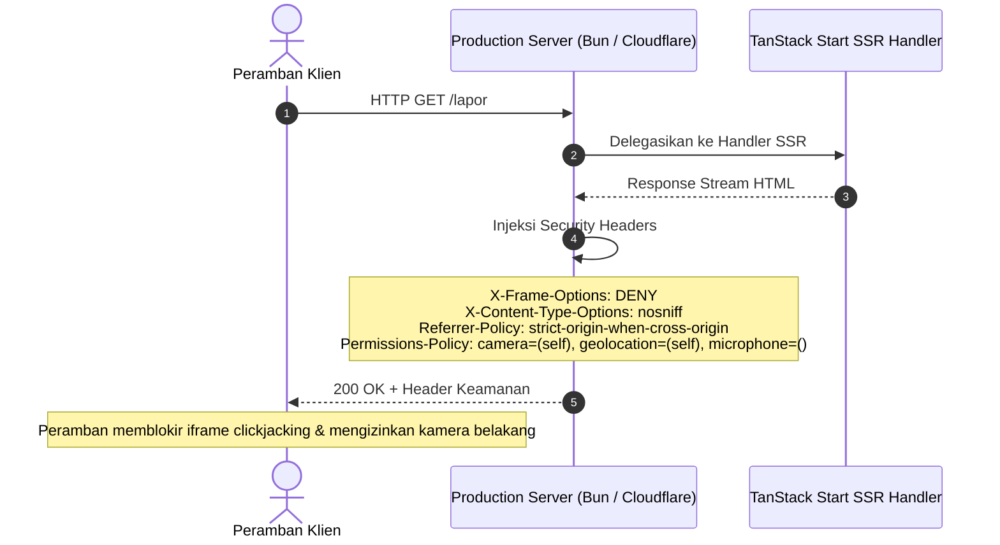
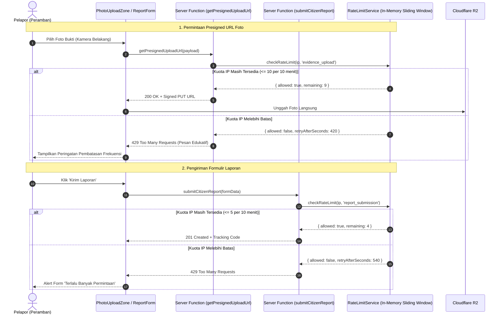

# Plan 06 — Security Headers & Rate Limiting Hardening

## 1. Scope & Objectives

- **Target:** Mengimplementasikan pengerasan keamanan lapis infrastruktur dan proteksi penyalahgunaan layanan publik pada SiagaWarga. Rencana ini mencakup:
  1. **HTTP Security Headers Standar:** Menambahkan header proteksi peramban (`X-Frame-Options: DENY`, `X-Content-Type-Options: nosniff`, `Referrer-Policy: strict-origin-when-cross-origin`, dan `Permissions-Policy: camera=(self), geolocation=(self), microphone=()`) pada seluruh respons HTTP statis dan SSR di server Bun (`server.ts`) serta handler TanStack Start (Cloudflare Workers).
  2. **Rate Limiting Sisi Server (`/lapor` & Presigned Upload URL):** Mengembangkan modul rate limiting *sliding-window in-memory* berkinerja tinggi (`src/server/services/rate-limit.ts`) yang ramah lingkungan Edge (Cloudflare Workers) dan Bun/Node.js tanpa mewajibkan infrastruktur Redis tambahan, untuk membatasi frekuensi pembuatan URL unggah bukti dan pengiriman formulir laporan per alamat IP warga.
  3. **Penanganan Umpan Balik UI:** Menyajikan pesan galat pembatasan laju (HTTP 429 Too Many Requests) yang jelas, manusiawi, dan informatif pada antarmuka pelaporan (`PhotoUploadZone` dan `ReportForm`) berlandaskan standar `bahasa-website`.
- **Out of Scope:**
  - COOP/COEP (`Cross-Origin-Opener-Policy` / `Cross-Origin-Embedder-Policy`) karena terbukti memblokir render vektor tile peta MapLibre GL, foto satelit NASA FIRMS, dan autentikasi lintas-domain Google OAuth.
  - Content Security Policy (CSP) mode *strict enforce* ditunda ke rilis terpisah agar tidak memutus aliran data dinamis peta CARTO dan Cloudflare R2 sebelum audit domain selesai.
  - Autentikasi brute force rate limiting karena autentikasi SiagaWarga murni berbasis 1-Click Google OAuth tanpa penyimpanan sandi lokal (Rule 21).
  - Penghapusan otomatis data laporan (retention purge) karena data bencana karhutla merupakan arsip historis pemantauan publik bagi instansi Damkar dan BPBD.
- **Competition Alignment (WIA 2026):**
  - **Fungsionalitas (25%):** Mencegah *spamming* pengiriman laporan palsu, *storage exhaustion* pada Cloudflare R2, dan serangan otomatis bot ke API publik.
  - **Desain & UX (20%):** Umpan balik pembatasan laju yang elegan tanpa membuat peramban *freeze* atau melempar *white screen*.
  - **Kesesuaian Tema (15%):** Menjaga integritas data *Public Service Tracking* agar tidak tercemar oleh data sampah atau manipulasi penolakan layanan (DoS).

---

## 2. PRD Reference & Dependencies

- **PRD Reference:**
  - Section 5.1 & FR-2: Validasi Formulir Pelaporan dan Pencegahan Spam
  - Appendix E: Standar Keamanan & Pertahanan Siber (OWASP Top 10)
  - AGENTS.md Rule 1: Zero Direct DB Access on Client
  - AGENTS.md Rule 4: Mandatory Photo Upload with Safety Disclaimer
  - AGENTS.md Rule 17: Edge Runtime (`workerd`) Compatibility
- **Preceding Plan Dependencies:**
  - `03-citizen-incident-reporting.md` (Fondasi alur formulir pelaporan dan unggah presigned Cloudflare R2)
- **Target Route(s):**
  - Global (seluruh rute untuk HTTP Security Headers)
  - `/lapor` (Proteksi pengiriman laporan dan permintaan presigned URL foto bukti)

---

## 3. Use Cases & Sequence Diagrams

### Use Case 1 — Penginjeksian Header Keamanan pada Respons HTTP



### Use Case 2 — Pembatasan Laju Unggah Foto Bukti & Pengiriman Laporan



---

## 4. Data Models, Schemas & Server Functions

### 4.1 Zod Schemas & Tipe (`src/lib/schema/rate-limit.ts`)

```typescript
import { z } from 'zod'

export const rateLimitActionEnum = z.enum([
  'evidence_upload',
  'report_submission',
])

export type RateLimitAction = z.infer<typeof rateLimitActionEnum>

export const rateLimitResultSchema = z.object({
  allowed: z.boolean(),
  limit: z.number().int().positive(),
  remaining: z.number().int().nonnegative(),
  resetAtEpochMs: z.number().int().positive(),
  retryAfterSeconds: z.number().int().nonnegative(),
})

export type RateLimitResult = z.infer<typeof rateLimitResultSchema>
```

### 4.2 Layanan Pembatas Laju (`src/server/services/rate-limit.ts`)

Menerapkan pola *sliding window counter* dengan pembersihan memori otomatis (*TTL garbage collection*). Bekerja mulus baik di Bun runtime produksi maupun Cloudflare Workers runtime (`workerd`) tanpa ketergantungan paket Node.js native (Rule 17).

```typescript
export interface RateLimitConfig {
  windowMs: number
  maxRequests: number
}

export const RATE_LIMIT_CONFIGS: Record<RateLimitAction, RateLimitConfig> = {
  evidence_upload: {
    windowMs: 10 * 60 * 1000, // 10 menit
    maxRequests: 10,           // Maks 10 unggahan per IP per 10 menit
  },
  report_submission: {
    windowMs: 10 * 60 * 1000, // 10 menit
    maxRequests: 5,            // Maks 5 laporan baru per IP per 10 menit
  },
}
```

Fungsi utama:
- `extractClientIp(request: Request): string` — mengekstrak IP klien dengan prioritas: `cf-connecting-ip` (Cloudflare) > `x-real-ip` > `x-forwarded-for` (elemen pertama) > fallback `'127.0.0.1'`.
- `checkRateLimit(ip: string, action: RateLimitAction): RateLimitResult` — memeriksa dan mencatat stempel waktu permintaan, membersihkan entri kadaluwarsa, dan mengembalikan status izin.
- `resetRateLimitsForTesting(): void` — utilitas pembersih cache untuk pengujian unit.

### 4.3 Utilitas Header Keamanan (`src/server/services/security-headers.ts`)

```typescript
export const SECURITY_HEADERS: Record<string, string> = {
  'X-Frame-Options': 'DENY',
  'X-Content-Type-Options': 'nosniff',
  'Referrer-Policy': 'strict-origin-when-cross-origin',
  'Permissions-Policy': 'camera=(self), geolocation=(self), microphone=()',
}

/**
  * Menyuntikkan security headers ke instance Headers atau objek konfigurasi respons
  */
export function applySecurityHeaders(headers: Headers): void {
  for (const [key, value] of Object.entries(SECURITY_HEADERS)) {
    headers.set(key, value)
  }
}
```

### 4.4 Modifikasi Server Functions

1. **`src/server/functions/evidence.ts` (`getPresignedUploadUrl`):**
   - Mendapatkan IP pemanggil menggunakan `getRequest()` dari `@tanstack/react-start/server`.
   - Mengeksekusi `checkRateLimit(clientIp, 'evidence_upload')`.
   - Jika `!result.allowed`, lemparkan error terstruktur:
     `throw new Error("RATE_LIMIT_EXCEEDED: Batas pembuatan tiket unggah tercapai. Silakan coba lagi dalam beberapa menit.")`
2. **`src/server/functions/reports.ts` (`submitCitizenReport`):**
   - Mendapatkan IP pemanggil menggunakan `getRequest()` dari `@tanstack/react-start/server`.
   - Mengeksekusi `checkRateLimit(clientIp, 'report_submission')`.
   - Jika `!result.allowed`, lemparkan error terstruktur:
     `throw new Error("RATE_LIMIT_EXCEEDED: Anda telah mengirim beberapa laporan dalam waktu singkat. Harap tunggu sebelum mengirim laporan berikutnya.")`

### 4.5 Modifikasi Server Produksi Bun (`server.ts`)

- Pada `initializeServer()` dan pembuatan respons static / fallback SSR:
  Menambahkan seluruh `SECURITY_HEADERS` pada respons `Response` sebelum dikirimkan ke peramban.

---

## 5. UI/UX Design & Microcopy Specification (DESIGN.md & bahasa-skills)

- **Surface Mode:** Operate (Formulir Pelaporan dan Zona Unggah Foto)
- **Komponen Terdampak:**
  - `src/components/report/photo-upload-zone.tsx`
  - `src/components/report/report-form.tsx`

### 5.1 Shadcn Component Mapping & Verification (Rule 16)

| Elemen UI | Primitif Shadcn (`src/components/ui/`) | Status | Penggunaan / Varian |
| :--- | :--- | :--- | :--- |
| Peringatan Pembatasan Laju | `alert.tsx` (`Alert`, `AlertTitle`, `AlertDescription`) | Tersedia | Varian `destructive` dengan ikon `ClockIcon` / `ShieldAlertIcon` |
| Tombol Coba Lagi | `button.tsx` (`Button`) | Tersedia | Varian `outline`, Ukuran `sm` |

### 5.2 Spesifikasi Mikrocopy UI (Sesuai `bahasa-website` & `bahasa-inti`)

Semua pesan galat pembatasan laju ditulis secara objektif, tenang, dan tidak bernada menyalahkan warga:

1. **Galat Pembatasan Unggah Foto (`PhotoUploadZone`):**
   - **Judul:** *"Batas Frekuensi Unggah Terlampaui"*
   - **Deskripsi:** *"Perangkat Anda telah melakukan beberapa kali pengunggahan foto dalam waktu singkat. Silakan tunggu sekitar 5–10 menit sebelum mengunggah foto baru demi menjaga stabilitas sistem."*
2. **Galat Pembatasan Formulir Laporan (`ReportForm`):**
   - **Judul:** *"Laporan Anda Sedang Diproses"*
   - **Deskripsi:** *"Sistem mendeteksi pengiriman beberapa laporan dari koneksi Anda dalam waktu berdekatan. Laporan sebelumnya telah diterima oleh petugas verifikasi. Mohon tunggu beberapa saat sebelum mengirim laporan berikutnya."*
3. **Aturan Anti-Slop:**
   - Tanpa kata klise *"Ups! Terjadi kesalahan"*.
   - Tanpa tanda hubung em-dash ganda (*—*).
   - Zero emoji policy (Rule 14), menggunakan ikon resmi Lucide (`ClockIcon`, `ShieldAlertIcon`).

---

## 6. Implementation File List

### File Baru:
- `src/lib/schema/rate-limit.ts` — Zod schema dan tipe TypeScript untuk pembatasan laju.
- `src/server/services/rate-limit.ts` — Logika sliding window in-memory rate limiter dengan TTL cleanup.
- `src/server/services/security-headers.ts` — Definisi konstan dan injektor security headers.
- `tests/security.test.ts` — Pengujian unit rate limiter, ekstraksi IP, dan pengujian integrasi server function.

### File yang Dimodifikasi:
- `server.ts` — Menyuntikkan security headers ke semua respons HTTP (static assets & SSR).
- `src/server/functions/evidence.ts` — Mengintegrasikan pemeriksaan laju IP sebelum menerbitkan URL presigned.
- `src/server/functions/reports.ts` — Mengintegrasikan pemeriksaan laju IP sebelum memproses laporan warga.
- `src/components/report/photo-upload-zone.tsx` — Menangkap error pembatasan laju dan menampilkan Alert ramah pengguna.
- `src/components/report/report-form.tsx` — Menampilkan pesan edukatif jika formulir terkena limitasi laju.

---

## 7. Testing & Quality Gates (TDD dengan Bun)

### Skenario Uji Unit & Integrasi (`tests/security.test.ts`):
1. **Security Headers Verification:**
   - Memastikan kamus `SECURITY_HEADERS` memuat `X-Frame-Options: DENY`, `X-Content-Type-Options: nosniff`, dan `Referrer-Policy: strict-origin-when-cross-origin`.
   - Memastikan `Permissions-Policy` mengizinkan kamera (`camera=(self)`) dan lokasi (`geolocation=(self)`), serta mematikan mikrofon (`microphone=()`).
2. **Rate Limiting Logic:**
   - Mengizinkan permintaan hingga batas maksimal (`maxRequests`).
   - Menolak permintaan ke-(N+1) dengan `{ allowed: false }` dan nilai `retryAfterSeconds > 0`.
   - Mengizinkan kembali permintaan setelah jendela waktu (`windowMs`) berlalu.
   - Mengisolasi penghitungan antar IP yang berbeda.
3. **Server Function Integration:**
   - `getPresignedUploadUrl` melemparkan galat pembatasan laju setelah 10 kali pemanggilan beruntun dari IP yang sama.
   - `submitCitizenReport` melemparkan galat pembatasan laju setelah 5 kali pengiriman beruntun dari IP yang sama.

### Gerbang Kualitas Wajib:
```bash
bun test tests/security.test.ts     # Seluruh pengujian keamanan lolos
bun test                            # 100% tes repositori (60+ tes) lolos
bun run lint && bun run lint:design # Lolos ESLint & @shadcn/lint tanpa error
bun run typecheck                   # tsc --noEmit lolos 0 error
bun run build                       # Build produksi sukses
```
