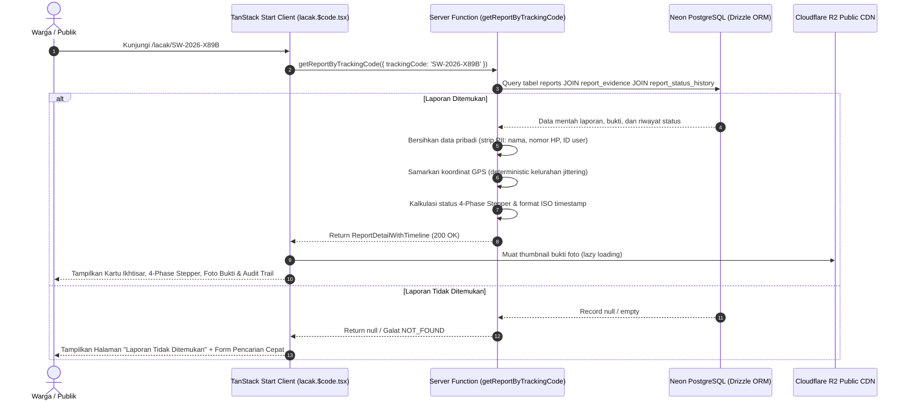
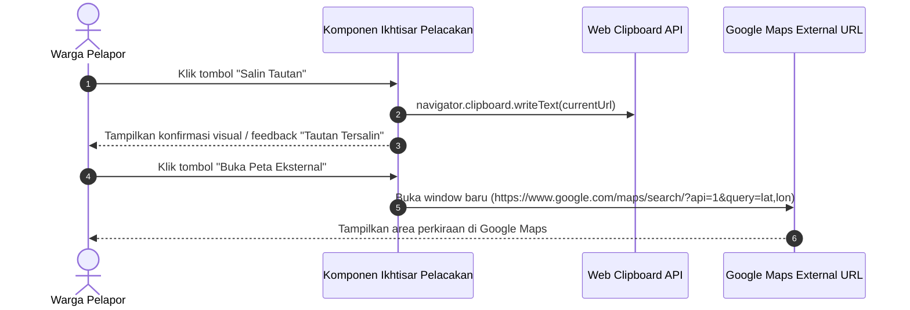

# Plan 07 — Halaman Pelacakan Publik & Linimasa Audit 4 Fase (/lacak/$code)

## 1. Scope & Objectives

- **Target:** Mengimplementasikan secara komprehensif halaman pelacakan laporan insiden publik berbasis kode pelacakan unik (`/lacak/$code`) sesuai amanat **PRD Seksi 5.3 (FR-5)** dan filosofi inti **System Honesty**:
  1. **Linimasa Audit 4 Fase (4-Phase Stepper):** Visualisasi transparan perkembangan laporan warga dari hulu ke hilir:
     - **Fase 1 (Diterima):** Lolos validasi format Zod dan foto bukti tersimpan aman di Cloudflare R2.
     - **Fase 2 (Dianalisis):** Analisis spasial PostGIS `ST_DWithin` (radius 2 km / 4 jam) untuk klasterisasi laporan sekitar dan verifikasi titik panas satelit NASA FIRMS.
     - **Fase 3 (Diverifikasi):** Peninjauan bukti foto oleh tim verifikator lapangan (`pending`, `needs_review`, `verified`, `insufficient_evidence`, `rejected`).
     - **Fase 4 (Tindak Lanjut):** Catatan resmi eskalasi instansi lapangan (Damkar / BPBD / Manggala Agni: `not_forwarded`, `forwarded`, `acknowledged`, `in_progress`, `resolved`).
  2. **Pemisahan Status Multi-Dimensi (Rule 9 — System Honesty):** Memisahkan status verifikasi keabsahan bukti (`verification_status`), tingkat urgensi pemadaman (`priority`), dan intervensi fisik instansi tanggap darurat (`handling_status`) secara independen tanpa klaim sepihak.
  3. **Perlindungan Privasi Warga & Penyamaran Koordinat (Rule 7 — Zero PII Leakage):** Menyaring seluruh data pribadi warga (`reporter_phone`, `reporter_email`, `reporter_user_id`) dari payload publik. Koordinat geografis pada peta publik disamarkan secara deterministik setingkat kelurahan/desa (resolusi ~500m–1km) untuk melindungi privasi lokasi tempat tinggal pelapor.
  4. **Pemeriksaan Bukti Foto & Integritas Data:** Menampilkan foto bukti lapangan berasio 4:3 dengan dialog pratinjau resolusi penuh (`ResponsiveOverlay`), perbandingan waktu pengamatan vs waktu pemotretan EXIF kamera asli, serta indikator integritas *checksum* SHA-256.
  5. **Buku Catatan Audit Terbuka (Rule 8):** Menyajikan linimasa riwayat status dari tabel `report_status_history` lengkap dengan waktu pembaruan, aktor pengubah (`system` / `moderator`), dan catatan alasan verifikasi resmi (`reason_note`).
  6. **Ketahanan Rute & Salin Tautan Cepat:** Implementasi `pendingComponent` (kerangka *skeleton* responsif), `errorComponent` (antarmuka ramah saat kendala jaringan), tampilan khusus *Laporan Tidak Ditemukan* (*Not Found*), dan tombol salin tautan pelacakan ke papan klip peramban (*clipboard*).

- **Out of Scope:**
  - Antarmuka pengubah status dan verifikasi oleh tim moderator (dialokasikan pada implementasi `/admin/triase` dan `/admin/laporan.$id`).
  - Penambahan bukti foto susulan oleh pelapor setelah laporan terdaftar (fitur v2).
  - Peta publik multi-layer penuh seluruh Indonesia (dialokasikan pada `/pantau`).

- **Competition Alignment (WIA MIA 2026 — Subtema Public Service Tracking):**
  - **Fungsionalitas (25%):** Pelacakan tiket laporan publik tanpa harus login akun, pemrosesan kueri kilat di Cloudflare Edge, dan transparansi linimasa audit.
  - **Desain & Interaksi (20%):** Primitif compound Base UI, stepper 4 fase adaptif mobile-first, zero gradients, kontainer terpadu `max-w-4xl` (Rule 22), dan tipografi *JetBrains Mono* untuk kode pelacakan.
  - **Kualitas Konten & Bahasa (20%):** Divalidasi ketat via `bahasa-inti` dan `bahasa-website`, bebas klise AI-slop, zero emoji (Rule 14), dan ikon resmi Lucide React (`*Icon`).
  - **Orisinalitas & Nilai Sosial (20%):** Menjawab masalah klasik laporan darurat yang "hilang tanpa jejak" dengan menyajikan audit trail transparan dan alasan penolakan/verifikasi yang jujur.
  - **Kesesuaian Tema (15%):** Inti dari subtema *Public Service Tracking*, memberikan kepastian kepada publik mengenai status penanganan bencana kebakaran.

---

## 2. PRD Reference & Dependencies

- **PRD Section:**
  - Seksi 4.2 & 4.3 (Peta Situs & Hierarki Rute `/lacak/$code`).
  - Seksi 5.3 / FR-5 (Halaman Pelacakan Publik & Linimasa Audit 4-Phase Stepper).
  - Seksi 6.1 (Skema Relasional `reports`, `report_evidence`, dan `report_status_history`).
  - Seksi 7.1 (Kontrak Server Function `getReportByTrackingCode`).
  - Seksi 8 (Standar Keamanan, Penyamaran Koordinat, dan Kontainer Desktop `max-w-4xl`).
- **Preceding Plan Dependencies:**
  - [`01-landing-and-emergency-banner.md`](01-landing-and-emergency-banner.md) (Komponen dasar, `quickTrackingSchema`, dan token warna).
  - [`03-citizen-incident-reporting.md`](03-citizen-incident-reporting.md) (Struktur data tabel `reports`, `report_evidence`, `report_status_history`, dan format tracking code `SW-YYYY-XXXX`).
  - [`06-security-headers-and-rate-limiting.md`](06-security-headers-and-rate-limiting.md) (Proteksi header keamanan HTTP dan penegasan aturan arsitektur).
- **Target Route(s):**
  - `/lacak/$code` ([`src/routes/lacak.$code.tsx`](src/routes/lacak.$code.tsx)) — Halaman publik pelacakan detail laporan insiden.

---

## 3. Use Cases & Sequence Diagrams

### Use Case 1: Warga Membuka Halaman Pelacakan (/lacak/$code)

Warga membuka URL pelacakan secara langsung atau diarahkan otomatis dari halaman pelaporan `/lapor` atau pencarian beranda. Server Function mengambil data laporan, menyamarkan data pribadi dan koordinat presisi, serta menyusun struktur 4-Phase Stepper.



### Use Case 2: Warga Menyalin Tautan Pelacakan & Membuka Rute di Google Maps

Warga menekan tombol salin tautan untuk membagikan progres penanganan kepada warga sekitar, atau membuka estimasi lokasi kebakaran di Google Maps.



---

## 4. Data Models, Schemas & Server Functions

### 4.1 Zod Schemas (`src/lib/schema/tracking.ts` & `src/lib/schema/index.ts`)

Mendefinisikan kontrak tipe data pelacakan publik secara isomorphic:

```typescript
import { z } from 'zod'
import {
  handlingStatusEnum,
  incidentTypeEnum,
  priorityEnum,
  verificationStatusEnum,
} from './reports'

/**
 * Validasi parameter input kode pelacakan rute /lacak/$code.
 */
export const getReportTrackingInputSchema = z.object({
  trackingCode: z
    .string()
    .trim()
    .toUpperCase()
    .regex(/^SW-\d{4}-[A-Z0-9]{4}$/, {
      message: 'Format kode pelacakan tidak valid. Contoh: SW-2026-X89B',
    }),
})

export type GetReportTrackingInput = z.infer<typeof getReportTrackingInputSchema>

/**
 * Fase individual pada 4-Phase Stepper.
 */
export const stepperPhaseStatusEnum = z.enum([
  'completed',
  'in_progress',
  'pending',
  'rejected',
])

export type StepperPhaseStatus = z.infer<typeof stepperPhaseStatusEnum>

export const trackingTimelinePhaseSchema = z.object({
  phaseIndex: z.number().int().min(1).max(4),
  phaseKey: z.enum(['received', 'analyzed', 'verified', 'handling']),
  title: z.string(),
  description: z.string(),
  status: stepperPhaseStatusEnum,
  timestampIso: z.string().datetime().nullable(),
  badgeLabel: z.string(),
  note: z.string().optional(),
})

export type TrackingTimelinePhase = z.infer<typeof trackingTimelinePhaseSchema>

/**
 * Entri catatan riwayat audit imutabel (Rule 8).
 */
export const trackingAuditEntrySchema = z.object({
  id: z.string().uuid(),
  statusType: z.enum(['verification', 'handling', 'priority']),
  previousValue: z.string().nullable(),
  newValue: z.string(),
  changedBy: z.string(), // Label yang disanitasi: 'Sistem' atau 'Petugas Verifikasi'
  reasonNote: z.string(),
  createdAtIso: z.string().datetime(),
})

export type TrackingAuditEntry = z.infer<typeof trackingAuditEntrySchema>

/**
 * Data bukti foto publik yang aman (Rule 7: bebas EXIF sensitif GPS).
 */
export const trackingEvidenceSchema = z.object({
  id: z.string().uuid(),
  mediaUrl: z.string().url(),
  mimeType: z.string(),
  fileSizeBytes: z.number(),
  fileHashSha256: z.string(),
  exifCaptureTimeIso: z.string().datetime().nullable(),
})

export type TrackingEvidence = z.infer<typeof trackingEvidenceSchema>

/**
 * Koordinat yang disamarkan (Rule 7: jittered to kelurahan level ~500m-1km).
 */
export const maskedLocationSchema = z.object({
  latitude: z.number(),
  longitude: z.number(),
  approximateRadiusMeters: z.number().default(800),
})

export type MaskedLocation = z.infer<typeof maskedLocationSchema>

/**
 * Kontrak respons detail pelacakan laporan lengkap.
 */
export const reportTrackingDetailSchema = z.object({
  id: z.string().uuid(),
  trackingCode: z.string(),
  incidentType: incidentTypeEnum,
  description: z.string(),
  observedAtIso: z.string().datetime(),
  submittedAtIso: z.string().datetime(),
  addressDisplay: z.string().nullable(),
  maskedLocation: maskedLocationSchema,
  verificationStatus: verificationStatusEnum,
  priority: priorityEnum,
  handlingStatus: handlingStatusEnum,
  clusterId: z.string().uuid().nullable(),
  isPotentialDuplicate: z.boolean(),
  satelliteHotspotMatched: z.boolean(),
  evidence: trackingEvidenceSchema.nullable(),
  phases: z.array(trackingTimelinePhaseSchema).length(4),
  auditHistory: z.array(trackingAuditEntrySchema),
})

export type ReportTrackingDetail = z.infer<typeof reportTrackingDetailSchema>
```

### 4.2 Sanitasi Data & Logika Penyamaran Koordinat Spasial (`src/server/services/tracking.ts`)

Implementasi penyamaran deterministik dan penyusunan 4-Phase Stepper:

```typescript
/**
 * Menghasilkan koordinat tersamar deterministik (~500m s/d 800m) berdasarkan ID laporan.
 * Mencegah kebocoran koordinat presisi rumah warga ke publik (Rule 7).
 */
export function calculateMaskedCoordinates(
  reportId: string,
  lat: number,
  lon: number,
): { latitude: number; longitude: number; approximateRadiusMeters: number } {
  // Gunakan hash deterministik dari reportId agar posisi pin tidak bergeser antar-refresh
  let hash = 0
  for (let i = 0; i < reportId.length; i++) {
    hash = (hash << 5) - hash + reportId.charCodeAt(i)
    hash |= 0
  }

  // Offset sekitar 0.004 s/d 0.007 derajat (~450m - 800m)
  const latOffset = ((Math.abs(hash) % 70) - 35) / 10000
  const lonOffset = ((Math.abs(hash >> 8) % 70) - 35) / 10000

  return {
    latitude: Number((lat + latOffset).toFixed(5)),
    longitude: Number((lon + lonOffset).toFixed(5)),
    approximateRadiusMeters: 800,
  }
}

/**
 * Mengkalkulasi status dan narasi pada 4-Phase Stepper.
 */
export function buildTrackingPhases(report: {
  submittedAt: Date
  observedAt: Date
  verificationStatus: string
  handlingStatus: string
  isPotentialDuplicate: boolean
  satelliteHotspotMatched: boolean
  auditHistory: Array<{ statusType: string; newValue: string; createdAt: Date; reasonNote: string }>
}): Array<TrackingTimelinePhase>
```

**Aturan Penentuan Status 4 Fase:**
1. **Fase 1 (Diterima):** Status `completed`, waktu `submittedAtIso`, narasi: *"Laporan dan foto bukti berhasil diunggah dan terdaftar di basis data SiagaWarga."*
2. **Fase 2 (Dianalisis):** Status `completed`, waktu `submittedAtIso`, narasi:
   - Jika `isPotentialDuplicate`: *"Terpetakan dalam radius 2 km dari klaster kebakaran aktif warga sekitar."*
   - Jika `satelliteHotspotMatched`: *"Terindikasi selaras dengan anomali titik panas satelit NASA FIRMS."*
   - Jika mandiri: *"Selesai dianalisis secara spasial; tidak ada laporan ganda terdeteksi di area sekitar."*
3. **Fase 3 (Diverifikasi):**
   - `pending` $\to$ status `in_progress`, badge *"Menunggu Verifikasi"*, narasi: *"Menunggu peninjauan keabsahan bukti foto oleh verifikator."*
   - `needs_review` $\to$ status `in_progress`, badge *"Uji Silang"*, narasi: *"Petugas memerlukan pengecekan data tambahan di lapangan."*
   - `verified` $\to$ status `completed`, badge *"Terverifikasi Sah"*, narasi: *"Laporan dan bukti foto dinyatakan sah dan valid oleh verifikator."*
   - `insufficient_evidence` $\to$ status `rejected`, badge *"Bukti Tidak Memadai"*, narasi: *"Foto bukti buram atau tidak memperlihatkan indikasi kebakaran."*
   - `rejected` $\to$ status `rejected`, badge *"Ditolak"*, narasi: *"Laporan ditolak oleh petugas verifikasi."*
4. **Fase 4 (Tindak Lanjut):**
   - `not_forwarded` $\to$ status `pending`, badge *"Belum Diteruskan"*, narasi: *"Laporan berada dalam antrean sebelum diteruskan ke instansi penanganan."*
   - `forwarded` $\to$ status `in_progress`, badge *"Diteruskan ke Damkar/BPBD"*, narasi: *"Informasi telah diteruskan ke instansi pemadam kebakaran dan BPBD wilayah setempat."*
   - `acknowledged` $\to$ status `in_progress`, badge *"Terkonfirmasi Instansi"*, narasi: *"Posko siaga bencana telah menerima dan mengonfirmasi laporan."*
   - `in_progress` $\to$ status `in_progress`, badge *"Operasi Pemadaman"*, narasi: *"Regu pemadam berada di lokasi dan operasi pemadaman sedang berlangsung."*
   - `resolved` $\to$ status `completed`, badge *"Selesai / Teratasi"*, narasi: *"Titik api telah berhasil dipadamkan dan lokasi dinyatakan aman."*
   - `unknown` $\to$ status `pending`, badge *"Status Belum Diketahui"*.

### 4.3 Server Functions (`src/server/functions/tracking.ts`)

```typescript
import { createServerFn } from '@tanstack/react-start'
import { getReportTrackingInputSchema } from '@/lib/schema/tracking'
import type { ReportTrackingDetail } from '@/lib/schema/tracking'
import { fetchReportByTrackingCode } from '@/server/services/tracking'

/**
 * Mengambil detail laporan dan linimasa audit publik berdasarkan kode pelacakan unik.
 * Menegakkan Rule 7 (Zero PII leakage) dan Rule 1 (Zero direct DB access on client).
 */
export const getReportByTrackingCode = createServerFn({ method: 'GET' })
  .validator((input: unknown) => getReportTrackingInputSchema.parse(input))
  .handler(async ({ data }): Promise<ReportTrackingDetail | null> => {
    return fetchReportByTrackingCode(data.trackingCode)
  })
```

---

## 5. UI/UX Design & Microcopy Specification (DESIGN.md & bahasa-skills)

- **Surface Mode:** **Experience / Tracking** (Kejelasan status, kepastian informasi, scanability tinggi, ketenangan visual tanpa sensasionalisme).
- **Geometri Kontainer Terpadu (Rule 22 & DESIGN.md 4.6):**  
  `mx-auto w-full max-w-4xl px-4 py-8 sm:px-6 lg:py-12`  
  Seluruh komponen kartu dan elemen header mengisi lebar kontainer penuh (`w-full`) secara flush.

### 5.1 Shadcn Component Mapping & Verification (Rule 16)

> *Audit terhadap `docs/shadcn/components/base/` dan `src/components/ui/` untuk mencegah halusinasi kode.*

| UI Feature / Element | Shadcn Base UI Primitives (`docs/shadcn/components/base/`) | Status di `src/components/ui/` | Varian / Modifiers / Props |
| -------------------- | --------------------------------------------------------- | ------------------------------ | -------------------------- |
| Kartu Penampung Konten | `card.md` (`Card`, `CardHeader`, `CardTitle`, `CardContent`, `CardFooter`) | Tersedia (`card.tsx`) | Default `bg-card border-border`, radius `--radius` |
| Lencana Status & Prioritas | `badge.md` (`Badge`) | Tersedia (`badge.tsx`) | `default` (emerald), `secondary`, `destructive`, `outline` |
| Tombol Salin & Navigasi | `button.md` (`Button`) | Tersedia (`button.tsx`) | `default`, `outline`, `secondary`, `size="sm"` |
| Peta Wilayah Tersamar | `map.md` (`Map`, `MapMarker`, `MarkerContent`, `MarkerTooltip`) | Tersedia (`map.tsx`) | CARTO Positron basemap, circle marker radius 800m |
| Dialog Zoom Bukti Foto | `dialog.md` / `drawer.md` (`ResponsiveOverlay`) | Tersedia (`responsive-overlay.tsx`) | Drawer (<768px), Dialog (≥768px) |
| Pemisah Bagian Konten | `separator.md` (`Separator`) | Tersedia (`separator.tsx`) | `my-4`, `bg-border` |
| Notifikasi Salin & Info | `alert.md` (`Alert`, `AlertTitle`, `AlertDescription`) | Tersedia (`alert.tsx`) | Variant `default`, `destructive` |
| Kerangka Loading (SSR) | `skeleton.md` (`Skeleton`) | Tersedia (`skeleton.tsx`) | Blok-blok layout peniru kartu |

### 5.2 Rincian Modul Antarmuka (`src/components/tracking/`)

1. **`tracking-overview-card.tsx` (Kartu Ikhtisar Laporan):**
   - Header kode tiket: `<h1 className="font-mono text-2xl font-bold sm:text-3xl">SW-2026-X89B</h1>`.
   - Lencana status berdampingan: Badge jenis insiden (`Karhutla` / `Permukiman`), Lencana status penanganan, dan Badge status verifikasi.
   - Waktu pengamatan: `Dilihat pada 31 Oktober 2026, 14:15 WIB` dan waktu pelaporan: `Dilaporkan 15 menit yang lalu`.
   - Tombol aksi: `Salin Tautan Pelacakan` (dengan status feedback "Tautan Tersalin" sesaat) dan tombol `Laporkan Insiden Baru`.
2. **`tracking-stepper.tsx` (Linimasa Visual 4 Fase):**
   - Tampilan tahapan linimasa adaptif: vertikal di ponsel, horizontal/vertikal bersih di desktop.
   - Ikon tahapan resmi Lucide:
     - Fase 1: `FileCheck2Icon` (Laporan Diterima)
     - Fase 2: `NetworkIcon` atau `LayersIcon` (Analisis Spasial & Titik Panas)
     - Fase 3: `ShieldCheckIcon` / `CheckCircle2Icon` / `XCircleIcon` (Verifikasi Lapangan)
     - Fase 4: `TruckIcon` / `FlameKindlingIcon` (Tindak Lanjut Penanganan)
   - Setiap simpul menampilkan status: `Selesai` (hijau sage/emerald), `Dalam Proses` (amber/ember), `Menunggu` (muted), atau `Ditolak` (rose).
3. **`tracking-evidence-card.tsx` (Pemeriksaan Bukti Foto):**
   - Pratinjau foto berasio 4:3 dengan hover zoom halus.
   - Pemicu dialog resolusi penuh menggunakan `ResponsiveOverlay`.
   - Kotak informasi metadata teknis:
     - Waktu pemotretan EXIF kamera vs Waktu pelaporan.
     - Status keutuhan berkas: `Hash SHA-256 Terverifikasi`.
     - Keterangan deskripsi saksi mata dari pelapor.
4. **`tracking-location-card.tsx` (Lokasi Terkira & Penyamaran Wilayah):**
   - Komponen peta `mapcn` MapLibre GL dengan basemap netral CARTO Positron.
   - Lingkaran area estimasi (~800 meter) menandai tingkat kelurahan/desa tanpa menunjukkan titik atap rumah pelapor (Rule 7).
   - Teks alamat/patokan umum.
   - Tombol tautan eksternal: *"Buka Petunjuk Arah di Google Maps"* (`target="_blank"`).
5. **`tracking-audit-timeline.tsx` (Buku Catatan Catatan Verifikasi Resmi):**
   - Menampilkan entri riwayat dari `report_status_history`.
   - Tiap kartu riwayat mencantumkan: Waktu perubahan (WIB), Pelaksana (`Sistem` / `Petugas Verifikasi`), Perubahan Status, dan Catatan Alasan (`reason_note`).
6. **`tracking-not-found.tsx` (Keadaan Laporan Tidak Ditemukan):**
   - Tampilan bersahabat saat kode tiket salah atau tidak ditemukan di basis data.
   - Dilengkapi bilah input pencarian cepat kode pelacakan dan tombol navigasi kembali ke beranda.

### 5.3 Standar Bahasa & Microcopy (`bahasa-skills` Verified)

- **Judul Halaman (SEO & Aksesibilitas):**  
  `Status Laporan SW-YYYY-XXXX | SiagaWarga`
- **Deskripsi Meta (SEO):**  
  `Pantau linimasa transparansi penanganan laporan kebakaran SW-YYYY-XXXX secara langsung melalui audit 4 fase SiagaWarga.`
- **Label Tombol & Aksi:**
  - `Salin Tautan` (berubah menjadi `Tautan Tersalin!` selama 2 detik)
  - `Buka Peta Google`
  - `Lihat Foto Penuh`
  - `Cari Tiket Lain`
- **Pesan Keamanan & Penafian:**
  - *"Koordinat titik kejadian pada peta publik disamarkan ke tingkat desa/kelurahan demi melindungi privasi tempat tinggal warga pelapor."*
  - *"Catatan verifikasi di bawah ini diterbitkan secara resmi oleh sistem dan petugas lapangan tanpa perubahan data sepihak."*
- **Penolakan Emojis (Rule 14):** 100% menggunakan Lucide Icons, zero emojis.

---

## 6. Implementation File List

### 6.1 Berkas Baru (New Files)

- `src/lib/schema/tracking.ts` — Skema isomorphic Zod untuk input kode pelacakan, 4-Phase Stepper, koordinat tersamar, dan audit detail.
- `src/server/services/tracking.ts` — Layanan basis data: kueri relasional `reports`, `reportEvidence`, `reportStatusHistory`, algoritma jittering deterministik, dan perakit 4-Phase Stepper.
- `src/server/functions/tracking.ts` — Server Function TanStack Start `getReportByTrackingCode` dengan validator Zod.
- `src/components/tracking/tracking-overview-card.tsx` — Komponen ringkasan tiket pelacakan, lencana status, waktu, dan aksi salin tautan.
- `src/components/tracking/tracking-stepper.tsx` — Komponen linimasa visual 4 fase penanganan bencana.
- `src/components/tracking/tracking-evidence-card.tsx` — Komponen foto bukti kejadian berasio 4:3, viewer dialog responsif, dan metadata EXIF/SHA-256.
- `src/components/tracking/tracking-location-card.tsx` — Komponen peta mini area kejadian dengan radius tersamar ~800m dan navigasi Google Maps.
- `src/components/tracking/tracking-audit-timeline.tsx` — Komponen linimasa catatan resmi petugas verifikasi dari `report_status_history`.
- `src/components/tracking/tracking-not-found.tsx` — Tampilan penanganan saat kode tiket tidak terdaftar.
- `tests/tracking.test.ts` — Berkas pengujian unit dan integrasi untuk skema tracking, kalkulasi jitter spasial, perakit fase, dan server function.

### 6.2 Berkas yang Dimodifikasi (Modified Files)

- `src/lib/schema/index.ts` — Mengekspor seluruh skema dan tipe data dari `tracking.ts`.
- `src/routes/lacak.$code.tsx` — Mengubah rute stub menjadi implementasi penuh: loader SSR `getReportByTrackingCode`, `pendingComponent` skeleton, `errorComponent` tangguh, dan rendering kartu-kartu pelacakan.

---

## 7. Testing & Quality Gates (TDD with Bun)

### 7.1 Cakupan Pengujian (`tests/tracking.test.ts`)

1. **Uji Validasi Skema Zod:**
   - Memvalidasi format kode pelacakan `SW-YYYY-XXXX` dan menolak karakter acak/simbol.
   - Memvalidasi skema respons `reportTrackingDetailSchema` dengan seluruh data fase wajib terisi.
2. **Uji Penyamaran Koordinat Deterministik (Rule 7):**
   - Memastikan koordinat hasil jitter berjarak antara 300m s/d 1.000m dari koordinat asli.
   - Memastikan koordinat hasil jitter bersifat stabil / identik pada pemanggilan berulang dengan `reportId` yang sama.
   - Memastikan data sensitif (`reporterPhone`, `reporterName`, `reporterUserId`) tidak ada dalam payload keluaran.
3. **Uji Kalkulasi 4-Phase Stepper:**
   - Memastikan Fase 1 (`received`) selalu bernilai `completed`.
   - Menguji transisi Fase 3 berdasarkan nilai `verificationStatus` (`pending` $\to$ `in_progress`, `verified` $\to$ `completed`, `rejected` $\to$ `rejected`).
   - Menguji transisi Fase 4 berdasarkan nilai `handlingStatus` (`not_forwarded` $\to$ `pending`, `in_progress` $\to$ `in_progress`, `resolved` $\to$ `completed`).
4. **Uji Integrasi Basis Data (Neon DB):**
   - Kueri pelacakan dengan kode valid mengembalikan detail laporan beserta bukti foto dan riwayat audit.
   - Kueri pelacakan dengan kode fiktif mengembalikan nilai `null`.

### 7.2 Verifikasi Gerbang Kualitas Mandatori

```bash
# 1. Seluruh tes unit & integrasi lulus
bun test

# 2. Typecheck bersih tanpa galat tipe
bun run typecheck

# 3. Linter & kepatuhan desain tanpa restyle
bun run lint && bun run lint:design

# 4. Kompilasi build produksi sukses
bun run build
```
