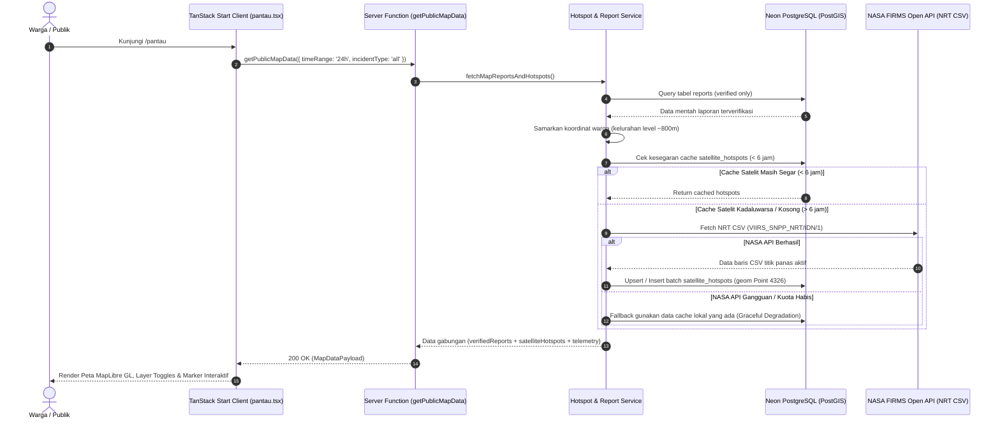
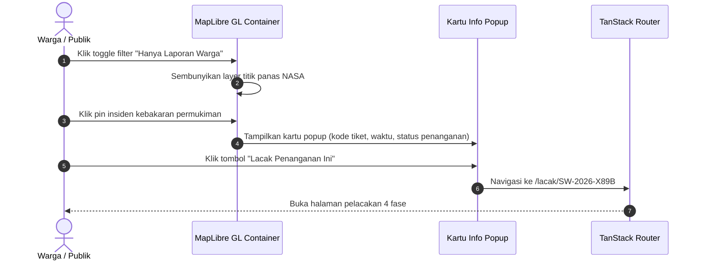

# Plan 08 — Peta Publik Interaktif Dual-Layer & Integrasi Satelit NASA FIRMS (/pantau)

## 1. Scope & Objectives

- **Target:** Mengimplementasikan secara komprehensif halaman peta publik interaktif (`/pantau`) yang menggabungkan dua lapisan data geospasial waktu nyata (*dual-layer spatial monitoring*) sesuai amanat **PRD Seksi 4.3 (Sitemap)**, **Seksi 5.6 (Strategi Caching NASA FIRMS)**, dan **Seksi 7 (FR-2 / FR-3)**:
  1. **Layer 1 (Laporan Warga Terverifikasi):** Visualisasi titik insiden kebakaran yang telah dinyatakan sah (`verification_status = 'verified'`) dengan penyamaran koordinat presisi setingkat kelurahan (~500m s/d 800m) guna menegakkan **Rule 7 (Zero PII Leakage)**.
  2. **Layer 2 (Titik Panas Satelit NASA FIRMS):** Visualisasi anomali termal aktif sensor satelit VIIRS SNPP 375m dan MODIS di seluruh wilayah Indonesia dengan mekanisme *caching* PostGIS berjenjang (TTL 6 jam) guna menegakkan **Rule 6**.
  3. **Penyaringan Interaktif Multi-Kriteria:** Filter cepat berdasarkan tipe kebakaran (karhutla, permukiman, industri), rentang waktu pengamatan (24 jam terakhir, 3 hari, 7 hari), dan status penanganan instansi pemadam.
  4. **Kartu Pop-up Insiden & Tautan Lacak Cepat:** Interaksi klik pin pada peta untuk menampilkan ringkasan insiden, waktu pengamatan relatif, tingkat kecerahan (*brightness temp*), serta tombol aksi langsung *"Lacak Penanganan Ini"* yang menavigasi ke rute `/lacak/$code`.
  5. **Ketahanan Rute & Kontainer Desktop:** Menegakkan kontainer desktop terpadu `max-w-4xl` (**Rule 22**), kerangka pemuatan (*skeleton loading*) pada `pendingComponent`, dan penanganan galat jaringan ramah warga pada `errorComponent` (**Rule 19**).

- **Out of Scope:**
  - Antarmuka pengubah status dan verifikasi oleh tim moderator (dialokasikan pada `/admin/triase` dan `/admin/laporan.$id`).
  - Fitur pengunduhan data mentah GeoJSON spasial untuk kebutuhan GIS tingkat lanjut (dialokasikan pada v2).
  - Integrasi sensor satelit geostasioner Himawari-9 (menggunakan VIIRS/MODIS NASA FIRMS resmi terlebih dahulu).

- **Competition Alignment (WIA MIA 2026 — Subtema Public Service Tracking):**
  - **Fungsionalitas (25%):** Visualisasi geospasial performa tinggi berbasis MapLibre GL (`mapcn`) tanpa ketergantungan API pihak ketiga berbayar (Mapbox), integrasi API satelit resmi NASA, dan pencocokan spasial PostGIS instan.
  - **Desain & Interaksi (20%):** Antarmuka dual-layer adaptif mobile-first, palet warna bertema taktis kebencanaan (*Forest*, *Pine*, *Ember*, *Canvas*), pin interaktif intuitif, dan *clean controls*.
  - **Kualitas Konten & Bahasa (20%):** Mengikuti standar `bahasa-inti`, `bahasa-website`, dan `bahasa-seo`, bebas jargon AI-slop, zero emoji (**Rule 14**), serta ikon resmi Lucide React (`*Icon`).
  - **Orisinalitas & Nilai Sosial (20%):** Memecahkan kebingungan warga terhadap sebaran titik api aktif dengan menyajikan visualisasi gabungan antara pantauan antariksa (NASA) dan bukti saksi mata warga lapangan secara jujur (*System Honesty*).
  - **Kesesuaian Tema (15%):** Menjadi etalase keterbukaan informasi publik dalam penanganan bencana kebakaran di Indonesia.

---

## 2. PRD Reference & Dependencies

- **PRD Section:**
  - Seksi 4.2 & 4.3 (Peta Situs & Hierarki Rute `/pantau`).
  - Seksi 5.2 (Triase Cerdas & Korelasi Spasial NASA FIRMS).
  - Seksi 5.6 (Strategi Ingestion & Caching NASA FIRMS 6 Jam).
  - Seksi 6.1 (Tabel `satellite_hotspots`, `reports`, dan indeks PostGIS `idx_hotspots_geom`).
  - Seksi 7.1 (Spesifikasi Server Function `getPublicReports` & `getSatelliteHotspots`).
  - Seksi 8 (Standar Keamanan, Penyamaran Koordinat, dan Kontainer Desktop `max-w-4xl`).
- **Preceding Plan Dependencies:**
  - [`01-landing-and-emergency-banner.md`](01-landing-and-emergency-banner.md) (Komponen dasar, tata letak, dan token warna).
  - [`03-citizen-incident-reporting.md`](03-citizen-incident-reporting.md) (Skema relasional tabel `reports` dan PostGIS Point geom).
  - [`06-security-headers-and-rate-limiting.md`](06-security-headers-and-rate-limiting.md) (Pengecualian sadar COOP/COEP agar tile MapLibre & CARTO Positron tidak terblokir).
  - [`07-public-tracking-timeline.md`](07-public-tracking-timeline.md) (Fungsi sanitasi `calculateMaskedCoordinates` dan integrasi rute `/lacak/$code`).
- **Target Route(s):**
  - `/pantau` ([`src/routes/pantau.tsx`](src/routes/pantau.tsx)) — Halaman publik peta interaktif sebaran kebakaran dan titik panas satelit.

---

## 3. Use Cases & Sequence Diagrams

### Use Case 1: Warga Menjelajahi Peta Publik Dual-Layer (/pantau)

Warga membuka halaman `/pantau` untuk melihat situasi kebakaran di sekitar wilayahnya. Server Function mengambil laporan warga terverifikasi dan mengecek cache satelit NASA FIRMS di PostGIS.



### Use Case 2: Warga Memfilter Lapisan dan Membuka Detail Insiden

Warga mematikan layer satelit, memilih hanya insiden "Permukiman", mengklik salah satu pin, lalu menavigasi ke halaman pelacakan detail.



---

## 4. Data Models, Schemas & Server Functions

### 4.1 Zod Schemas (`src/lib/schema/map.ts` & `src/lib/schema/index.ts`)

Mendefinisikan kontrak tipe data geospasial publik secara isomorphic:

```typescript
import { z } from 'zod'
import {
  handlingStatusEnum,
  incidentTypeEnum,
} from './reports'

/**
 * Parameter filter kueri untuk peta publik /pantau.
 */
export const publicMapQuerySchema = z.object({
  incidentType: z.enum(['all', 'karhutla', 'permukiman', 'industri', 'lainnya']).default('all'),
  timeRange: z.enum(['24h', '3d', '7d']).default('24h'),
  handlingStatus: z.enum(['all', 'not_forwarded', 'forwarded', 'acknowledged', 'in_progress', 'resolved']).default('all'),
})

export type PublicMapQuery = z.infer<typeof publicMapQuerySchema>

/**
 * Item insiden laporan warga untuk tampilan peta publik.
 * Rule 7: Zero PII Leakage & Koordinat Tersamar (~800m).
 */
export const publicMapReportItemSchema = z.object({
  id: z.string().uuid(),
  trackingCode: z.string(),
  incidentType: incidentTypeEnum,
  description: z.string(),
  observedAtIso: z.string().datetime(),
  submittedAtIso: z.string().datetime(),
  latitude: z.number(), // Jittered latitude
  longitude: z.number(), // Jittered longitude
  addressDisplay: z.string().nullable(),
  handlingStatus: handlingStatusEnum,
  thumbnailUrl: z.string().url().nullable(),
})

export type PublicMapReportItem = z.infer<typeof publicMapReportItemSchema>

/**
 * Item titik panas satelit NASA FIRMS dari sensor VIIRS/MODIS.
 */
export const publicMapHotspotItemSchema = z.object({
  id: z.string().uuid(),
  source: z.string(), // e.g. 'VIIRS_SNPP', 'MODIS'
  latitude: z.number(),
  longitude: z.number(),
  brightness: z.number().nullable(), // Kelvin
  confidence: z.string().nullable(), // 'nominal', 'high', 'low'
  acquiredAtIso: z.string().datetime(),
})

export type PublicMapHotspotItem = z.infer<typeof publicMapHotspotItemSchema>

/**
 * Ringkasan statistik telemetri sebaran insiden pada peta.
 */
export const mapTelemetryStatsSchema = z.object({
  totalVerifiedReports: z.number().int().min(0),
  totalActiveHotspots: z.number().int().min(0),
  totalInHandling: z.number().int().min(0),
  lastSyncedAtIso: z.string().datetime(),
})

export type MapTelemetryStats = z.infer<typeof mapTelemetryStatsSchema>

/**
 * Kontrak respons gabungan untuk rute /pantau.
 */
export const publicMapDataResponseSchema = z.object({
  reports: z.array(publicMapReportItemSchema),
  hotspots: z.array(publicMapHotspotItemSchema),
  stats: mapTelemetryStatsSchema,
})

export type PublicMapDataResponse = z.infer<typeof publicMapDataResponseSchema>
```

### 4.2 PostGIS Model & Cache Satelit NASA FIRMS (`src/server/db/schema/hotspots.ts`)

Skema tabel `satellite_hotspots` telah tersedia di basis data Neon PostgreSQL:

```typescript
// Menggunakan tabel yang sudah ada di src/server/db/schema/hotspots.ts
export const satelliteHotspots = pgTable(
  'satellite_hotspots',
  {
    id: uuid('id').defaultRandom().primaryKey(),
    source: varchar('source', { length: 20 }).notNull(),
    latitude: doublePrecision('latitude').notNull(),
    longitude: doublePrecision('longitude').notNull(),
    geom: geometry('geom', { type: 'point', srid: 4326 }),
    brightness: doublePrecision('brightness'),
    confidence: varchar('confidence', { length: 20 }),
    acquiredAt: timestamp('acquired_at', { withTimezone: true }).notNull(),
    fetchedAt: timestamp('fetched_at', { withTimezone: true }).defaultNow().notNull(),
  },
  (table) => [index('idx_hotspots_geom').using('gist', table.geom)],
)
```

### 4.3 Logika Ingestion & Caching Satelit (`src/server/services/hotspots.ts`)

Mengimplementasikan **Rule 6 (NASA FIRMS 6-Hour Cache in PostGIS)** dan penanganan *graceful degradation* saat koneksi eksternal terhambat:

```typescript
/**
 * Mengambil data titik panas satelit NASA FIRMS dengan proteksi kuota 6 jam.
 */
export async function getOrSyncSatelliteHotspots(timeRangeHours: number = 24): Promise<Array<PublicMapHotspotItem>> {
  // 1. Periksa apakah cache PostGIS masih segar (< 6 jam)
  const sixHoursAgo = new Date(Date.now() - 6 * 60 * 60 * 1000)
  const latestFetch = await db
    .select({ fetchedAt: satelliteHotspots.fetchedAt })
    .from(satelliteHotspots)
    .orderBy(desc(satelliteHotspots.fetchedAt))
    .limit(1)

  const isCacheStale = !latestFetch.length || latestFetch[0].fetchedAt < sixHoursAgo

  // 2. Jika kadaluwarsa, jalankan sinkronisasi latar belakang dari NASA FIRMS API
  if (isCacheStale) {
    try {
      await syncNasaFirmsHotspots()
    } catch (error) {
      console.warn('Gagal sinkronisasi data NASA FIRMS, menggunakan data cache lokal:', error)
    }
  }

  // 3. Ambil data titik panas berdasarkan rentang waktu yang diminta
  const timeLimit = new Date(Date.now() - timeRangeHours * 60 * 60 * 1000)
  const records = await db
    .select()
    .from(satelliteHotspots)
    .where(gte(satelliteHotspots.acquiredAt, timeLimit))
    .orderBy(desc(satelliteHotspots.acquiredAt))
    .limit(300)

  return records.map((r) => ({
    id: r.id,
    source: r.source,
    latitude: r.latitude,
    longitude: r.longitude,
    brightness: r.brightness,
    confidence: r.confidence,
    acquiredAtIso: r.acquiredAt.toISOString(),
  }))
}

/**
 * Pengurai CSV dan pembuat entri geometri PostGIS ST_SetSRID(ST_MakePoint).
 */
export function parseNasaFirmsCsv(csvText: string): Array<NewSatelliteHotspot>
```

### 4.4 Server Functions (`src/server/functions/map.ts`)

```typescript
import { createServerFn } from '@tanstack/react-start'
import { publicMapQuerySchema, type PublicMapDataResponse } from '@/lib/schema/map'
import { fetchPublicMapData } from '@/server/services/map'

/**
 * Server Function untuk mengambil data laporan warga terverifikasi dan titik panas satelit
 * untuk peta publik /pantau.
 * Menegakkan Rule 1 (Zero direct DB on client) dan Rule 7 (Zero PII leakage).
 */
export const getPublicMapData = createServerFn({ method: 'GET' })
  .validator((input: unknown) => publicMapQuerySchema.parse(input))
  .handler(async ({ data }): Promise<PublicMapDataResponse> => {
    return fetchPublicMapData(data)
  })
```

---

## 5. UI/UX Design & Microcopy Specification (DESIGN.md & bahasa-skills)

- **Surface Mode:** **Experience / Monitoring** (Navigasi geospasial intuitif, kejelasan kategori visual, scanability tinggi, ketenangan visual tanpa sensasionalisme).
- **Geometri Kontainer Terpadu (Rule 22 & DESIGN.md 4.6):**  
  `mx-auto w-full max-w-4xl px-4 py-8 sm:px-6 lg:py-12`  
  Seluruh komponen kartu ringkasan, peta interaktif, dan filter mengisi kontainer penuh (`w-full`) secara flush.

### 5.1 Shadcn Component Mapping & Verification (Rule 16)

> *Audit terhadap `docs/shadcn/components/base/` dan `src/components/ui/` untuk mencegah halusinasi kode.*

| UI Feature / Element | Shadcn Base UI Primitives (`docs/shadcn/components/base/`) | Status di `src/components/ui/` | Varian / Modifiers / Props |
| -------------------- | --------------------------------------------------------- | ------------------------------ | -------------------------- |
| Wadah Kartu Peta & Filter | `card.md` (`Card`, `CardHeader`, `CardTitle`, `CardContent`) | Tersedia (`card.tsx`) | Default `variant="default"`, `variant="canvas"`, radius `--radius` |
| Lencana Status & Sumber Data | `badge.md` (`Badge`) | Tersedia (`badge.tsx`) | `variant="default"`, `success`, `warning`, `destructive`, `info`, `size="xs"` |
| Tombol Aksi & Navigasi | `button.md` (`Button`) | Tersedia (`button.tsx`) | `variant="default"`, `outline`, `secondary`, `size="sm"` |
| Peta Dual-Layer MapLibre | `map.md` (`Map`, `MapMarker`, `MarkerContent`, `MarkerPopup`, `MarkerTooltip`, `MapControls`) | Tersedia (`map.tsx`) | Basemap CARTO Positron, auto-fit bounds Indonesia |
| Tab Rentang Waktu | `tabs.md` (`Tabs`, `TabsList`, `TabsTrigger`, `TabsContent`) | Tersedia (`tabs.tsx`) | Default horizontal tabs |
| Penafian Privasi & Info | `alert.md` (`Alert`, `AlertTitle`, `AlertDescription`) | Tersedia (`alert.tsx`) | Variant `default` |
| Kerangka Loading (SSR) | `skeleton.md` (`Skeleton`) | Tersedia (`skeleton.tsx`) | Kerangka layout peta dan kontrol filter |

### 5.2 Rincian Modul Antarmuka (`src/components/map/`)

1. **`map-telemetry-header.tsx` (Bilah Metrik Pantau Real-Time):**
   - Menampilkan metrik ringkas: Total Laporan Terverifikasi, Total Titik Panas Satelit Aktif, dan Status Sedang Ditangani.
   - Indikator waktu sinkronisasi satelit terakhir (e.g. *"Sinkronisasi Satelit: 20 menit lalu"*).
2. **`map-filter-bar.tsx` (Bilah Kontrol Lapisan & Kategori):**
   - Toggle sakelar layer:
     - Lapisan 1: `Laporan Warga` (Pin Ember `#D85820`)
     - Lapisan 2: `Titik Panas NASA` (Dot Oranye Satelit `#E07020`)
   - Selektor tab rentang waktu: `24 Jam`, `3 Hari`, `7 Hari`.
   - Pilihan tipe kebakaran: `Semua`, `Karhutla`, `Permukiman`, `Industri`.
3. **`public-interactive-map.tsx` (Peta Dual-Layer MapLibre GL):**
   - Koordinat tengah default Indonesia: `[118.0149, -2.5489]`, zoom level `5`.
   - Kontrol zoom dan lokasi (`MapControls`).
   - Pin Laporan Warga: Lingkaran Ember dengan ikon `FlameIcon` dan efek *pulse* halus untuk insiden berstatus penanganan `in_progress`.
   - Pin Titik Panas NASA: Simbol satelit kompak dengan tooltip suhu kecerahan Kelvin dan tingkat keyakinan (*confidence*).
   - Klik pin membuka `MarkerPopup` dengan detail cepat dan tombol *"Lacak Status Laporan"*.
4. **`map-empty-state.tsx` (Keadaan Peta Bersih / Nihil Insiden):**
   - Tampilan tenang saat area/filter yang dipilih tidak memiliki kebakaran aktif.
   - Pesan edukasi: *"Kondisi Terpantau Aman: Tidak ditemukan insiden kebakaran aktif pada kriteria filter saat ini."*

### 5.3 Standar Bahasa & Microcopy (`bahasa-skills` Verified)

- **Judul Halaman (SEO & Aksesibilitas):**  
  `Peta Pantau Sebaran Kebakaran & Satelit NASA FIRMS | SiagaWarga`
- **Deskripsi Meta (SEO):**  
  `Pantau sebaran titik kebakaran terverifikasi warga dan titik panas satelit NASA FIRMS di seluruh Indonesia secara interaktif dan waktu nyata.`
- **Label Tombol & Interaksi:**
  - `Lacak Status Laporan`
  - `Buka Petunjuk Arah`
  - `Tampilkan Satelit NASA`
  - `Hanya Laporan Warga`
  - `Muat Ulang Peta`
- **Pesan Keamanan & Penafian:**
  - *"Titik insiden warga disamarkan ke radius ~800m tingkat kelurahan demi melindungi privasi tempat tinggal warga pelapor (Rule 7)."*
  - *"Titik panas satelit NASA bersumber dari sensor termal inframerah VIIRS 375m & MODIS dengan pembaruan berkala setiap 6 jam."*
- **Penolakan Emojis (Rule 14):** 100% menggunakan Lucide Icons (`FlameIcon`, `SatelliteIcon`, `MapPinIcon`, `LayersIcon`, `InfoIcon`), zero emojis.

---

## 6. Implementation File List

### 6.1 Berkas Baru (New Files)

- `src/lib/schema/map.ts` — Skema Zod isomorphic untuk kueri filter peta, laporan tersamar, titik panas satelit, dan metrik telemetri.
- `src/server/services/hotspots.ts` — Layanan sinkronisasi data NRT satelit NASA FIRMS, pengurai CSV, dan kueri PostGIS berjangka TTL 6 jam.
- `src/server/services/map.ts` — Layanan basis data: penggabungan data laporan terverifikasi (dengan koordinat tersamar) dan titik panas satelit.
- `src/server/functions/map.ts` — Server Function TanStack Start `getPublicMapData` dengan validator Zod.
- `src/components/map/map-telemetry-header.tsx` — Komponen ringkasan telemetri kebakaran dan status sinkronisasi.
- `src/components/map/map-filter-bar.tsx` — Komponen bilah filter multi-kriteria dan sakelar lapisan dual-layer.
- `src/components/map/public-interactive-map.tsx` — Komponen inti peta MapLibre GL dengan rendering dua lapis pin interaktif dan pop-up.
- `src/components/map/map-empty-state.tsx` — Tampilan informatif ketika filter menghasilkan nihil titik kebakaran.
- `tests/map.test.ts` — Berkas pengujian unit dan integrasi untuk skema peta, pengurai CSV NASA FIRMS, caching PostGIS, dan server function.

### 6.2 Berkas yang Dimodifikasi (Modified Files)

- `src/lib/schema/index.ts` — Mengekspor seluruh skema dan tipe data dari `map.ts`.
- `src/routes/pantau.tsx` — Mengubah rute stub menjadi implementasi penuh: SSR loader `getPublicMapData`, `pendingComponent` skeleton peta, `errorComponent` tangguh, dan rendering peta interaktif.

---

## 7. Testing & Quality Gates (TDD with Bun)

### 7.1 Cakupan Pengujian (`tests/map.test.ts`)

1. **Uji Validasi Skema Zod:**
   - Memvalidasi parameter kueri filter (`incidentType`, `timeRange`, `handlingStatus`).
   - Memvalidasi struktur respons `publicMapDataResponseSchema` (laporan warga, titik panas satelit, dan statistik telemetri).
2. **Uji Pengurai CSV NASA FIRMS & Konversi Geometri:**
   - Memastikan berkas CSV dari NASA FIRMS terurai menjadi koordinat lintang/bujur, tingkat kecerahan Kelvin, waktu akuisisi UTC yang valid, dan format Point PostGIS.
   - Menolak atau melewatkan baris data yang cacat atau di luar batas geografis Indonesia.
3. **Uji Caching Berjenjang 6 Jam (Rule 6):**
   - Memastikan kueri memanfaatkan data lokal PostGIS jika cache berusia kurang dari 6 jam.
   - Memastikan *fallback* lokal aman (*graceful degradation*) jika API eksternal NASA FIRMS mengalami gangguan koneksi.
4. **Uji Penyamaran Koordinat & Zero PII (Rule 7):**
   - Memastikan seluruh koordinat laporan warga pada respons peta telah melalui kalkulasi tersamar.
   - Memastikan tidak ada nomor telepon, email, atau user ID pelapor yang bocor ke payload publik.
5. **Uji Integrasi Server Function:**
   - Memastikan server function `getPublicMapData` mengembalikan struktur data yang sesuai dan dapat dieksekusi di lingkungan edge.

### 7.2 Verifikasi Gerbang Kualitas Mandatori

```bash
# 1. Seluruh tes unit & integrasi lulus
bun test

# 2. Typecheck bersih tanpa galat tipe
bun run typecheck

# 3. Linter & kepatuhan desain tanpa restyle
bun run lint && bun run lint:design

# 4. Kompilasi build produksi sukses
bun run build
```
