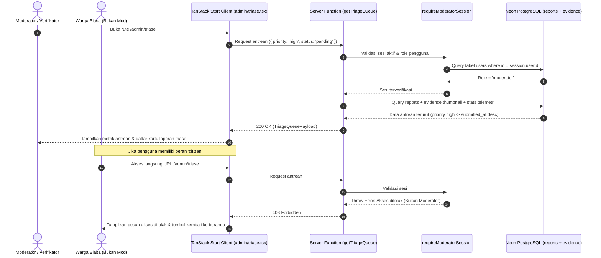
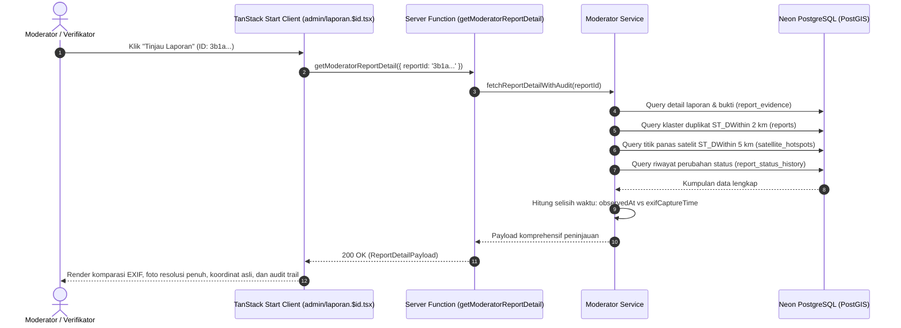
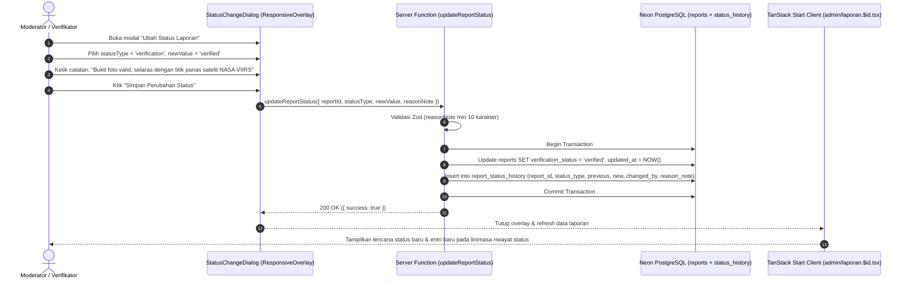

# Plan 09 — Moderator Command Center: Antrean Triase (/admin/triase) & Peninjauan Laporan/Verifikasi Bukti (/admin/laporan/$id)

## 1. Scope & Objectives

- **Target:** Mengimplementasikan secara komprehensif modul pusat kendali moderator (*Moderator Command Center*) yang mencakup antarmuka antrean triase berbasis urgensi (`/admin/triase`) dan halaman peninjauan bukti kejadian mendalam (`/admin/laporan/$id`) sesuai amanat **PRD Seksi 4.3 (Sitemap)**, **Seksi 5.3 (Lapisan 3: Verifikasi Kejadian Human-in-the-Loop)**, **Seksi 5.4 (Lapisan 4: Konfirmasi Penanganan)**, **Seksi 5.5 (Otorisasi RBAC Moderator)**, dan **Seksi 7 (FR-4)**:
  1. **Pengamanan Rute Berbasis RBAC (Role-Based Access Control):** Menegakkan otorisasi sesi moderator secara ketat (`requireModeratorSession`) pada rute `/admin/triase` dan `/admin/laporan/$id`. Pengguna dengan peran biasa (`citizen`) atau pengunjung anonim ditolak secara anggun dengan pesan edukatif atau diarahkan ke alur masuk Google OAuth (**Rule 21**).
  2. **Dasbor Antrean Triase Cerdas (`/admin/triase`):**
     - Kartu telemetri antrean: metrik laporan menunggu verifikasi (`pending`), perlu tinjauan (`needs_review`), prioritas tinggi (`high`), dan laporan masuk hari ini.
     - Bilah filter multi-kriteria: penyaringan berdasarkan tingkat urgensi (`priority`), status verifikasi (`verification_status`), jenis insiden (`incident_type`), serta pencarian teks waktu nyata (kode pelacakan, alamat, atau deskripsi).
     - Kartu antrean informatif: penampil miniatur foto bukti, lencana status multi-dimensi, indikator korelasi satelit NASA FIRMS (`Satelit Cocok`), indikator klaster duplikat spasial PostGIS (`Klaster Sekitar`), durasi waktu tunggu sejak dilaporkan, serta tautan aksi langsung *"Tinjau Laporan"*.
     - Kondisi kosong (*empty state*) manusiawi yang memvalidasi bahwa tidak ada antrean laporan tersisa.
  3. **Peninjauan Laporan & Verifikasi Bukti Mendalam (`/admin/laporan/$id`):**
     - **Penampil Bukti Media & Analisis Integritas:** Penampil foto bukti resolusi penuh berdampingan dengan komparasi waktu pengamatan warga (`observed_at`) vs waktu asli metadata kamera (`exif_capture_time`), kalkulasi selisih waktu, nilai hash SHA-256 berkas, dan ukuran file.
     - **Konteks Geospasial & Lapangan Tanpa Penyamaran:** Menampilkan koordinat GPS asli warga (presisi penuh tanpa jitter khusus bagi moderator yang bertugas mengarahkan instansi), alamat lengkap, tombol buka navigasi ke Google Maps (`_blank`), daftar laporan serupa dalam radius 2 km (klaster deduplikasi PostGIS), dan daftar anomali titik panas satelit NASA FIRMS dalam radius 5 km.
     - **Identitas Pelapor Terlindung:** Menampilkan nama, nomor telepon, dan email Google pelapor jika tidak memilih anonim; atau lencana perlindungan saksi jika pelapor memilih anonim.
     - **Linimasa Audit Trail Imutabel:** Riwayat kronologis setiap perubahan status dari tabel `report_status_history` yang menampilkan nama moderator peninjau, waktu pengubahan, dan catatan alasan wajib (**Rule 8**).
  4. **Dialog Pengubah Status Multi-Dimensi (`StatusChangeDialog`):**
     - Menggunakan komponen overlay adaptif `ResponsiveOverlay` (**Rule 12**: Drawer pada mobile `<768px`, Dialog pada desktop `≥768px`).
     - Memungkinkan moderator mengubah dimensi status secara independen: Status Verifikasi (`verification_status`), Status Penanganan (`handling_status`), atau Prioritas (`priority`) sesuai prinsip **System Honesty** (**Rule 9**).
     - Formulir mewajibkan pengisian **Catatan Alasan Verifikasi** (`reason_note`, minimal 10 karakter) sebelum aksi dapat disimpan.
     - Eksekusi pembaruan atomik ke basis data Neon PostgreSQL: memperbarui kolom status pada tabel `reports` dan secara otomatis menyisipkan entri ke tabel `report_status_history`.
  5. **Ketahanan Rute & Standar Kontainer Desktop:**
     - Kontainer terpadu `max-w-4xl` pada rute non-landing (**Rule 22**).
     - Kerangka pemuatan (*skeleton loading*) pada `pendingComponent` dan penanganan galat jaringan pada `errorComponent` (**Rule 19**).
     - Seluruh teks dan microcopy diaudit menggunakan `bahasa-inti` dan `bahasa-website`, bebas AI-slop, zero emoji (**Rule 14**), serta menggunakan ikon resmi Lucide React (`*Icon`).

- **Out of Scope:**
  - Pelacakan armada truk pemadam waktu nyata via GPS instansi (ranah internal Pusdalops Damkar).
  - Manajemen akun superadmin untuk mengubah peran pengguna secara massal (dilakukan melalui migrasi DB/CLI pengelola).
  - Integrasi webhook eksternal ke WhatsApp Dispatcher dinas (dialokasikan pada fase pasca-kompetisi).

- **Competition Alignment (WIA MIA 2026 — Subtema Public Service Tracking):**
  - **Fungsionalitas (25%):** Menuntaskan siklus pelacakan layanan publik dari pengaduan saksi warga hingga triase, verifikasi manusiawi (*Human-in-the-Loop*), dan pencatatan audit penanganan resmi tanpa mengorbankan integritas data.
  - **Desain & Interaksi (20%):** Antarmuka operasional taktis bertema kebencanaan dengan hierarki informasi yang tenang, penampil komparasi EXIF kamera yang presisi, dan dialog ubah status berbasis Base UI yang aksesibel.
  - **Kualitas Konten & Bahasa (20%):** Istilah operasional baku Indonesia (*Triase*, *Verifikasi Bukti*, *Penanganan Lapangan*, *Catatan Alasan*), bebas kalimat klise buatan mesin (*AI-slop*), dan zero emoji (**Rule 14**).
  - **Orisinalitas & Nilai Sosial (20%):** Memecahkan dilema verifikasi darurat dengan menyajikan bukti foto, metadata kamera, titik panas satelit NASA, dan klaster saksi mata dalam satu layar terintegrasi.
  - **Kesesuaian Tema (15%):** Membuktikan esensi *Public Service Tracking* yang sejati: transparansi publik berpadu dengan akuntabilitas internal aparatur verifikator.

---

## 2. PRD Reference & Dependencies

- **PRD Section:**
  - Seksi 4.1 & 4.2 (Persona Verifikator/Moderator & Alur Triase Cepat).
  - Seksi 4.3 (Hierarki Rute `/admin/triase` dan `/admin/laporan/$id`).
  - Seksi 5.3 (Lapisan 3: Verifikasi Kejadian Human-in-the-Loop).
  - Seksi 5.4 (Lapisan 4: Konfirmasi Penanganan Lapangan).
  - Seksi 5.5 (Autentikasi Hybrid, Google OAuth & Otorisasi RBAC Moderator).
  - Seksi 6.1 (Tabel `reports`, `report_evidence`, `report_status_history`, `users`, `satellite_hotspots`).
  - Seksi 7.1 (Kontrak Server Function `getTriageQueue`, `updateReportStatus`).
  - Seksi 8 (Standar Keamanan, Perlindungan PII, dan Kontainer Desktop `max-w-4xl`).
- **Preceding Plan Dependencies:**
  - [`02-google-oauth-better-auth.md`](02-google-oauth-better-auth.md) (Skema `users`, `sessions`, `accounts`, dan helper `requireModeratorSession`).
  - [`03-citizen-incident-reporting.md`](03-citizen-incident-reporting.md) (Tabel `reports`, `report_evidence`, PostGIS Point geom).
  - [`07-public-tracking-timeline.md`](07-public-tracking-timeline.md) (Tabel `report_status_history` dan enum multi-status).
  - [`08-public-map-and-satellite-hotspots.md`](08-public-map-and-satellite-hotspots.md) (Tabel `satellite_hotspots` dan integrasi data NASA FIRMS).
- **Target Route(s):**
  - `/admin/triase` ([`src/routes/admin/triase.tsx`](src/routes/admin/triase.tsx)) — Dasbor antrean triase laporan insiden moderator.
  - `/admin/laporan/$id` ([`src/routes/admin/laporan.$id.tsx`](src/routes/admin/laporan.$id.tsx)) — Halaman peninjauan bukti kejadian, audit EXIF/satelit/klaster, dan pengubah status.

---

## 3. Use Cases & Sequence Diagrams

### Use Case 1: Moderator Membuka Dasbor Triase dan Menyaring Antrean (/admin/triase)

Moderator login melalui Google OAuth, membuka `/admin/triase`. Sistem memvalidasi peran (`role === 'moderator' || role === 'superadmin'`) ke database Neon, lalu memuat daftar antrean terurut berdasarkan urgensi.



---

### Use Case 2: Moderator Meninjau Bukti Laporan & Analisis Lapangan (/admin/laporan/$id)

Moderator memilih salah satu kartu laporan untuk meninjau bukti foto, komparasi waktu kamera (EXIF), korelasi titik panas satelit NASA FIRMS, dan klaster saksi mata sekitar.



---

### Use Case 3: Moderator Mengubah Status Laporan dengan Catatan Alasan Wajib

Moderator membuka dialog pengubah status, memilih status baru (misal: `verified`), mengisi catatan alasan investigasi, dan menyimpan perubahan secara atomik.



---

## 4. Data Models, Schemas & Server Functions

### 4.1 Isomorphic Schemas (`src/lib/schema/moderator.ts`)

Perluasan skema isomorphic Zod untuk menangani kueri antrean triase, respons detail peninjauan, dan pembaruan status:

```typescript
import { z } from 'zod'
import {
  incidentTypeEnum,
  verificationStatusEnum,
  priorityEnum,
  handlingStatusEnum,
} from './reports'

/**
 * Filter kueri untuk antrean triase moderator.
 */
export const triageQueueQuerySchema = z.object({
  priority: z.enum(['all', 'high', 'normal', 'low']).default('all'),
  status: z
    .enum([
      'all',
      'pending',
      'needs_review',
      'verified',
      'insufficient_evidence',
      'rejected',
    ])
    .default('all'),
  incidentType: z
    .enum(['all', 'karhutla', 'permukiman', 'industri', 'lainnya'])
    .default('all'),
  search: z.string().optional().default(''),
  limit: z.number().int().min(1).max(100).default(50),
  offset: z.number().int().min(0).default(0),
})

export type TriageQueueQuery = z.infer<typeof triageQueueQuerySchema>

/**
 * Item antrean laporan triase untuk tampilan daftar kartu.
 */
export const moderatorQueueItemSchema = z.object({
  id: z.string().uuid(),
  trackingCode: z.string(),
  incidentType: incidentTypeEnum,
  description: z.string(),
  observedAt: z.string().datetime(),
  submittedAt: z.string().datetime(),
  addressDisplay: z.string().nullable(),
  verificationStatus: verificationStatusEnum,
  priority: priorityEnum,
  handlingStatus: handlingStatusEnum,
  isPotentialDuplicate: z.boolean(),
  clusterId: z.string().uuid().nullable(),
  satelliteHotspotMatched: z.boolean(),
  evidenceThumbnailUrl: z.string().nullable(),
  evidenceCount: z.number().int().min(0),
})

export type ModeratorQueueItem = z.infer<typeof moderatorQueueItemSchema>

/**
 * Statistik ringkasan telemetri antrean triase.
 */
export const triageStatsSchema = z.object({
  pendingCount: z.number().int().min(0),
  needsReviewCount: z.number().int().min(0),
  highPriorityCount: z.number().int().min(0),
  todayReportsCount: z.number().int().min(0),
})

export type TriageStats = z.infer<typeof triageStatsSchema>

/**
 * Payload respons lengkap antrean triase.
 */
export const triageQueueResponseSchema = z.object({
  items: z.array(moderatorQueueItemSchema),
  stats: triageStatsSchema,
  totalMatching: z.number().int().min(0),
})

export type TriageQueueResponse = z.infer<typeof triageQueueResponseSchema>

/**
 * Bukti foto dan metadata EXIF untuk peninjauan verifikator.
 */
export const moderatorEvidenceSchema = z.object({
  id: z.string().uuid(),
  mediaUrl: z.string().url(),
  r2ObjectKey: z.string(),
  fileHashSha256: z.string(),
  exifCaptureTime: z.string().datetime().nullable(),
  fileSizeBytes: z.number().int().positive(),
  mimeType: z.string(),
  createdAt: z.string().datetime(),
  // Analisis konsistensi waktu
  timeDiscrepancyMinutes: z.number().nullable(),
  isExifConsistent: z.boolean().nullable(),
})

export type ModeratorEvidence = z.infer<typeof moderatorEvidenceSchema>

/**
 * Laporan lain dalam klaster terdekat (radius 2 km).
 */
export const nearbyClusterReportSchema = z.object({
  id: z.string().uuid(),
  trackingCode: z.string(),
  incidentType: incidentTypeEnum,
  observedAt: z.string().datetime(),
  distanceMeters: z.number(),
  verificationStatus: verificationStatusEnum,
})

export type NearbyClusterReport = z.infer<typeof nearbyClusterReportSchema>

/**
 * Titik panas satelit NASA FIRMS terdekat (radius 5 km).
 */
export const nearbySatelliteHotspotSchema = z.object({
  id: z.string().uuid(),
  source: z.string(),
  distanceKm: z.number(),
  brightness: z.number().nullable(),
  confidence: z.string().nullable(),
  acquiredAt: z.string().datetime(),
})

export type NearbySatelliteHotspot = z.infer<typeof nearbySatelliteHotspotSchema>

/**
 * Riwayat perubahan status imutabel.
 */
export const reportAuditHistoryItemSchema = z.object({
  id: z.string().uuid(),
  statusType: z.string(),
  previousValue: z.string().nullable(),
  newValue: z.string(),
  changedBy: z.string(),
  reasonNote: z.string(),
  createdAt: z.string().datetime(),
})

export type ReportAuditHistoryItem = z.infer<typeof reportAuditHistoryItemSchema>

/**
 * Payload detail lengkap laporan untuk halaman /admin/laporan/$id.
 */
export const moderatorReportDetailSchema = z.object({
  id: z.string().uuid(),
  trackingCode: z.string(),
  incidentType: incidentTypeEnum,
  description: z.string(),
  observedAt: z.string().datetime(),
  submittedAt: z.string().datetime(),
  
  // Koordinat presisi asli (khusus moderator/aparatur, Rule 7)
  latitude: z.number(),
  longitude: z.number(),
  addressDisplay: z.string().nullable(),
  
  verificationStatus: verificationStatusEnum,
  priority: priorityEnum,
  handlingStatus: handlingStatusEnum,
  
  isPotentialDuplicate: z.boolean(),
  clusterId: z.string().uuid().nullable(),
  satelliteHotspotMatched: z.boolean(),
  
  // Data pelapor
  isAnonymous: z.boolean(),
  reporterName: z.string().nullable(),
  reporterPhone: z.string().nullable(),
  reporterEmail: z.string().nullable(),
  
  evidence: z.array(moderatorEvidenceSchema),
  nearbyClusterReports: z.array(nearbyClusterReportSchema),
  nearbySatelliteHotspots: z.array(nearbySatelliteHotspotSchema),
  statusHistory: z.array(reportAuditHistoryItemSchema),
})

export type ModeratorReportDetail = z.infer<typeof moderatorReportDetailSchema>

/**
 * Input mutasi perubahan status laporan oleh verifikator.
 */
export const updateReportStatusInputSchema = z.object({
  reportId: z.string().uuid('ID laporan tidak valid'),
  statusType: z.enum(['verification', 'handling', 'priority'], {
    message: 'Tipe status harus salah satu dari: verification, handling, atau priority',
  }),
  newValue: z.string().min(1, 'Nilai status baru wajib dipilih'),
  reasonNote: z
    .string()
    .trim()
    .min(10, 'Catatan alasan verifikasi minimal 10 karakter wajib diisi untuk integritas audit'),
})

export type UpdateReportStatusInput = z.infer<typeof updateReportStatusInputSchema>
```

---

### 4.2 Layanan Basis Data & Logika Bisnis (`src/server/services/moderator.ts`)

Layanan sisi server yang mengeksekusi kueri agregasi, kueri spasial PostGIS terdekat, dan pembaruan status atomik:

1. **`fetchTriageQueue(query: TriageQueueQuery)`:**
   - Menghitung statistik antrean: `pendingCount`, `needsReviewCount`, `highPriorityCount`, `todayReportsCount`.
   - Mengambil laporan dengan join ke `report_evidence` untuk mendapatkan URL foto utama.
   - Pengurutan terpadu: `CASE WHEN priority = 'high' THEN 1 WHEN priority = 'normal' THEN 2 ELSE 3 END ASC, submitted_at DESC`.
   - Menyaring berdasarkan pencarian teks: `ilike(tracking_code, %search%) OR ilike(description, %search%) OR ilike(address_display, %search%)`.

2. **`fetchModeratorReportDetail(reportId: string)`:**
   - Mengambil baris laporan utama dan informasi pelapor (termasuk join opsional ke tabel `users` untuk email/nama jika pelapor tidak anonim).
   - Mengambil seluruh berkas bukti dari `report_evidence`.
   - Menghitung selisih waktu antara `observed_at` dan `exif_capture_time`:
     - Toleransi normal: jika selisih $\le 120$ menit (2 jam), ditandai `isExifConsistent = true`.
     - Jika selisih $> 120$ menit atau tanggal kamera berbeda hari, ditandai `isExifConsistent = false` untuk menjadi peringatan bagi moderator.
   - Kueri spasial PostGIS mencari laporan serupa terdekat dalam radius 2.000 meter (`ST_DWithin`).
   - Kueri spasial PostGIS mencari titik panas satelit terdekat dalam radius 5.000 meter dari tabel `satellite_hotspots`.
   - Mengambil seluruh riwayat status dari `report_status_history` terurut dari yang terbaru.

3. **`executeReportStatusChange(actorName: string, input: UpdateReportStatusInput)`:**
   - Memvalidasi konsistensi nilai status terhadap enum:
     - Jika `statusType === 'verification'`, `newValue` harus berupa salah satu dari `verification_status_enum`.
     - Jika `statusType === 'handling'`, `newValue` harus berupa salah satu dari `handling_status_enum`.
     - Jika `statusType === 'priority'`, `newValue` harus berupa salah satu dari `priority_enum`.
   - Membaca nilai status saat ini (`previousValue`) dari tabel `reports`.
   - Menjalankan transaksi:
     - Update kolom pada `reports` sesuai `statusType` dan perbarui `updated_at`.
     - Insert ke `report_status_history` mencatat `changed_by = actorName`, `previous_value = previousValue`, `new_value = newValue`, dan `reason_note = reasonNote`.

---

### 4.3 Spesifikasi Server Functions (`src/server/functions/moderator.ts`)

```typescript
import { createServerFn } from '@tanstack/react-start'
import {
  triageQueueQuerySchema,
  updateReportStatusInputSchema,
} from '@/lib/schema/moderator'
import { requireModeratorSession } from './auth'
import {
  fetchTriageQueue,
  fetchModeratorReportDetail,
  executeReportStatusChange,
} from '@/server/services/moderator'
import { z } from 'zod'

/**
 * Server Function GET untuk mengambil daftar antrean triase dan telemetri.
 */
export const getTriageQueue = createServerFn({ method: 'GET' })
  .validator((input: unknown) => triageQueueQuerySchema.parse(input))
  .handler(async ({ data }) => {
    await requireModeratorSession()
    return fetchTriageQueue(data)
  })

/**
 * Server Function GET untuk mengambil detail lengkap laporan insiden bagi verifikator.
 */
export const getModeratorReportDetail = createServerFn({ method: 'GET' })
  .validator((input: unknown) =>
    z.object({ reportId: z.string().uuid() }).parse(input),
  )
  .handler(async ({ data }) => {
    await requireModeratorSession()
    return fetchModeratorReportDetail(data.reportId)
  })

/**
 * Server Function POST untuk memperbarui status verifikasi/penanganan/prioritas laporan.
 */
export const updateReportStatus = createServerFn({ method: 'POST' })
  .validator((input: unknown) => updateReportStatusInputSchema.parse(input))
  .handler(async ({ data }) => {
    const session = await requireModeratorSession()
    const actorName = session.user.name || session.user.email || 'Moderator Resmi'
    return executeReportStatusChange(actorName, data)
  })
```

---

## 5. UI/UX Design & Microcopy Specification (DESIGN.md & bahasa-skills)

- **Surface Mode:** Operate (Admin / Verifikator) — antarmuka taktis berorientasi tugas, mengutamakan kecepatan membaca informasi, ketelitian bukti, dan kejelasan status.
- **Standar Kontainer Geometry:** Mematuhi `mx-auto w-full max-w-4xl px-4 py-8 sm:px-6 lg:py-12` (**Rule 22**).
- **Universal Zero Emoji Policy & Strict Lucide Icons:** Menggunakan `*Icon` dari Lucide React secara eksklusif (**Rule 14**).

### 5.1 Shadcn Component Mapping & Verification (Rule 16)

| Elemen UI / Fitur | Komponen Shadcn Base UI (`docs/shadcn/components/base/`) | Status di `src/components/ui/` | Props & Varian yang Digunakan |
|---|---|---|---|
| Metrik Antrean Triase | `card.md` (`Card`, `CardHeader`, `CardTitle`, `CardContent`) | Tersedia (`card.tsx`) | Surface flat, border solid |
| Lencana Status Multi-Dimensi | `badge.md` (`Badge`) | Tersedia (`badge.tsx`) | Varian `default`, `secondary`, `destructive`, `outline` |
| Filter Prioritas & Status | `tabs.md` (`Tabs`, `TabsList`, `TabsTrigger`) | Tersedia (`tabs.tsx`) | Navigasi tab taktis |
| Input Pencarian Antrean | `input.tsx` & `input-group.tsx` | Tersedia | Ikon `SearchIcon` prefix |
| Dialog Ubah Status | `responsive-overlay.tsx` (Drawer / Dialog) | Tersedia (`responsive-overlay.tsx`) | Drawer `<768px`, Dialog `≥768px` (**Rule 12**) |
| Pilihan Dimensi & Nilai Status | `radio-group.md` (`RadioGroup`, `RadioGroupItem`) | Tersedia (`radio-group.tsx`) | Opsi radio berlabel jelas |
| Kolom Catatan Alasan | `textarea.md` (`Textarea`) & `field.md` (`Field`, `FieldLabel`) | Tersedia (`textarea.tsx`, `field.tsx`) | Textarea dengan validasi min 10 karakter |
| Tombol Aksi Verifikasi | `button.md` (`Button`) | Tersedia (`button.tsx`) | Varian `default`, `outline`, `ghost` |
| Avatar Pelapor & Moderator | `avatar.md` (`Avatar`, `AvatarImage`, `AvatarFallback`) | Tersedia (`avatar.tsx`) | Inisial atau foto profil akun Google |
| Garis Pemisah Bagian | `separator.md` (`Separator`) | Tersedia (`separator.tsx`) | Pemisah horizontal antar panel |
| Kerangka Pemuatan (*Skeleton*) | `skeleton.md` (`Skeleton`) | Tersedia (`skeleton.tsx`) | `pendingComponent` pada kedua rute (**Rule 19**) |
| Peringatan Akses Ditolak | `alert.md` (`Alert`, `AlertTitle`, `AlertDescription`) | Tersedia (`alert.tsx`) | Varian `destructive` |

---

### 5.2 Rincian Komponen Domain (`src/components/triage/`)

1. **`triage-stats-header.tsx`:**
   - 4 kartu ringkasan telemetri:
     - **Menunggu Verifikasi:** Jumlah laporan berstatus `pending` (Lencana oranye/amber).
     - **Perlu Tinjauan:** Jumlah laporan berstatus `needs_review` (Lencana kuning/muted).
     - **Prioritas Mendesak:** Jumlah laporan prioritas `high` (Lencana merah/destructive).
     - **Laporan Masuk Hari Ini:** Total laporan baru dalam 24 jam terakhir.
2. **`triage-filter-bar.tsx`:**
   - Bilah pencarian teks kode/alamat/deskripsi (debounced 300ms).
   - Tab penyaring prioritas: "Semua", "Mendesak", "Normal", "Rendah".
   - Filter status verifikasi ringkas melalui tombol lencana interaktif.
3. **`triage-queue-card.tsx`:**
   - Kartu antrean dengan foto thumbnail berasio 1:1 di sisi kiri (atau atas pada layar ponsel).
   - Teks kode pelacakan tebal (`text-sm font-semibold text-foreground`), jenis insiden, alamat ringkas, dan waktu tunggu (contoh: *"Dilaporkan 14 menit yang lalu"*).
   - Baris lencana penanda khusus:
     - Lencana `Satelit Cocok` (ikon `SatelliteIcon`) jika korelasi titik panas terkonfirmasi.
     - Lencana `Klaster Sekitar` (ikon `LayersIcon`) jika terdeteksi duplikat spasial $\le 2$ km.
   - Tombol aksi primer *"Tinjau Laporan"* dengan ikon `ArrowRightIcon` menuju `/admin/laporan/$id`.
4. **`triage-empty-state.tsx`:**
   - Ilustrasi taktis dan pesan manusiawi sesuai `bahasa-website`:
     - Judul: *"Tidak Ada Laporan yang Perlu Ditinjau"*
     - Deskripsi: *"Seluruh laporan warga pada filter ini telah selesai diverifikasi atau belum ada laporan baru yang masuk."*
     - Tombol aksi: *"Reset Filter Pencarian"*
5. **`incident-evidence-viewer.tsx`:**
   - Penampil foto resolusi tinggi dengan kemampuan buka ukuran penuh.
   - Kartu komparasi waktu kamera:
     - Baris 1: Waktu pengamatan yang diklaim warga (`observed_at`).
     - Baris 2: Waktu asli dari EXIF kamera (`exif_capture_time`).
     - Indikator selisih waktu: *"Selisih 8 menit (Waktu kamera selaras)"* atau *"Selisih 2 hari (Peringatan: Anomali waktu kamera terdeteksi)"*.
   - Informasi integritas teknis: SHA-256 hash dan ukuran berkas.
6. **`incident-context-cards.tsx`:**
   - **Kartu Koordinat & Peta:** Koordinat presisi asli (Lat, Lon), alamat, tombol *"Buka di Google Maps"* (`_blank`), dan cuplikan lokasi.
   - **Kartu Klaster Saksi Mata Warga:** Daftar laporan lain dalam radius 2 km dengan tautan cepat ke peninjauan laporan terkait.
   - **Kartu Titik Panas NASA FIRMS:** Jarak titik panas terdekat, sensor (VIIRS 375m/MODIS), tingkat kecerahan (*brightness* Kelvin), dan tingkat kepercayaan (*confidence*).
7. **`incident-reporter-card.tsx`:**
   - Menampilkan status anonimitas pelapor. Jika tidak anonim: Nama, Nomor Telepon (dengan tautan panggil/WhatsApp petugas), dan Email terverifikasi Google. Jika anonim: *"Pelapor memilih merahasiakan identitas (Anonim)"*.
8. **`incident-audit-timeline.tsx`:**
   - Linimasa kronologis seluruh riwayat perubahan status dari `report_status_history`.
   - Menampilkan nama verifikator/moderator, waktu perubahan, dimensi yang diubah, serta kutipan catatan alasan wajib (`reason_note`).
9. **`status-change-dialog.tsx`:**
   - Menggunakan `ResponsiveOverlay` (Drawer pada ponsel, Dialog pada desktop).
   - Pilihan dimensi status:
     - `Verifikasi Kejadian`: `pending`, `needs_review`, `verified`, `insufficient_evidence`, `rejected`.
     - `Penanganan Lapangan`: `not_forwarded`, `forwarded`, `acknowledged`, `in_progress`, `resolved`, `unknown`.
     - `Tingkat Prioritas`: `high`, `normal`, `low`.
   - Textarea wajib: *"Catatan Alasan Verifikasi"* dengan placeholder *"Contoh: Foto konsisten dengan titik panas NASA FIRMS pada radius 1.2 km, telah diteruskan ke BPBD setempat."*
   - Tombol *"Simpan Perubahan"* (dengan spinner saat memproses) dan tombol *"Batal"*.

---

### 5.3 Glosarium & Microcopy Terverifikasi (bahasa-inti & bahasa-website)

| Konteks | Microcopy Terverifikasi | Catatan Panduan Bahasa |
|---|---|---|
| Judul Halaman Dasbor | **Dasbor Triase Moderator** | Jelas, resmi, tanpa jargon berlebihan |
| Subjudul Dasbor | **Pusat kendali evaluasi bukti kejadian dan penentuan prioritas penanganan kebakaran.** | Ringkas dan berorientasi tugas |
| Judul Halaman Review | **Peninjauan Bukti & Verifikasi Insiden** | Fokus pada verifikasi bukti kejadian |
| Tombol Aksi Triase | **Tinjau Laporan** | Verba aksi eksplisit |
| Tombol Pengubah Status | **Ubah Status Laporan** | Menggunakan istilah baku *Ubah*, bukan *Edit* |
| Tombol Simpan Modal | **Simpan Perubahan** | Menyebut hasil aksi (maks 2 kata) |
| Label Catatan Alasan | **Catatan Alasan Verifikasi** | Wajib diisi, minimum 10 karakter |
| Placeholder Alasan | **Tuliskan pertimbangan teknis atau temuan lapangan yang mendasari perubahan status ini...** | Memandu moderator menulis secara objektif |
| Lencana Satelit Cocok | **Satelit Cocok** | Singkat, padat, tanpa emoji |
| Lencana Klaster Sekitar | **Klaster Sekitar** | Mengindikasikan keberadaan saksi mata lain |
| Peringatan Akses | **Hak Akses Khusus Moderator** | Pesan edukatif jika diakses warga biasa |
| Deskripsi Akses Ditolak | **Halaman ini hanya dapat diakses oleh verifikator resmi atau administrator sistem.** | Tidak menyalahkan pengguna |
| Tombol Pulang | **Kembali ke Beranda** | Memberikan jalan keluar yang jelas |

---

## 6. Implementation File List

### New Files
- `src/server/services/moderator.ts` — Layanan basis data: `fetchTriageQueue`, `fetchModeratorReportDetail`, dan `executeReportStatusChange`.
- `src/server/functions/moderator.ts` — Server functions: `getTriageQueue`, `getModeratorReportDetail`, dan `updateReportStatus`.
- `src/components/triage/triage-stats-header.tsx` — Kartu metrik telemetri antrean triase.
- `src/components/triage/triage-filter-bar.tsx` — Bilah filter prioritas, status, dan input pencarian.
- `src/components/triage/triage-queue-card.tsx` — Kartu item antrean laporan insiden.
- `src/components/triage/triage-empty-state.tsx` — Tampilan ramah ketika antrean kosong.
- `src/components/triage/incident-evidence-viewer.tsx` — Penampil foto bukti besar dan komparasi EXIF kamera.
- `src/components/triage/incident-context-cards.tsx` — Kartu geospasial asli, satelit NASA FIRMS, dan klaster saksi mata.
- `src/components/triage/incident-reporter-card.tsx` — Kartu identitas pelapor (anonim vs terverifikasi).
- `src/components/triage/incident-audit-timeline.tsx` — Linimasa riwayat status dan catatan alasan audit.
- `src/components/triage/status-change-dialog.tsx` — Dialog pengubah status via `ResponsiveOverlay`.
- `src/routes/admin/laporan.$id.tsx` — Rute peninjauan laporan mendalam dengan SSR loader dan status changer.
- `tests/moderator.test.ts` — Pengujian unit dan integrasi untuk skema moderator, logika selisih EXIF, kueri antrean, dan mutasi status atomik.

### Modified Files
- `src/lib/schema/moderator.ts` — Menambahkan skema isomorphic Zod: `triageQueueQuerySchema`, `moderatorQueueItemSchema`, `triageStatsSchema`, `moderatorReportDetailSchema`, dan `updateReportStatusInputSchema`.
- `src/lib/schema/index.ts` — Mengekspor kembali seluruh skema moderator baru.
- `src/routes/admin/triase.tsx` — Mengganti placeholder sementara dengan implementasi penuh dasbor triase: SSR loader dengan `getTriageQueue`, penjaga `requireModeratorSession`, skeleton pemuatan, dan batas galat.

---

## 7. Testing & Quality Gates (TDD with Bun)

Pengujian komprehensif di `tests/moderator.test.ts` menggunakan test runner bawaan Bun:

### 7.1 Cakupan Pengujian
1. **Validasi Skema Isomorphic Zod:**
   - Menguji bahwa `triageQueueQuerySchema` mengisi nilai default (`priority = 'all'`, `status = 'all'`).
   - Menguji bahwa `updateReportStatusInputSchema` menolak payload jika `reasonNote` kurang dari 10 karakter.
   - Menguji bahwa `updateReportStatusInputSchema` menolak `statusType` selain `verification`, `handling`, atau `priority`.
2. **Logika Komparasi EXIF Kamera vs Waktu Pengamatan:**
   - Menguji kalkulasi selisih waktu (`timeDiscrepancyMinutes`).
   - Memverifikasi bahwa selisih $\le 120$ menit menghasilkan `isExifConsistent = true`.
   - Memverifikasi bahwa selisih $> 120$ menit menghasilkan `isExifConsistent = false`.
   - Menangani kasus ketika foto tidak memiliki metadata EXIF (`exifCaptureTime === null`).
3. **Kueri Antrean Triase & Pengurutan Prioritas:**
   - Memverifikasi laporan berprioritas `high` selalu berada di urutan teratas sebelum `normal` dan `low`.
   - Memverifikasi filter pencarian berdasarkan kode lacak, deskripsi, dan alamat.
4. **Pembaruan Status Atomik & Riwayat Audit:**
   - Memverifikasi pembaruan kolom `verification_status` pada tabel `reports`.
   - Memverifikasi penyisipan otomatis baris riwayat ke `report_status_history` lengkap dengan `changed_by`, `previous_value`, `new_value`, dan `reason_note`.
   - Memverifikasi bahwa pembaruan gagal jika `newValue` tidak sesuai dengan enum dimensi yang dipilih.
5. **Penegakan RBAC Moderator:**
   - Memverifikasi bahwa peran `citizen` memicu galat otorisasi (403 Forbidden).
   - Memverifikasi bahwa peran `moderator` dan `superadmin` diberikan izin akses penuh.

### 7.2 Quality Gates Wajib
Sebelum merge ke `main`, seluruh gerbang kualitas berikut wajib lolos 100%:
1. `bun test` — 100% lulus pada seluruh berkas uji (termasuk `tests/moderator.test.ts`).
2. `bun run typecheck` — Bebas kesalahan tipe TypeScript (`tsc --noEmit`).
3. `bun run lint` & `bun run lint:design` — ESLint dan `@shadcn/lint` bebas dari pelanggaran (*zero restyle*, zero kelas ilegal).
4. `bun run build` — Build produksi TanStack Start dan Cloudflare bundle tuntas tanpa galat.
