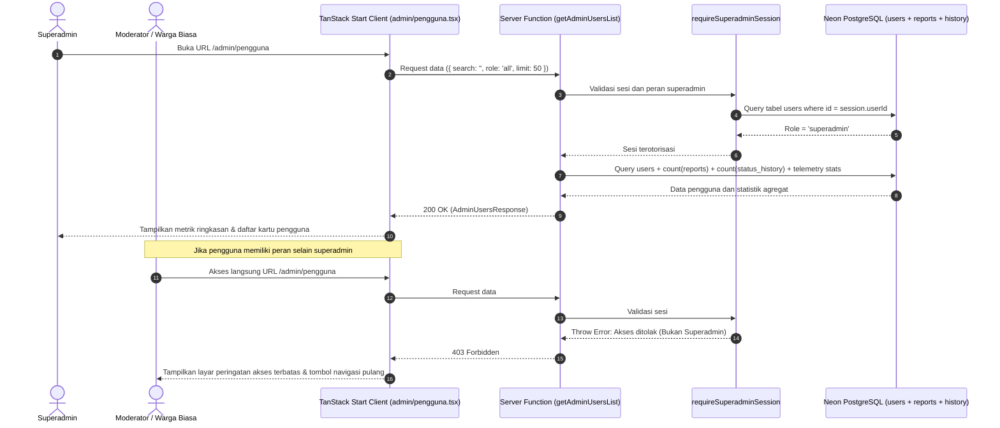
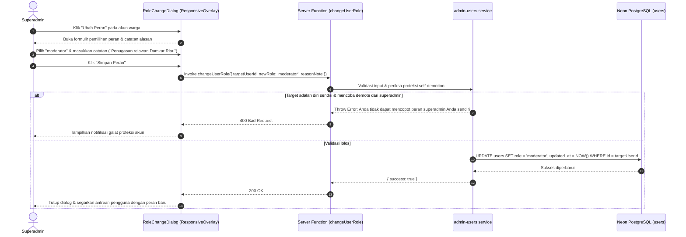

# Plan 10 — Panel Manajemen Pengguna & Otorisasi Peran Superadmin (/admin/pengguna)

## 1. Scope & Objectives

- **Target:** Mengimplementasikan secara komprehensif modul tata kelola pengguna dan otorisasi hak akses (*Superadmin User & Role Management*) pada rute `/admin/pengguna` sesuai mandat **PRD v1.1 Seksi 4.3 (Sitemap)**, **Seksi 5.5 (Autentikasi Hybrid, Google OAuth & Otorisasi RBAC)**, dan **Plan 09 Seksi 1 (Scope & Objectives)**:
  1. **Pengamanan Rute Khusus Superadmin (Strict RBAC Guard):**
     - Menegakkan otorisasi sesi superadmin secara ketat melalui fungsi server `requireSuperadminSession` (`role === 'superadmin'` yang divalidasi langsung ke basis data Neon PostgreSQL).
     - Menolak akses bagi pengunjung anonim atau pengguna dengan peran `citizen` dan `moderator` dengan tampilan pembatas hak akses yang manusiawi (*403 Forbidden Screen*) dan tombol navigasi kembali ke Beranda atau Dasbor Triase.
  2. **Telemetri Pengguna Terdaftar (`UserStatsHeader`):**
     - Menyajikan metrik agregat waktu nyata: Total Akun Terdaftar, Total Warga (`citizen`), Total Petugas Moderator (`moderator`), dan Total Administrator Utama (`superadmin`).
  3. **Bilah Filter & Pencarian Pengguna Waktu Nyata (`UserFilterBar`):**
     - Pencarian teks waktu nyata (debounced 300ms) berdasarkan nama akun, alamat surel Google, atau ID pengguna menggunakan komponen `InputGroup`.
     - Filter cepat berbasis tab/lencana peran: *Semua*, *Warga*, *Moderator*, dan *Superadmin*.
     - Tombol reset pencarian untuk mengembalikan antrean ke kondisi default.
  4. **Daftar Akun Pengguna & Kartu Kontribusi (`UserCardItem`):**
     - Menampilkan identitas akun: foto profil Google/avatar kustom, nama tampilan, dan surel Google terverifikasi.
     - Lencana status peran visual:
       - `superadmin`: Varian *Safety Ember* (`bg-destructive/10 text-destructive border-destructive/20`).
       - `moderator`: Varian *Pine Green* (`bg-[var(--color-pine)]/10 text-[var(--color-pine)] border-[var(--color-pine)]/20`).
       - `citizen`: Varian *Neutral Muted* (`bg-muted text-muted-foreground`).
     - Metrik partisipasi pengguna:
       - Jumlah laporan insiden yang pernah diajukan warga (relasi `reports.reporter_user_id`).
       - Jumlah tindakan verifikasi yang pernah dilakukan jika pengguna bertindak sebagai moderator (relasi `report_status_history.changed_by`).
     - Waktu pendaftaran akun (format tanggal relatif Indonesia).
     - Tombol aksi taktis: *"Ubah Peran"*.
  5. **Dialog Pengubahan Peran Adaptif (`RoleChangeDialog`):**
     - Menggunakan komponen overlay adaptif `ResponsiveOverlay` (**Rule 12**: Drawer pada ponsel `<768px`, Dialog pada layar desktop `≥768px`).
     - Pemilihan peran baru secara eksplisit melalui komponen `RadioGroup`: `citizen`, `moderator`, atau `superadmin`.
     - Masukan wajib: **Catatan Alasan Pengubahan Peran** (`reason_note`, minimal 10 karakter) untuk menjaga transparansi tata kelola.
     - **Proteksi Penguncian Mandiri (*Self-Demotion Lockout Protection*):** Sistem mencegah superadmin menurunkan peran akunnya sendiri jika dia adalah satu-satunya superadmin aktif di sistem atau saat mengedit akun miliknya sendiri, untuk menghindari ketiadaan administrator pengelola.
  6. **Integrasi Navigasi Sistem:**
     - Memperbarui menu tarik-turun profil di `HeaderNav` (`src/components/shared/header-nav.tsx`) untuk menampilkan tautan pintas *"Kelola Pengguna"* secara kondisional khusus bagi akun dengan peran `superadmin`.
     - Menambahkan tautan tab navigasi internal di header Dasbor Triase (`/admin/triase`) untuk berpindah mulus antara *Dasbor Triase* dan *Kelola Pengguna*.
  7. **Standar Kontainer & Ketahanan Rute:**
     - Kontainer terpadu `max-w-4xl` pada rute non-landing (**Rule 22**).
     - Kerangka pemuatan (*skeleton loading*) pada `pendingComponent` dan penanganan galat jaringan pada `errorComponent` (**Rule 19**).
     - Seluruh teks dan salinan antarmuka mematuhi `bahasa-inti` dan `bahasa-website`, bebas kalimat klise mesin (*AI-slop*), dan zero emoji (**Rule 14**).

- **Out of Scope:**
  - Penambahan form login manual dengan surel/kata sandi (tetap mematuhi prinsip 1-Click Google OAuth **Rule 21**).
  - Penghapusan akun pengguna secara permanen (menjaga integritas riwayat relasi laporan dan log audit).

- **Competition Alignment (WIA MIA 2026 — Subtema Public Service Tracking):**
  - **Fungsionalitas (25%):** Melengkapi arsitektur RBAC enterprise dengan antarmuka tata kelola peran yang operasional, aman, dan dapat diaudit secara penuh.
  - **Desain & Interaksi (20%):** Hierarki kartu pengguna berbasis Base UI yang bersih, lencana peran semantik bertema kebencanaan, dan modal konfirmasi peran yang adaptif.
  - **Kualitas Konten & Bahasa (20%):** Glosarium tata kelola baku Indonesia (*Superadmin*, *Moderator*, *Warga*, *Catatan Alasan Mutasi Peran*), konsisten tanpa emoji (**Rule 14**).
  - **Orisinalitas & Tata Kelola Publik (20%):** Membuktikan bahwa platform penanganan bencana memiliki sistem otorisasi berjenjang yang transparan untuk mencegah penyalahgunaan wewenang verifikasi laporan.
  - **Kesesuaian Tema (15%):** Memperkuat pilar akuntabilitas aparatur publik dalam pelacakan layanan kedaruratan.

---

## 2. PRD Reference & Dependencies

- **PRD Section:**
  - Seksi 4.3 (Hierarki Rute Halaman & Sitemap).
  - Seksi 5.5 (Autentikasi Hybrid, Google OAuth & Otorisasi RBAC: `citizen`, `moderator`, `superadmin`).
  - Seksi 6.1 (Tabel `users`, `sessions`, `reports`, `report_status_history`).
  - Seksi 8 (Standar Keamanan, Proteksi Header, dan Kontainer Desktop `max-w-4xl`).
- **Preceding Plan Dependencies:**
  - [`02-google-oauth-better-auth.md`](02-google-oauth-better-auth.md) (Skema `users`, sesi Better Auth, dan helper autentikasi server).
  - [`09-moderator-triage-and-incident-review.md`](09-moderator-triage-and-incident-review.md) (Dasbor triase dan alur verifikasi moderator).
- **Target Route(s):**
  - `/admin/pengguna` ([`src/routes/admin/pengguna.tsx`](src/routes/admin/pengguna.tsx)) — Panel manajemen pengguna dan otorisasi peran superadmin.

---

## 3. Use Cases & Sequence Diagrams

### Use Case 1: Superadmin Membuka Panel Manajemen Pengguna (/admin/pengguna)

Superadmin masuk dengan akun Google terverifikasi, membuka `/admin/pengguna`. Sistem memvalidasi peran (`role === 'superadmin'`) ke Neon PostgreSQL, menghitung statistik agregat peran, dan memuat daftar pengguna beserta kontribusinya.



---

### Use Case 2: Superadmin Mengubah Peran Pengguna (Promote / Demote)

Superadmin memilih pengguna, membuka `RoleChangeDialog`, memilih peran baru (`moderator`), mengisi catatan alasan, dan menyimpan perubahan.



---

## 4. Data Models, Schemas & Server Functions

### 4.1 Zod Schemas (`src/lib/schema/admin-users.ts`)

Mendefinisikan skema validasi tipe data pengguna dan parameter aksi administratif.

```typescript
import { z } from 'zod'

export const userRoleEnum = z.enum(['citizen', 'moderator', 'superadmin'])
export type UserRole = z.infer<typeof userRoleEnum>

export const adminUsersQuerySchema = z.object({
  search: z.string().default(''),
  role: z.enum(['all', 'citizen', 'moderator', 'superadmin']).default('all'),
  limit: z.number().int().min(1).max(100).default(50),
  offset: z.number().int().min(0).default(0),
})
export type AdminUsersQuery = z.infer<typeof adminUsersQuerySchema>

export const adminUserItemSchema = z.object({
  id: z.string(),
  name: z.string(),
  email: z.string().email(),
  image: z.string().nullable(),
  role: userRoleEnum,
  createdAt: z.date(),
  reportsCount: z.number().int().nonnegative(),
  moderationActionsCount: z.number().int().nonnegative(),
})
export type AdminUserItem = z.infer<typeof adminUserItemSchema>

export const userRoleStatsSchema = z.object({
  totalUsers: z.number().int().nonnegative(),
  citizenCount: z.number().int().nonnegative(),
  moderatorCount: z.number().int().nonnegative(),
  superadminCount: z.number().int().nonnegative(),
})
export type UserRoleStats = z.infer<typeof userRoleStatsSchema>

export const adminUsersResponseSchema = z.object({
  users: z.array(adminUserItemSchema),
  totalCount: z.number().int().nonnegative(),
  stats: userRoleStatsSchema,
})
export type AdminUsersResponse = z.infer<typeof adminUsersResponseSchema>

export const updateUserRoleInputSchema = z.object({
  targetUserId: z.string().min(1, 'ID pengguna target wajib disertakan.'),
  newRole: userRoleEnum,
  reasonNote: z
    .string()
    .trim()
    .min(10, 'Catatan alasan mutasi peran minimal 10 karakter.')
    .max(500, 'Catatan alasan maksimal 500 karakter.'),
})
export type UpdateUserRoleInput = z.infer<typeof updateUserRoleInputSchema>
```

Re-ekspor seluruh skema di [`src/lib/schema/index.ts`](src/lib/schema/index.ts).

---

### 4.2 Database Access & Service Layer (`src/server/services/admin-users.ts`)

Menyediakan fungsi atomik kueri agregasi dan pembaruan peran dengan proteksi penguncian akun:

1. `fetchAdminUsersList(query: AdminUsersQuery)`:
   - Menghitung agregat total peran (`totalUsers`, `citizenCount`, `moderatorCount`, `superadminCount`).
   - Menyaring pengguna berdasarkan teks pencarian (`ilike` pada `name` dan `email`) serta filter peran (`role`).
   - Menggabungkan perhitungan sub-kueri jumlah laporan yang diajukan (`reports.reporter_user_id`) dan jumlah tindakan moderasi (`report_status_history.changed_by`).
   - Mengembalikan daftar terurut (`created_at desc`).

2. `executeUserRoleChange(currentSuperadminId: string, input: UpdateUserRoleInput)`:
   - Memeriksa apakah target pengguna ada di tabel `users`.
   - **Self-Demotion Lockout Guard:** Jika `targetUserId === currentSuperadminId` dan `newRole !== 'superadmin'`, lemparkan galat: *"Anda tidak dapat mencopot peran superadmin Anda sendiri demi keamanan sistem."*
   - Menjalankan `UPDATE users SET role = input.newRole, updated_at = NOW() WHERE id = input.targetUserId`.
   - Mengembalikan konfirmasi keberhasilan.

---

### 4.3 Server Functions (`src/server/functions/admin-users.ts`)

Mengekspos endpoint aman TanStack Start dengan penjaga otorisasi `requireSuperadminSession`:

1. `getAdminUsersList`:
   - Metode: `GET`
   - Validator: `adminUsersQuerySchema`
   - Guard: `requireSuperadminSession`
   - Handler: Memanggil `fetchAdminUsersList(data)`.

2. `changeUserRole`:
   - Metode: `POST`
   - Validator: `updateUserRoleInputSchema`
   - Guard: `requireSuperadminSession`
   - Handler: Memanggil `executeUserRoleChange(session.user.id, data)`.

Penjaga sesi superadmin ditambahkan pada [`src/server/functions/auth.ts`](src/server/functions/auth.ts):
```typescript
export const requireSuperadminSession = createServerFn({
  method: 'GET',
}).handler(async () => {
  const request = getRequest()
  const session = await auth.api.getSession({
    headers: request.headers,
  })

  if (!session) {
    throw new Error('Autentikasi diperlukan.')
  }

  const role = await verifyUserRole(session.user.id)

  if (role !== 'superadmin') {
    throw new Error('Akses ditolak: Anda tidak memiliki hak akses administrator utama.')
  }

  return session
})
```

---

## 5. UI/UX Design & Microcopy Specification (DESIGN.md & bahasa-skills)

- **Surface Mode:** *Operate* (Dasbor Administrasi & Keamanan).
- **Geometry:** `mx-auto w-full max-w-4xl px-4 py-8 sm:px-6 lg:py-12` (**Rule 22**).

### 5.1 Shadcn Component Mapping & Verification (Rule 16)

> *Audit terhadap `docs/shadcn/components/base/` dan `src/components/ui/` untuk mencegah halusinasi.*

| Elemen UI / Komponen | Shadcn Base UI Reference | Status di `src/components/ui/` | Varian / Properti / Perilaku |
|---|---|---|---|
| Metrik Telemetri | `card.md` (`Card`, `CardContent`) | Tersedia (`card.tsx`) | Surface flat, border `border-border/60`, no gradients |
| Lencana Peran Akun | `badge.md` (`Badge`) | Tersedia (`badge.tsx`) | Varian semantik: `destructive` (Superadmin), `success` (Moderator), `secondary` (Warga) |
| Kotak Pencarian Pengguna | `input-group.md` (`InputGroup`) | Tersedia (`input-group.tsx`) | Komposisi `InputGroup`, `InputGroupAddon` (SearchIcon), `InputGroupInput` |
| Filter Kategori Peran | `tabs.md` (`Tabs`, `TabsList`, `TabsTrigger`) | Tersedia (`tabs.tsx`) | Varian horizontal baris tunggal, responsif scroll |
| Avatar Pengguna | `avatar.md` (`Avatar`, `AvatarImage`, `AvatarFallback`) | Tersedia (`avatar.tsx`) | Menampilkan foto profil Google atau inisial nama |
| Tombol Aksi Mutasi | `button.md` (`Button`) | Tersedia (`button.tsx`) | Varian `outline`, ukuran `sm`, ikon `UserCogIcon` |
| Dialog Konfirmasi Mutasi | `drawer.md` / `dialog.md` (`ResponsiveOverlay`) | Tersedia (`responsive-overlay.tsx`) | Drawer pada `<768px`, Dialog pada `≥768px` |
| Pilihan Peran Baru | `radio-group.md` (`RadioGroup`, `RadioGroupItem`) | Tersedia (`radio-group.tsx`) | Radio button vertikal dengan label deskripsi peran |
| Masukan Catatan Alasan | `textarea.md` (`Textarea`) | Tersedia (`textarea.tsx`) | Tinggi 3 baris, placeholder formal, min length 10 |
| Pemuatan Berkas | `skeleton.md` (`Skeleton`) | Tersedia (`skeleton.tsx`) | Bentuk card skeleton untuk daftar antrean |
| Kotak Peringatan Otorisasi | `alert.md` (`Alert`, `AlertTitle`, `AlertDescription`) | Tersedia (`alert.tsx`) | Varian `destructive` saat akses ditolak |

---

### 5.2 Komposisi Komponen Antarmuka (`src/components/admin/users/`)

1. **`user-stats-header.tsx`**:
   - 4 kartu telemetri:
     - Total Akun: Ikon `UsersIcon`, angka tebal.
     - Warga: Ikon `UserCheckIcon`, lencana abu-abu.
     - Moderator: Ikon `ShieldCheckIcon`, aksen Pine Green (`text-[var(--color-pine)]`).
     - Superadmin: Ikon `ShieldAlertIcon`, aksen Safety Ember (`text-destructive`).
2. **`user-filter-bar.tsx`**:
   - Pencarian `InputGroup` dengan placeholder: *"Cari nama, surel Google, atau ID pengguna..."*.
   - Filter tab peran: *"Semua"*, *"Warga"*, *"Moderator"*, *"Superadmin"*.
   - Tombol *"Reset"* (Ikon `RotateCcwIcon`).
3. **`user-card-item.tsx`**:
   - Kartu pengguna berbingkai bersih:
     - Avatar di sisi kiri dengan indikator peran.
     - Kolom tengah: Nama pengguna, alamat surel, tanggal terdaftar, serta 2 pill statistik (Laporan Dibuat & Tindakan Verifikasi).
     - Kolom kanan: Tombol *"Ubah Peran"* dengan ikon `UserCogIcon`.
4. **`user-empty-state.tsx`**:
   - Ilustrasi pencarian kosong dengan teks tenang: *"Tidak Ada Pengguna Ditemukan"*.
   - Keterangan: *"Tidak ada akun pengguna yang sesuai dengan kriteria filter saat ini. Coba periksa kembali ejaan nama atau ubah filter peran."*
5. **`role-change-dialog.tsx`**:
   - Membuka modal konfirmasi dengan detail nama dan surel pengguna yang sedang diubah.
   - Pilihan radio:
     - **Warga (`citizen`):** Akses dasar pelaporan insiden dan pemantauan publik.
     - **Moderator (`moderator`):** Hak evaluasi bukti kejadian, triase antrean, dan pengubah status penanganan.
     - **Superadmin (`superadmin`):** Otoritas penuh sistem termasuk mutasi peran dan audit keamanan.
   - Kolom catatan alasan penugasan / pencopotan peran (wajib min 10 karakter).
   - Tombol *"Batalkan"* dan *"Simpan Perubahan Peran"*.

---

### 5.3 Standar Bahasa & Microcopy (`bahasa-skills` Verified)

- **Judul Halaman:** *Manajemen Pengguna & Otorisasi*
- **Deskripsi Sub-header:** *Pusat kendali penetapan hak akses operasional moderator dan peninjauan akun warga terdaftar.*
- **Lencana Peran:**
  - `superadmin`: *Administrator Utama*
  - `moderator`: *Petugas Verifikator*
  - `citizen`: *Warga Pelapor*
- **Notifikasi Validasi:**
  - *"Catatan alasan mutasi peran minimal 10 karakter."*
  - *"Anda tidak dapat mencopot peran administrator utama pada akun Anda sendiri."*
  - *"Peran akun berhasil diperbarui."*
- **Layar Akses Ditolak (403):**
  - Judul: *Hak Akses Khusus Administrator Utama*
  - Penjelasan: *Halaman ini memiliki tingkat kerahasiaan tinggi dan hanya dapat diakses oleh administrator utama sistem SiagaWarga. Silakan kembali ke dasbor operasional atau beranda.*

---

## 6. Implementation File List

### 6.1 Berkas Baru (*New Files*)

1. **`src/lib/schema/admin-users.ts`** — Skema Zod tipe kueri pengguna, respons antrean, dan input mutasi peran.
2. **`src/server/services/admin-users.ts`** — Logika bisnis kueri data pengguna, agregasi laporan/moderasi, dan eksekusi pembaruan peran basis data.
3. **`src/server/functions/admin-users.ts`** — Server Functions TanStack Start (`getAdminUsersList`, `changeUserRole`).
4. **`src/components/admin/users/user-stats-header.tsx`** — Kartu metrik ringkasan peran akun.
5. **`src/components/admin/users/user-filter-bar.tsx`** — Bilah pencarian teks dan filter peran berbasis tab.
6. **`src/components/admin/users/user-card-item.tsx`** — Kartu entri pengguna dan tombol aksi mutasi.
7. **`src/components/admin/users/user-empty-state.tsx`** — Kondisi kosong pencarian pengguna.
8. **`src/components/admin/users/role-change-dialog.tsx`** — Dialog modal / drawer adaptif pengubah peran pengguna.
9. **`src/routes/admin/pengguna.tsx`** — Rute TanStack Router `/admin/pengguna` dengan SSR loader, skeleton, dan error boundary.
10. **`tests/admin-users.test.ts`** — Uji coba otomatis unit & integrasi alur manajemen pengguna dan pencegahan self-demotion lockout.

### 6.2 Berkas yang Dimodifikasi (*Modified Files*)

1. **`src/lib/schema/index.ts`** — Re-ekspor seluruh skema dari `src/lib/schema/admin-users.ts`.
2. **`src/server/functions/auth.ts`** — Menambahkan guard server `requireSuperadminSession`.
3. **`src/components/shared/header-nav.tsx`** — Menambahkan opsi navigasi dropdown *"Kelola Pengguna"* khusus bagi akun dengan peran `superadmin`.
4. **`src/routes/admin/triase.tsx`** — Menambahkan tab navigasi di bagian atas header untuk berpindah antara *Dasbor Triase* dan *Kelola Pengguna*.

---

## 7. Testing & Quality Gates (TDD with Bun)

Pengujian komprehensif di [`tests/admin-users.test.ts`](tests/admin-users.test.ts) menggunakan Bun test runner:

1. **Validasi Skema Zod:**
   - Kueri pencarian valid (`search`, `role`, `limit`, `offset`).
   - Penolakan mutasi peran dengan catatan alasan di bawah 10 karakter.
   - Penolakan nilai peran di luar enum (`citizen`, `moderator`, `superadmin`).
2. **Pengujian Otorisasi & Pencegahan Lockout (*Self-Demotion*):**
   - Penolakan superadmin mencopot perannya sendiri (`targetUserId === currentSuperadminId && newRole !== 'superadmin'`).
   - Izin superadmin mengubah peran pengguna lain (`citizen` $\to$ `moderator`, `moderator` $\to$ `citizen`).
3. **Pengujian Agregasi Statistik:**
   - Verifikasi perhitungan akurat `totalUsers`, `citizenCount`, `moderatorCount`, dan `superadminCount`.
4. **Eksekusi 4 Quality Gates Mandatori:**
   - Gate 1: `bun test` (seluruh pengujian lulus 100%).
   - Gate 2: `bun run lint` & `bun run lint:design` (nol kesalahan ESLint & `@shadcn/lint`).
   - Gate 3: `bun run typecheck` (`tsc --noEmit` lolos nol galat).
   - Gate 4: `bun run build` (build produksi Vite/TanStack Start berhasil tanpa kendala).
