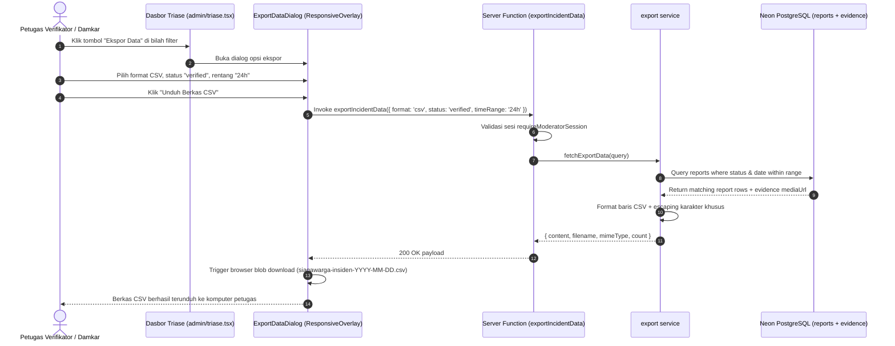
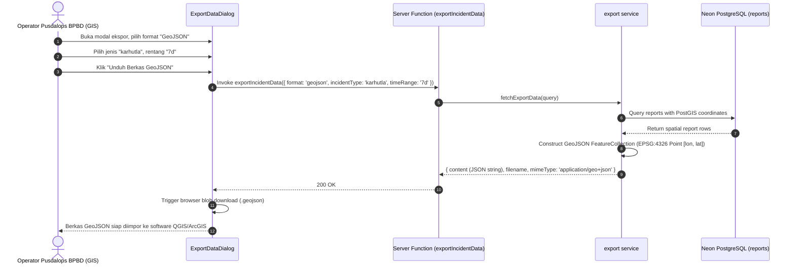

# Plan 11 — Ekspor Data Insiden untuk Damkar & BPBD (CSV & GeoJSON di /admin/triase)

## 1. Scope & Objectives

- **Target:** Mengimplementasikan modul interoperabilitas data insiden kebakaran (*Emergency Incident Data Export*) pada rute `/admin/triase` yang memungkinkan petugas verifikator (Moderator) dan Administrator Utama (Superadmin) mengekspor data laporan ke dalam 2 format standar industri:
  1. **Format CSV (Comma-Separated Values):**
     - Format tabel tabular terstruktur yang kompatibel dengan Microsoft Excel, Google Sheets, LibreOffice Calc, dan sistem basis data relasional.
     - Menyertakan kolom operasional esensial: `kode_lacak`, `jenis_insiden`, `deskripsi`, `waktu_pengamatan`, `waktu_lapor`, `latitude`, `longitude`, `alamat_lokasi`, `status_verifikasi`, `prioritas`, `status_penanganan`, `korelasi_satelit`, `klaster_duplikat`, `nama_pelapor`, `telepon_pelapor`, dan `tautan_bukti_foto`.
     - Penanganan sanitasi teks khusus CSV (escaping tanda petik ganda, newline, dan pemisah koma) untuk mencegah *CSV Injection* atau kerusakan tata letak kolom.
  2. **Format GeoJSON Spasial (RFC 7946):**
     - Format standar internasional geospasial (`FeatureCollection`) dengan geometri titik `Point` berkoordinat `[longitude, latitude]` dalam sistem referensi koordinat WGS 84 (EPSG:4326).
     - Siap diimpor langsung (*drag-and-drop*) ke perangkat lunak GIS institusi penanganan bencana (seperti QGIS, ArcGIS Desktop/Online, MapInfo, Google Earth, atau WebGIS Pusdalops BPBD/Damkar).
     - Menyimpan seluruh metadata laporan sebagai atribut `properties` pada setiap objek `Feature`.
  3. **Panel Dialog Ekspor Interaktif (`ExportDataDialog`):**
     - Menggunakan komponen overlay adaptif `ResponsiveOverlay` (**Rule 12**: Drawer pada ponsel `<768px`, Dialog pada layar desktop `≥768px`).
     - Kontrol pemilihan format ekspor (CSV vs GeoJSON) menggunakan `RadioGroup`.
     - Filter fleksibel:
       - Status Verifikasi: *Semua*, *Terverifikasi Saja* (default), *Menunggu*, atau *Perlu Tinjauan*.
       - Jenis Insiden: *Semua*, *Karhutla*, atau *Permukiman*.
       - Rentang Waktu: *24 Jam Terakhir*, *7 Hari Terakhir* (default), *30 Hari Terakhir*, atau *Semua Waktu*.
     - Tombol aksi *"Unduh Berkas"* yang secara otomatis menghasilkan berkas unduhan di peramban pengguna (`siagawarga-insiden-YYYY-MM-DD.csv` atau `siagawarga-insiden-YYYY-MM-DD.geojson`).
  4. **Pemicu Aksi di Bilah Kontrol Triase (`TriageFilterBar`):**
     - Menambahkan tombol taktis *"Ekspor Data"* berdampingan dengan tombol pencarian dan filter di [`/admin/triase`](src/routes/admin/triase.tsx).
  5. **Pengamanan Hak Akses & Privasi (Rule 7 & RBAC):**
     - Ekspor data hanya dapat diakses oleh akun terautentikasi dengan peran `moderator` atau `superadmin` (`requireModeratorSession`).
     - Perlindungan saksi: Jika pelapor memilih `is_anonymous = true`, nama pelapor pada berkas ekspor dicatat sebagai *"Warga Anonim"* dan nomor telepon dikosongkan (`null`).

- **Out of Scope:**
  - Ekspor format shapefile (.shp) biner (karena memerlukan library native C/C++ yang melanggar kompatibilitas runtime Cloudflare Workers / Edge **Rule 17**).
  - Webhook push otomatis dua arah ke server Pusdalops dinas (alokasi fase pasca-kompetisi).

- **Competition Alignment (WIA MIA 2026 — Subtema Public Service Tracking):**
  - **Fungsionalitas (25%):** Menyediakan jembatan interoperabilitas data nyata antara aplikasi aduan masyarakat dengan piranti analisis dinas pemadam dan BPBD.
  - **Desain & Interaksi (20%):** Antarmuka pemilihan format ekspor berbasis Base UI yang bersih dengan indikator pratinjau yang meyakinkan.
  - **Kualitas Konten & Format (20%):** Standar metadata geospasial GeoJSON RFC 7946 yang presisi dan penamaan kolom CSV dalam Bahasa Indonesia baku yang jelas.
  - **Orisinalitas & Dampak Publik (20%):** Memecahkan problem klasik pelaporan bencana di Indonesia di mana data sering terisolasi (*data silo*) dan sulit dipindahkan ke sistem komando operasi lapangan.
  - **Kesesuaian Tema (15%):** Membuktikan esensi *Public Service Tracking* yang berorientasi pada kemudahan tindak lanjut fisik oleh aparatur pemerintah.

---

## 2. PRD Reference & Dependencies

- **PRD Section:**
  - Seksi 4.1 (Persona Instansi Damkar / BPBD: Kebutuhan ringkasan insiden dan data spasial akurat).
  - Seksi 5.4 (Lapisan 4: Konfirmasi Penanganan Lapangan).
  - Seksi 6.1 (Tabel `reports`, `report_evidence`, geometri PostGIS WGS 84).
  - Seksi 7.1 (Spesifikasi Kontrak Server Function).
- **Preceding Plan Dependencies:**
  - [`09-moderator-triage-and-incident-review.md`](09-moderator-triage-and-incident-review.md) (Rute `/admin/triase`, guard sesi moderator, dan antrean insiden).
- **Target Route(s):**
  - `/admin/triase` ([`src/routes/admin/triase.tsx`](src/routes/admin/triase.tsx)) — Dasbor triase laporan insiden.

---

## 3. Use Cases & Sequence Diagrams

### Use Case 1: Moderator / Petugas Damkar Mengunduh Data CSV untuk Laporan Harian

Petugas verifikator membuka dasbor triase, menekan tombol "Ekspor Data", memilih format CSV dan rentang waktu 24 jam terakhir, lalu mengunduh file spreadsheet untuk laporan dinas.



---

### Use Case 2: Operator Pusdalops BPBD Mengunduh GeoJSON untuk Analisis Spasial QGIS

Operator GIS mengunduh sebaran insiden karhutla 7 hari terakhir dalam format GeoJSON standar untuk dioverlay dengan peta tutupan lahan di QGIS.



---

## 4. Data Models, Schemas & Server Functions

### 4.1 Zod Schemas (`src/lib/schema/export.ts`)

Mendefinisikan tipe masukan parameter ekspor dan struktur respons:

```typescript
import { z } from 'zod'

export const exportFormatEnum = z.enum(['csv', 'geojson'])
export type ExportFormat = z.infer<typeof exportFormatEnum>

export const exportTimeRangeEnum = z.enum(['24h', '7d', '30d', 'all'])
export type ExportTimeRange = z.infer<typeof exportTimeRangeEnum>

export const exportReportsQuerySchema = z.object({
  format: exportFormatEnum.default('csv'),
  verificationStatus: z
    .enum([
      'all',
      'pending',
      'needs_review',
      'verified',
      'insufficient_evidence',
      'rejected',
    ])
    .default('verified'),
  incidentType: z
    .enum(['all', 'karhutla', 'permukiman', 'industri', 'lainnya'])
    .default('all'),
  timeRange: exportTimeRangeEnum.default('7d'),
  limit: z.number().int().min(1).max(2000).default(500),
})
export type ExportReportsQuery = z.infer<typeof exportReportsQuerySchema>

export const exportDataResponseSchema = z.object({
  filename: z.string(),
  mimeType: z.string(),
  content: z.string(),
  totalRows: z.number().int().nonnegative(),
})
export type ExportDataResponse = z.infer<typeof exportDataResponseSchema>
```

Re-ekspor seluruh skema pada [`src/lib/schema/index.ts`](src/lib/schema/index.ts).

---

### 4.2 Database Access & Formatter Service (`src/server/services/export.ts`)

Layanan murni TypeScript tanpa dependensi library biner native:

1. `escapeCsvValue(value: string | number | null | undefined): string`:
   - Mengonversi nilai ke string.
   - Jika mengandung tanda koma (`,`), tanda petik ganda (`"`), atau baris baru (`\n`), bungkus dengan tanda petik ganda dan lakukan *doubling* pada tanda petik (`""`).

2. `generateReportsCsv(rows: Array<ExportReportRow>): string`:
   - Header CSV:
     `kode_lacak,jenis_insiden,deskripsi,waktu_pengamatan,waktu_lapor,latitude,longitude,alamat,status_verifikasi,prioritas,status_penanganan,korelasi_satelit,klaster_duplikat,nama_pelapor,telepon_pelapor,tautan_bukti_foto`
   - Baris data terformat rapi dengan pemisah baris `\r\n` (CRLF standar RFC 4180).

3. `generateReportsGeoJson(rows: Array<ExportReportRow>): string`:
   - Menghasilkan struktur baku GeoJSON RFC 7946:
     ```json
     {
       "type": "FeatureCollection",
       "features": [
         {
           "type": "Feature",
           "geometry": {
             "type": "Point",
             "coordinates": [101.4500, 0.5333]
           },
           "properties": {
             "trackingCode": "SW-2026-X89B",
             "incidentType": "karhutla",
             "description": "...",
             "observedAt": "2026-11-06T10:00:00.000Z",
             "submittedAt": "2026-11-06T10:15:00.000Z",
             "address": "Kec. Rumbai, Kota Pekanbaru, Riau",
             "verificationStatus": "verified",
             "priority": "high",
             "handlingStatus": "in_progress",
             "satelliteHotspotMatched": true,
             "isPotentialDuplicate": false,
             "reporterName": "Budi Santoso",
             "evidenceUrl": "https://pub-r2.siagawarga.id/..."
           }
         }
       ]
     }
     ```

4. `fetchExportData(query: ExportReportsQuery): Promise<ExportDataResponse>`:
   - Menghitung batas waktu berdasarkan `timeRange` (`24h`, `7d`, `30d`, `all`).
   - Menyusun kueri Drizzle ORM dengan filter status, tipe insiden, dan tanggal.
   - Mengambil bukti foto pertama per laporan dari `report_evidence`.
   - Menghasilkan nama berkas bertanggal: `siagawarga-insiden-YYYY-MM-DD.csv` atau `.geojson`.
   - Mengembalikan payload konten string siap unduh.

---

### 4.3 Server Function (`src/server/functions/export.ts`)

Mengekspos endpoint aman TanStack Start:

```typescript
export const exportIncidentData = createServerFn({ method: 'POST' })
  .validator((data: unknown) => exportReportsQuerySchema.parse(data))
  .handler(async ({ data }): Promise<ExportDataResponse> => {
    await requireModeratorSession()
    return fetchExportData(data)
  })
```

---

## 5. UI/UX Design & Microcopy Specification (DESIGN.md & bahasa-skills)

- **Surface Mode:** *Operate* (Dasbor Antrean Triase).

### 5.1 Shadcn Component Mapping & Verification (Rule 16)

> *Audit terhadap `docs/shadcn/components/base/` dan `src/components/ui/` untuk mencegah halusinasi.*

| Elemen UI / Komponen | Shadcn Base UI Reference | Status di `src/components/ui/` | Varian / Properti / Perilaku |
|---|---|---|---|
| Tombol Pemicu Ekspor | `button.md` (`Button`) | Tersedia (`button.tsx`) | Varian `outline`, ukuran `sm`, ikon `DownloadIcon` |
| Dialog Modal Ekspor | `drawer.md` / `dialog.md` (`ResponsiveOverlay`) | Tersedia (`responsive-overlay.tsx`) | Drawer pada `<768px`, Dialog pada `≥768px` |
| Pemilihan Format Berkas | `radio-group.md` (`RadioGroup`) | Tersedia (`radio-group.tsx`) | Kartu radio vertikal (CSV Spreadsheet vs GeoJSON Spasial) |
| Pemilihan Status & Waktu | `tabs.md` (`Tabs`, `TabsList`, `TabsTrigger`) | Tersedia (`tabs.tsx`) | Tab pill horizontal untuk status dan rentang hari |
| Indikator Pemuatan Unduh | `spinner.md` (`Spinner`) | Tersedia (`spinner.tsx`) | Animasi putar di dalam tombol unduh |
| Kotak Peringatan Galat | `alert.md` (`Alert`, `AlertDescription`) | Tersedia (`alert.tsx`) | Varian `destructive` saat kueri ekspor gagal |

---

### 5.2 Komponen Antarmuka (`src/components/triage/export-data-dialog.tsx`)

Struktur antarmuka dialog ekspor:
- **Judul Dialog:** *Ekspor Rekapitulasi Data Insiden*
- **Deskripsi:** *Unduh data rekaman kebakaran terverifikasi untuk kebutuhan pelaporan instansi Damkar atau integrasi sistem GIS Pusdalops BPBD.*
- **Pilihan Format Berkas:**
  - **Tabel CSV (Spreadsheet):** Disertai deskripsi: *"Format tabel untuk Microsoft Excel, Google Sheets, dan pengarsipan dinas."*
  - **Spasial GeoJSON (Peta GIS):** Disertai deskripsi: *"Format vektor spasial untuk visualisasi di QGIS, ArcGIS, dan WebGIS."*
- **Filter Status Laporan:**
  - *Terverifikasi Saja* (Direkomendasikan bagi Damkar), *Semua Status*, *Menunggu Verifikasi*, *Perlu Tinjauan*.
- **Filter Rentang Waktu:**
  - *24 Jam Terakhir*, *7 Hari Terakhir*, *30 Hari Terakhir*, *Semua Waktu*.
- **Filter Kategori Insiden:**
  - *Semua Insiden*, *Karhutla Saja*, *Permukiman Saja*.
- **Tombol Unduh Berkas:**
  - Memanggil `exportIncidentData`, menerima payload string, membuat `Blob`, dan men-trigger unduhan browser melalui elemen `<a download="...">` secara instan.

---

### 5.3 Microcopy & UI Text (`bahasa-skills` Verified)

- **Label Tombol Pemicu:** *Ekspor Data*
- **Judul Dialog:** *Ekspor Rekapitulasi Insiden Kebakaran*
- **Label Tombol Unduh:** *Unduh Berkas CSV* / *Unduh Berkas GeoJSON*
- **Notifikasi Keberhasilan:** *Berkas ekspor berhasil diunduh ke perangkat Anda.*
- **Notifikasi Kosong:** *Tidak ada data insiden yang sesuai dengan kriteria filter ekspor saat ini.*
- **Proteksi Privasi:** *Data pelapor anonim disamarkan secara otomatis sesuai standar perlindungan saksi warga.*

---

## 6. Implementation File List

### 6.1 Berkas Baru (*New Files*)

1. **`src/lib/schema/export.ts`** — Skema Zod tipe masukan kueri ekspor (`exportReportsQuerySchema`) dan respons payload (`exportDataResponseSchema`).
2. **`src/server/services/export.ts`** — Logika pemformatan CSV (RFC 4180), pembangunan struktur GeoJSON (RFC 7946), kueri basis data Drizzle, dan sanitasi PII.
3. **`src/server/functions/export.ts`** — Server Function TanStack Start `exportIncidentData` yang diamankan oleh guard `requireModeratorSession`.
4. **`src/components/triage/export-data-dialog.tsx`** — Dialog modal/drawer adaptif (`ResponsiveOverlay`) untuk memilih format berkas dan mengunduh rekaman insiden.
5. **`tests/export.test.ts`** — Pengujian otomatis unit & integrasi untuk generator CSV, generator GeoJSON, sanitasi teks koma/petik, dan validasi skema.

### 6.2 Berkas yang Dimodifikasi (*Modified Files*)

1. **`src/lib/schema/index.ts`** — Re-ekspor seluruh skema dari `src/lib/schema/export.ts`.
2. **`src/components/triage/triage-filter-bar.tsx`** — Menambahkan tombol *"Ekspor Data"* di samping bilah pencarian/reset filter.
3. **`src/routes/admin/triase.tsx`** — Memasang state dialog ekspor dan merender `ExportDataDialog`.

---

## 7. Testing & Quality Gates (TDD with Bun)

Pengujian komprehensif pada [`tests/export.test.ts`](tests/export.test.ts) menggunakan Bun test runner:

1. **Validasi Skema Zod:**
   - Parameter kueri default (`format: 'csv'`, `status: 'verified'`, `timeRange: '7d'`).
   - Penolakan format berkas di luar enum (`csv`, `geojson`).
   - Penolakan batas entri negatif atau melebihi 2000.
2. **Pengujian Pemformatan CSV (RFC 4180):**
   - Validasi susunan header CSV sesuai urutan yang ditentukan.
   - Validasi sanitasi karakter khusus: teks yang mengandung koma atau tanda petik dibungkus petik ganda dengan benar (`"Kebakaran, merembet"`).
   - Validasi pemisah baris CRLF (`\r\n`).
   - Validasi koordinat numerik latitude dan longitude.
3. **Pengujian Pembangunan GeoJSON (RFC 7946):**
   - Validasi struktur `FeatureCollection` dan array `features`.
   - Validasi koordinat geometri Point: urutan `[longitude, latitude]` (format GeoJSON standar, bukan lat/lon).
   - Validasi integritas atribut `properties` (kode lacak, status verifikasi, jenis insiden, alamat).
4. **Pengujian Sanitasi Privasi & Anonimitas:**
   - Memastikan nama pelapor anonim disamarkan menjadi *"Warga Anonim"* dan nomor telepon dikosongkan.
5. **Eksekusi 4 Quality Gates Mandatori:**
   - Gate 1: `bun test` (100% tes lolos).
   - Gate 2: `bun run lint` & `bun run lint:design` (nol kesalahan ESLint & `@shadcn/lint`).
   - Gate 3: `bun run typecheck` (`tsc --noEmit` nol galat).
   - Gate 4: `bun run build` (build produksi Vite berhasil).
