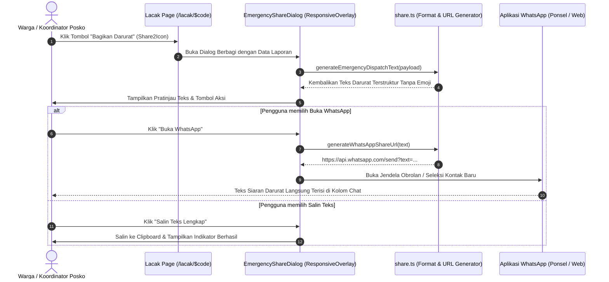
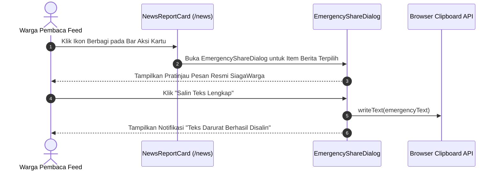

# Plan 12 — Emergency WhatsApp Dispatcher & Citizen Disaster Broadcast

## 1. Scope & Objectives
- **Target:** Membangun generator pesan darurat terstruktur dan pengirim pesan 1-klik ke WhatsApp (*WhatsApp Emergency Dispatcher*) untuk memfasilitasi diseminasi informasi kebakaran yang cepat, akurat, dan terverifikasi dari platform SiagaWarga ke grup koordinasi warga (RT/RW), posko relawan, Babinsa/Bhabinkamtibmas, serta petugas Damkar & BPBD lapangan. Fitur ini diintegrasikan ke dalam halaman pelacakan publik (`/lacak/$code`) dan kartu linimasa feed publik (`/news`).
- **Out of Scope:** Otomatisasi bot WhatsApp berbayar pihak ketiga (seperti Twilio atau WhatsApp Business API berbayar dengan webhook terpusat) — fitur ini beroperasi secara *zero-cost* menggunakan protokol standar tautan antarmuka WhatsApp Web dan aplikasi ponsel (`api.whatsapp.com/send` / `wa.me`).
- **Competition Alignment (WIA MIA 2026):**
  - **Fungsionalitas (25%):** Menghubungkan pelaporan berbasis web dengan saluran komunikasi lapangan paling masif di Indonesia (WhatsApp) secara instan tanpa friksi registrasi tambahan.
  - **Desain (20%):** Menggunakan `ResponsiveOverlay` (Drawer pada ponsel, Dialog pada desktop), preview teks terformat dalam kontainer monospace, dan tombol aksi yang jelas.
  - **Konten (20%):** Format teks siaran darurat baku dan profesional, bebas AI-slop, dilengkapi penafian privasi dan nomor darurat resmi 112/113.
  - **Orisinalitas (20%):** Mengubah data pelacakan spasial dan audit transparansi menjadi teks darurat yang langsung siap ditindaklanjuti posko tanggap darurat.
  - **Kesesuaian Tema (15%):** *Public Service Tracking* — mempercepat koordinasi penanganan kebakaran antara warga dan instansi pemadam.

---

## 2. PRD Reference & Dependencies
- **PRD Section:** Section 5.3 (Public Tracking & Social Verification), Section 7.2 (Citizen Engagement & Dispatch), dan Non-Functional Requirements (Privacy & Low-Bandwidth Resilience).
- **Preceding Plan Dependencies:**
  - `docs/plans/05-citizen-news-feed.md` (Plan 05 — Public News Feed di `/news`)
  - `docs/plans/07-public-tracking-timeline.md` (Plan 07 — Public Tracking di `/lacak/$code`)
  - `docs/plans/11-incident-data-export-damkar-bpbd.md` (Plan 11 — Format Standarisasi Insiden)
- **Target Route(s):**
  - `/lacak/$code` (Halaman pelacakan rinci laporan warga)
  - `/news` (Halaman linimasa kabar publik terverifikasi)

---

## 3. Use Cases & Sequence Diagrams

### Use Case 1: Warga / Petugas Membagikan Laporan Darurat ke Grup WhatsApp dari Halaman Lacak


### Use Case 2: Warga Membagikan Kabar Terverifikasi dari Feed Berita (/news)


---

## 4. Data Models, Schemas & Server Functions

### 4.1 Zod Schemas (`src/lib/schema/share.ts`)
Schema validasi untuk payload data yang dibutuhkan oleh generator siaran darurat. Memastikan tidak ada data tidak lengkap atau koordinat liar yang diumpankan ke WhatsApp.

```typescript
import { z } from 'zod'
import {
  handlingStatusEnum,
  incidentTypeEnum,
  verificationStatusEnum,
} from './reports'

export const emergencyDispatchPayloadSchema = z.object({
  trackingCode: z
    .string()
    .trim()
    .regex(/^SW-\d{4}-[A-Z0-9]{4}$/, {
      message: 'Format kode pelacakan tidak valid.',
    }),
  incidentType: incidentTypeEnum,
  verificationStatus: verificationStatusEnum,
  handlingStatus: handlingStatusEnum,
  observedAtIso: z.string().optional(),
  submittedAtIso: z.string(),
  addressDisplay: z.string().nullable().optional(),
  latitude: z.number().min(-11.0).max(6.0),
  longitude: z.number().min(95.0).max(141.0),
  description: z.string().min(1),
  reporterName: z.string().optional(),
})

export type EmergencyDispatchPayload = z.infer<
  typeof emergencyDispatchPayloadSchema
>
```

### 4.2 Generator Teks Siaran Darurat & Tautan WhatsApp (`src/lib/share.ts`)
Mengonversi payload insiden menjadi naskah siaran yang memenuhi kaidah laporan darurat resmi Indonesia:
1. **Zero Emoji:** Sesuai Rule 14 AGENTS.md, tidak menggunakan emoji apa pun. Menggunakan penanda tipografi tebal (`*`) dan miring (`_`) standar WhatsApp.
2. **Perlindungan Privasi (Rule 7):** Nomor telepon dan email pelapor tidak pernah dicantumkan. Identitas pelapor disanitasi jika anonim.
3. **Koordinat & Navigasi Cepat:** Tautan Google Maps dengan koordinat lintang/bujur presisi untuk navigasi armada Damkar.
4. **Tautan Pembaruan Langsung:** Tautan langsung ke `/lacak/$code` untuk memantau perkembangan penanganan 4 fase.

Contoh format teks yang dihasilkan:
```text
[LAPORAN DARURAT KEBAKARAN - SIAGAWARGA]

*Kode Lacak:* SW-2026-X89B
*Jenis Kejadian:* Kebakaran Hutan dan Lahan
*Status Verifikasi:* Terverifikasi Sah
*Status Penanganan:* Operasi Pemadaman
*Waktu Kejadian:* 6 November 2026, 21:30 WIB
*Lokasi:* Jl. Raya Pelalawan Km 12, Pangkalan Kerinci

*Keterangan Lapangan:*
"Asap tebal membubung tinggi di dekat kebun sawit warga, arah angin menuju pemukiman."

*Navigasi Lokasi (Google Maps):*
https://www.google.com/maps/search/?api=1&query=-0.321,101.892

*Pantau Perkembangan Langsung:*
https://siagawarga.id/lacak/SW-2026-X89B

_Laporan warga terverifikasi melalui Platform SiagaWarga. Hubungi Layanan Darurat: 112 / 113_
```

Fungsi pembantu:
- `generateEmergencyDispatchText(payload: EmergencyDispatchPayload): string`
- `generateWhatsAppShareUrl(text: string, phoneNumber?: string): string`
- `copyTextToClipboard(text: string): Promise<boolean>`

---

## 5. UI/UX Design & Microcopy Specification (DESIGN.md & bahasa-skills)

- **Surface Mode:** Experience (Tracking) & Operate (News Stream)
- **Geometry:** Standard container geometry `max-w-4xl` untuk non-landing routes (Rule 22).

### 5.1 Shadcn Component Mapping & Verification (Rule 16)

| UI Feature / Element | Shadcn Component (`docs/shadcn/components/base/`) | Status di `src/components/ui/` | Variants / Modifiers / Props |
| :--- | :--- | :--- | :--- |
| **Modal Berbagi Darurat** | `drawer.md` / `dialog.md` (`ResponsiveOverlay`) | Sudah Tersedia (`responsive-overlay.tsx`) | Mobile: Bottom Drawer, Desktop: Centered Dialog |
| **Tombol Aksi Utama** | `button.md` (`Button`) | Sudah Tersedia (`button.tsx`) | Variant `ember`, Size `default` / `sm` |
| **Tombol Salin & Sekunder** | `button.md` (`Button`) | Sudah Tersedia (`button.tsx`) | Variant `outline` / `ghost`, Size `sm` |
| **Pratinjau Teks Siaran** | `card.md` (`Card`, `CardContent`) | Sudah Tersedia (`card.tsx`) | Variant `canvas`, background `bg-muted/60` |
| **Pita Peringatan Darurat** | `alert.md` (`Alert`, `AlertDescription`) | Sudah Tersedia (`alert.tsx`) | Variant `warning` / `default` |
| **Pemisah Konten** | `separator.md` (`Separator`) | Sudah Tersedia (`separator.tsx`) | `orientation="horizontal"` |

### 5.2 Responsive Overlay (`src/components/shared/emergency-share-dialog.tsx`)
Dialog dirancang adaptif:
- Pada layar seluler (`<768px`): Muncul sebagai lembar tarik bawah (*bottom drawer*) yang mudah dijangkau satu tangan warga saat di lapangan.
- Pada layar tablet/komputer (`≥768px`): Muncul sebagai jendela dialog mengambang (*centered dialog*) dengan lebar maksimal `max-w-md` atau `max-w-lg`.
- Dilengkapi kotak pratinjau teks (*read-only*) dengan tombol satu ketukan salin (*one-tap copy*).

### 5.3 Microcopy & UI Text (bahasa-skills verified)
- **Judul Modal:** "Bagikan Laporan Darurat"
- **Deskripsi Modal:** "Kirimkan ringkasan laporan resmi ini ke grup WhatsApp warga, posko relawan, atau petugas pemadam kebakaran terdekat."
- **Tombol WhatsApp Primer:** "Buka WhatsApp" (Ikon `SendIcon` atau `MessageSquareShareIcon`)
- **Tombol Salin Sekunder:** "Salin Teks Lengkap" (Ikon `CopyIcon` / `CheckIcon`)
- **Tombol Salin Tautan:** "Salin Tautan Saja" (Ikon `LinkIcon`)
- **Penafian Darurat:** "Jika api mengancam keselamatan warga dan bangunan secara langsung, segera hubungi 113 (Damkar) atau 112 (Panggilan Darurat Bebas Pulsa)."

---

## 6. Implementation File List

### New Files
1. `src/lib/schema/share.ts`: Schema Zod untuk payload diseminasi darurat (`emergencyDispatchPayloadSchema`).
2. `src/lib/share.ts`: Implementasi logika pemformatan teks darurat resmi, pembuat tautan WhatsApp Web/Mobile, dan penanganan clipboard.
3. `src/components/shared/emergency-share-dialog.tsx`: Komponen dialog `ResponsiveOverlay` untuk pratinjau teks dan eksekusi pembagian ke WhatsApp.
4. `tests/share.test.ts`: Pengujian unit otomatis (Bun) untuk formatting teks darurat, sanitasi data, validasi tautan WhatsApp, dan batas karakter.

### Modified Files
1. `src/lib/schema/index.ts`: Mengekspor kembali schema dan tipe dari `src/lib/schema/share.ts`.
2. `src/components/tracking/tracking-overview-card.tsx`: Menambahkan tombol "Bagikan Darurat" pada bilah aksi kartu di `/lacak/$code` dan menghubungkannya ke `EmergencyShareDialog`.
3. `src/components/news/news-report-card.tsx`: Memperbarui tombol aksi berbagi pada kartu feed `/news` agar memunculkan `EmergencyShareDialog`.

---

## 7. Testing & Quality Gates (TDD with Bun)

### Test Scenarios (`tests/share.test.ts`)
1. **Validasi Schema Zod:**
   - Memvalidasi payload laporan yang sah dengan semua atribut lengkap.
   - Menolak koordinat di luar wilayah kedaulatan Indonesia.
   - Menangani nilai alamat `null` secara anggun tanpa melempar kesalahan runtime.
2. **Pemformatan Teks Darurat (Zero Emoji & Profesional):**
   - Menghasilkan judul pembuka resmi `[LAPORAN DARURAT KEBAKARAN - SIAGAWARGA]`.
   - Memastikan tidak ada karakter emoji sama sekali di dalam string teks keluaran (Rule 14).
   - Memastikan tautan Google Maps terbentuk dengan format parameter kueri yang benar (`latitude,longitude`).
   - Memastikan tautan pelacakan SiagaWarga menyertakan kode lacak yang tepat.
   - Memastikan catatan saksi mata dikutip dengan tanda petik ganda dan dipotong secara wajar jika terlalu panjang.
3. **Pembangkit URL WhatsApp:**
   - Melakukan encoding URI komponen secara sempurna terhadap spasi, baris baru (`\n`), tanda petik ganda, dan karakter khusus.
   - Menghasilkan tautan valid yang diawali dengan `https://api.whatsapp.com/send?text=`.
   - Mendukung penambahan nomor telepon tujuan opsional (`&phone=628...`).

### Quality Gates Checklist
1. `bun test tests/share.test.ts` dan seluruh test suite lulus 100% (target >150 passing tests).
2. `bun run lint` (ESLint) bersih tanpa kesalahan.
3. `bun run lint:design` (@shadcn/lint) bersih tanpa pelanggaran desain.
4. `bun run typecheck` (`tsc --noEmit`) tanpa kesalahan tipe.
5. `bun run build` sukses menghasilkan bundel produksi Cloudflare.
