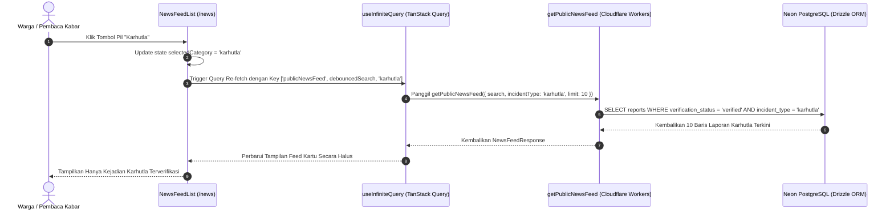
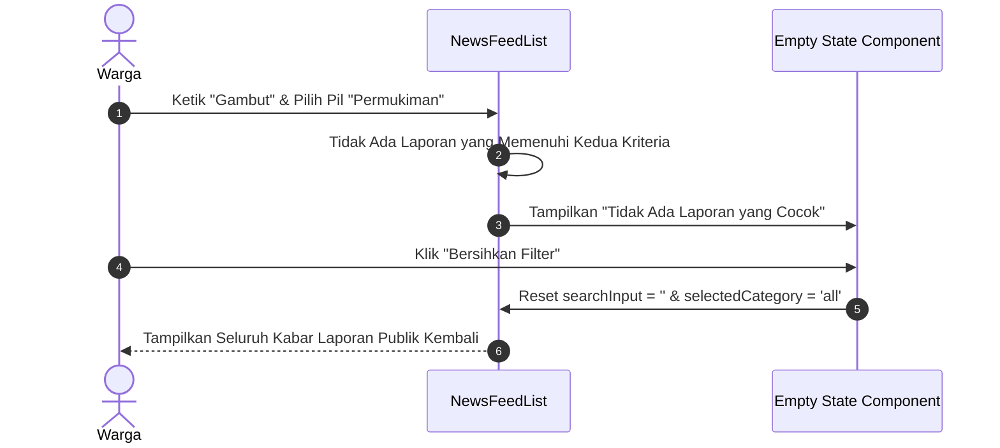

# Plan 13 — News Incident Category Quick Filters

## 1. Scope & Objectives
- **Target:** Membangun bilah filter kategori insiden cepat (*Quick Pill Filters*) pada halaman Kabar Warga (`/news`) yang memungkinkan warga, relawan, dan jurnalis menyaring laporan kebakaran terverifikasi berdasarkan kategori (*Semua*, *Karhutla*, *Permukiman*, *Industri*) secara instan. Filter pil ini bersinergi secara reaktif dengan bilah pencarian teks waktu nyata dan sistem *infinite scroll* TanStack Query tanpa memicu pemuatan ulang halaman (*zero page reload*).
- **Out of Scope:** Penyaringan multi-kategori kompleks berbasis checkbox majemuk atau geofencing dinamis (keduanya telah ditangani pada peta spasial `/pantau` dan ekspor `/admin/triase`).
- **Competition Alignment (WIA MIA 2026):**
  - **Fungsionalitas (25%):** Memberikan akses cepat bagi pengguna untuk memilah informasi bencana spesifik wilayah mereka (misal: memantau karhutla di Sumatra/Kalimantan vs kebakaran rumah padat penduduk di area perkotaan).
  - **Desain (20%):** Memanfaatkan tombol pil Base UI (`Button size="pill"`), transisi status aktif/inaktif yang elegan, dan penataan ergonomis di bawah bilah pencarian.
  - **Konten (20%):** Istilah kategori baku dan ramah warga (*bahasa-website*), bebas jargon mesin, dan terbebas dari AI-slop.
  - **Orisinalitas (20%):** Penggabungan interaktif antara penelusuran kata kunci teks bebas dan kategorisasi insiden terverifikasi secara instan.
  - **Kesesuaian Tema (15%):** *Public Service Tracking* — mempermudah publik memantau penanganan kebakaran sesuai sektor terdampak.

---

## 2. PRD Reference & Dependencies
- **PRD Section:** Section 5.4 (Public Incident Feed & Verification Transparency), Section 5.1 (Incident Classification: Karhutla, Permukiman, Industri, Lainnya), dan Appendix E (Performance & Edge Standards).
- **Preceding Plan Dependencies:**
  - `docs/plans/05-citizen-news-feed.md` (Plan 05 — Public News Feed Dasar di `/news`)
  - `docs/plans/12-emergency-whatsapp-dispatcher.md` (Plan 12 — Aksi Bagikan Darurat WhatsApp)
- **Target Route(s):**
  - `/news` (`src/routes/news.tsx` dan `src/components/news/news-feed-list.tsx`)

---

## 3. Use Cases & Sequence Diagrams

### Use Case 1: Warga Menyaring Laporan Berdasarkan Kategori Insiden


### Use Case 2: Sinergi Pencarian Teks & Filter Pil dengan State Kosong


---

## 4. Data Models, Schemas & Server Functions

### 4.1 Zod Schemas (`src/lib/schema/news.ts`)
Memperbarui `getNewsFeedInputSchema` untuk memvalidasi filter kategori opsional yang dapat berupa `'all'` atau enum jenis insiden resmi:

```typescript
import { z } from 'zod'
import {
  handlingStatusEnum,
  incidentTypeEnum,
  verificationStatusEnum,
} from './reports'

export const newsCategoryFilterEnum = z.enum([
  'all',
  'karhutla',
  'permukiman',
  'industri',
  'lainnya',
])
export type NewsCategoryFilter = z.infer<typeof newsCategoryFilterEnum>

export const getNewsFeedInputSchema = z.object({
  cursor: z.string().optional(),
  limit: z.number().int().min(1).max(30).default(10),
  search: z.string().optional(),
  incidentType: newsCategoryFilterEnum.default('all'),
})
export type GetNewsFeedInput = z.infer<typeof getNewsFeedInputSchema>
```

### 4.2 Kueri Drizzle ORM (`src/server/services/news.ts`)
Menambahkan klausul penyaringan `reports.incidentType` ketika parameter `incidentType` bernilai selain `'all'`:

```typescript
// Filter kategori insiden jika pengguna memilih selain 'all'
if (input.incidentType && input.incidentType !== 'all') {
  conditions.push(eq(reports.incidentType, input.incidentType))
}
```

### 4.3 Server Function (`src/server/functions/news.ts`)
Memastikan validator `getPublicNewsFeed` menerima schema yang telah diperbarui dan mengeksekusi layanan dengan aman di Cloudflare Edge.

---

## 5. UI/UX Design & Microcopy Specification (DESIGN.md & bahasa-skills)

- **Surface Mode:** Operate & Experience (News Stream)
- **Geometry:** Mengikuti standar geometri desktop `max-w-4xl` (Rule 22).

### 5.1 Shadcn Component Mapping & Verification (Rule 16)

| UI Feature / Element | Shadcn Component (`docs/shadcn/components/base/`) | Status di `src/components/ui/` | Variants / Modifiers / Props |
| :--- | :--- | :--- | :--- |
| **Tombol Pil Kategori** | `button.md` (`Button`) | Sudah Tersedia (`button.tsx`) | Aktif: `variant="default"`, Inaktif: `variant="outline"`, `size="pill"` |
| **Bilah Pencarian Teks** | `input-group.md` (`InputGroup`, `InputGroupInput`) | Sudah Tersedia (`input-group.tsx`) | `className="h-10"` |
| **Ikon Kategori** | `lucide-react` | Sudah Tersedia | `FlameIcon`, `TreesIcon`, `HomeIcon`, `FactoryIcon`, `LayersIcon` |
| **State Kosong (Empty)**| `card.md` (`Card`) | Sudah Tersedia (`card.tsx`) | Variant `canvas` dengan tombol aksi reset |

### 5.2 Desain Bilah Pil Kategori (Pill Filter Bar)
Bilah pil diletakkan tepat di bawah bilah pencarian teks dengan layout flex horizontal yang dapat digulir secara mulus pada ponsel (`overflow-x-auto no-scrollbar`):
- **Semua Laporan:** Ikon `LayersIcon` (Label: "Semua")
- **Karhutla:** Ikon `TreesIcon` (Label: "Karhutla")
- **Permukiman:** Ikon `HomeIcon` (Label: "Permukiman")
- **Industri:** Ikon `FactoryIcon` (Label: "Industri")

### 5.3 Microcopy & UI Text (bahasa-skills verified)
- **Label Pil:** "Semua", "Karhutla", "Permukiman", "Industri"
- **Aria Label:** "Saring laporan kategori {label}"
- **Pesan State Kosong:**
  - Judul: "Tidak Ada Laporan yang Cocok"
  - Deskripsi: "Tidak ditemukan laporan terverifikasi untuk kategori ini dengan kata kunci pencarian tersebut. Coba pilih kategori lain atau bersihkan penyaringan."
  - Label Tombol Reset: "Bersihkan Filter"

---

## 6. Implementation File List

### Modified Files
1. `src/lib/schema/news.ts`: Menambahkan `newsCategoryFilterEnum` dan memperbarui `getNewsFeedInputSchema` dengan default `'all'`.
2. `src/server/services/news.ts`: Menambahkan kondisi SQL Drizzle untuk `reports.incidentType` saat `incidentType !== 'all'`.
3. `src/components/news/news-feed-list.tsx`: Menambahkan state `selectedCategory`, bilah tombol pil kategori, integrasi query key TanStack Query, dan pembaruan empty state.
4. `tests/news.test.ts`: Menambahkan skenario uji unit untuk schema filter kategori, default value, dan kueri database berdasarkan kategori.

---

## 7. Testing & Quality Gates (TDD with Bun)

### Test Scenarios (`tests/news.test.ts`)
1. **Validasi Schema Zod:**
   - Memastikan `getNewsFeedInputSchema` mengisi nilai default `incidentType = 'all'`.
   - Menerima nilai filter kategori yang sah (`'all'`, `'karhutla'`, `'permukiman'`, `'industri'`, `'lainnya'`).
   - Menolak nilai kategori sembarangan di luar enum.
2. **Kueri Layanan Backend (`fetchPublicNewsFeed`):**
   - Mengambil laporan hanya dengan `incidentType` yang sesuai saat filter diterapkan.
   - Mengembalikan semua jenis laporan terverifikasi saat `incidentType === 'all'`.
   - Mengombinasikan pencarian teks `search` dan filter `incidentType` secara harmonis.

### Quality Gates Checklist
1. `bun test tests/news.test.ts` dan seluruh test suite lulus 100% (target >155 passing tests).
2. `bun run lint` (ESLint) bersih tanpa kesalahan.
3. `bun run lint:design` (@shadcn/lint) bersih tanpa pelanggaran desain.
4. `bun run typecheck` (`tsc --noEmit`) tanpa kesalahan tipe.
5. `bun run build` sukses menghasilkan bundel produksi Cloudflare.
