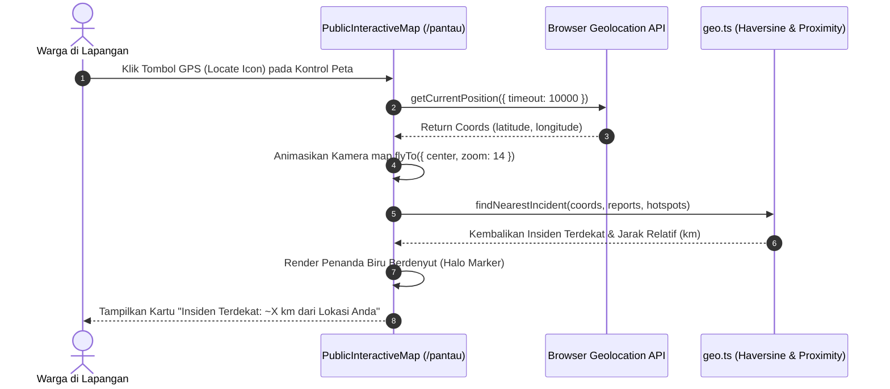
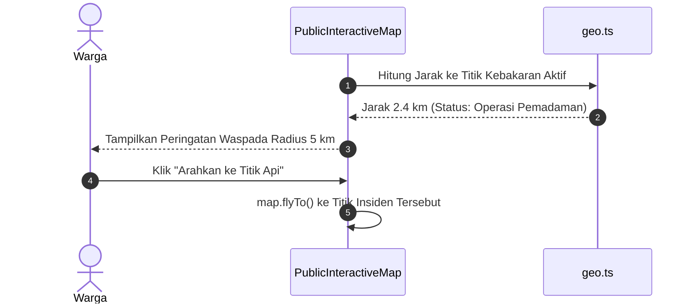

# Plan 14 — Map Geolocation & Proximity Tracking

## 1. Scope & Objectives
- **Target:** Memperkaya peta interaktif publik (`/pantau`) dengan kapabilitas geolokasi perangkat (*Locate Me*), navigasi kompas (*Compass Reset*), mode layar penuh (*Fullscreen Toggle*), penanda visual lokasi pengguna saat ini (*User Location Halo Marker*), dan deteksi jarak kedekatan (*Proximity Detection*) terhadap titik insiden kebakaran atau hotspot satelit NASA FIRMS terdekat. Fitur ini dirancang untuk memudahkan warga dan relawan tanggap darurat mengetahui apakah mereka berada dalam zona bahaya atau radius asap kebakaran secara langsung di lapangan.
- **Out of Scope:** Pelacakan posisi pengguna secara latar belakang terus-menerus (*background continuous tracking*) saat aplikasi tertutup (untuk menghemat baterai ponsel warga di area minim daya).
- **Competition Alignment (WIA MIA 2026):**
  - **Fungsionalitas (25%):** Meningkatkan kesiapsiagaan warga (*disaster situational awareness*) dengan menampilkan jarak relatif ke titik api terdekat secara instan menggunakan sensor GPS peramban.
  - **Desain (20%):** Kontrol navigasi MapLibre GL yang menyatu rapi, penanda posisi beranimasi lembut (*pulsing halo ring* warna sky/blue), dan kartu telemetri jarak insiden yang informatif.
  - **Konten (20%):** Peringatan zona bahaya dan informasi jarak yang lugas, baku (*bahasa-website*), bebas AI-slop, dan bebas emoji.
  - **Orisinalitas (20%):** Integrasi otomatis antara sensor GPS pengguna dengan titik hotspot satelit NASA FIRMS dan laporan warga terverifikasi.
  - **Kesesuaian Tema (15%):** *Public Service Tracking* — memantau keselamatan warga sipil di sekitar titik kejadian bencana kebakaran.

---

## 2. PRD Reference & Dependencies
- **PRD Section:** Section 5.2 (Interactive Incident & Hotspot Map), Section 7.2 (Citizen Engagement & Spatial Awareness), dan Rule 5 (Spatial Proximity & PostGIS).
- **Preceding Plan Dependencies:**
  - `docs/plans/08-public-map-and-satellite-hotspots.md` (Plan 08 — Peta Publik & Hotspot NASA FIRMS)
  - `docs/plans/13-news-category-quick-filters.md` (Plan 13 — Filter Kategori Insiden)
- **Target Route(s):**
  - `/pantau` (`src/routes/pantau.tsx` dan `src/components/map/public-interactive-map.tsx`)

---

## 3. Use Cases & Sequence Diagrams

### Use Case 1: Warga Mengaktifkan "Pusatkan ke Lokasi Saya" di Peta


### Use Case 2: Warga Berada Dekat Zona Bahaya (< 5 km)


---

## 4. Data Models, Schemas & Server Functions

### 4.1 Utilitas Kedekatan Spasial (`src/lib/geo.ts`)
Fungsi komputasi matematika murni (Formula Haversine) berbasis Standar Web tanpa dependensi biner pihak ketiga:

```typescript
export interface Coordinates {
  latitude: number
  longitude: number
}

export interface NearestIncidentResult {
  type: 'report' | 'hotspot'
  id: string
  title: string
  distanceKm: number
  latitude: number
  longitude: number
  statusLabel?: string
  trackingCode?: string
}

/**
 * Menghitung jarak lingkaran besar antara dua koordinat geografis
 * menggunakan formula Haversine (dalam kilometer).
 */
export function calculateHaversineDistanceKm(
  lat1: number,
  lon1: number,
  lat2: number,
  lon2: number,
): number {
  const R = 6371 // Radius bumi dalam kilometer
  const dLat = ((lat2 - lat1) * Math.PI) / 180
  const dLon = ((lon2 - lon1) * Math.PI) / 180
  const a =
    Math.sin(dLat / 2) * Math.sin(dLat / 2) +
    Math.cos((lat1 * Math.PI) / 180) *
      Math.cos((lat2 * Math.PI) / 180) *
      Math.sin(dLon / 2) *
      Math.sin(dLon / 2)
  const c = 2 * Math.atan2(Math.sqrt(a), Math.sqrt(1 - a))
  return Math.round(R * c * 100) / 100
}

/**
 * Format jarak yang manusiawi (misal: "850 m" atau "3,4 km").
 */
export function formatDistance(distanceKm: number): string {
  if (distanceKm < 1) {
    const meters = Math.round(distanceKm * 1000)
    return `${meters} m`
  }
  return `${distanceKm.toLocaleString('id-ID', { minimumFractionDigits: 1, maximumFractionDigits: 1 })} km`
}
```

### 4.2 Deteksi Insiden Terdekat
Fungsi pemindaian `findNearestIncident`:
- Membandingkan lokasi GPS pengguna dengan seluruh titik laporan terverifikasi aktif dan titik panas satelit NASA FIRMS.
- Mengembalikan objek `NearestIncidentResult` dengan jarak terkecil.
- Menentukan ambang batas peringatan dini (radius siaga < 5 km).

---

## 5. UI/UX Design & Microcopy Specification (DESIGN.md & bahasa-skills)

- **Surface Mode:** Experience (Peta Interaktif)
- **Geometry:** Mengikuti standar geometri desktop `max-w-4xl` (Rule 22).

### 5.1 Shadcn Component Mapping & Verification (Rule 16)

| UI Feature / Element | Shadcn Component (`docs/shadcn/components/base/`) | Status di `src/components/ui/` | Variants / Modifiers / Props |
| :--- | :--- | :--- | :--- |
| **Kontrol Peta Interaktif** | `map.md` (`MapControls`) | Sudah Tersedia (`map.tsx`) | `showZoom`, `showCompass`, `showLocate`, `showFullscreen` |
| **Penanda Lokasi Warga** | `map.md` (`MapMarker`, `MarkerContent`, `MarkerPopup`) | Sudah Tersedia (`map.tsx`) | Halo ring biru (`bg-sky-500`) |
| **Kartu Jarak Terdekat** | `card.md` (`Card`, `CardContent`) | Sudah Tersedia (`card.tsx`) | Variant `canvas`, floating overlay |
| **Lencana Status Jarak** | `badge.md` (`Badge`) | Sudah Tersedia (`badge.tsx`) | Jarak < 5 km: `variant="warning"`, Normal: `variant="secondary"` |
| **Tombol Navigasi Cepat**| `button.md` (`Button`) | Sudah Tersedia (`button.tsx`) | Variant `outline` / `default`, `size="xs"` |

### 5.2 Tata Letak & Visual Halo Penanda Posisi Pengguna
- **Titik Inti:** Bulatan kecil warna biru langit (`bg-sky-500`) dengan cincin putih bersih (`ring-2 ring-white`).
- **Halo Berdenyut:** Gelombang lingkaran lembut (`animate-ping bg-sky-500/30`) menandakan sinyal GPS aktif.
- **Kartu Mengambang (*Floating Proximity Bar*):** Terletak di bagian bawah kanvas peta ketika lokasi berhasil diperoleh, menyajikan:
  - Jarak ke titik kebakaran terdekat (misal: "Insiden terdekat: ~2,4 km dari lokasi Anda").
  - Tombol aksi "Arahkan ke Titik Api" untuk memindahkan tampilan peta ke insiden tersebut.
  - Tombol tutup/sembunyikan bilah.

### 5.3 Microcopy & UI Text (bahasa-skills verified)
- **Judul Penanda:** "Lokasi Anda Saat Ini"
- **Label Tombol Kontrol:** "Pusatkan ke lokasi saya", "Reset kompas arah utara", "Layar penuh"
- **Teks Kedekatan:** "Insiden terdekat: ~{jarak} dari lokasi Anda"
- **Peringatan Radius 5 km:** "Perhatian: Anda berada dalam radius 5 km dari titik kebakaran aktif."
- **Pesan Galat GPS:** "Gagal mendapatkan lokasi GPS. Pastikan izin lokasi telah diaktifkan pada peramban Anda."

---

## 6. Implementation File List

### New Files
1. `src/lib/geo.ts`: Fungsi komputasi Haversine, format jarak manusiawi, dan pemindai insiden terdekat (`findNearestIncident`).
2. `tests/geo.test.ts`: Pengujian unit otomatis (Bun) untuk formula jarak spasial, pembulatan meter/km, dan pengurutan jarak terdekat.

### Modified Files
1. `src/components/map/public-interactive-map.tsx`:
   - Mengaktifkan `showLocate`, `showCompass`, `showFullscreen` pada `MapControls`.
   - Menambahkan state `userLocation`, `nearestIncident`, dan `locationError`.
   - Merender `MapMarker` lokasi pengguna dengan animasi halo ring.
   - Merender bilah informasi kedekatan insiden terdekat di bawah kontainer peta.

---

## 7. Testing & Quality Gates (TDD with Bun)

### Test Scenarios (`tests/geo.test.ts`)
1. **Perhitungan Formula Haversine:**
   - Menghitung jarak antara Monas (Jakarta) dan Gedung Sate (Bandung) dengan akurasi deviasi < 1%.
   - Mengembalikan nilai 0 km jika koordinat asal dan tujuan identik.
   - Menghitung jarak antarpulau di Indonesia (misal: Pekanbaru ke Padang).
2. **Pemformatan Jarak Manusiawi (`formatDistance`):**
   - Mengonversi jarak < 1 km menjadi meter (misal: `0.75 km` -> `"750 m"`).
   - Mengonversi jarak >= 1 km menjadi kilometer dengan desimal koma Indonesia (misal: `3.42 km` -> `"3,4 km"`).
3. **Pencarian Insiden Terdekat (`findNearestIncident`):**
   - Menemukan laporan kebakaran terdekat dari sekumpulan laporan.
   - Menemukan hotspot satelit terdekat jika lebih dekat daripada laporan warga.
   - Mengembalikan `null` jika daftar laporan dan hotspot kosong.

### Quality Gates Checklist
1. `bun test tests/geo.test.ts` dan seluruh test suite lulus 100% (target >165 passing tests).
2. `bun run lint` (ESLint) bersih tanpa kesalahan.
3. `bun run lint:design` (@shadcn/lint) bersih tanpa pelanggaran desain.
4. `bun run typecheck` (`tsc --noEmit`) tanpa kesalahan tipe.
5. `bun run build` sukses menghasilkan bundel produksi Cloudflare.
