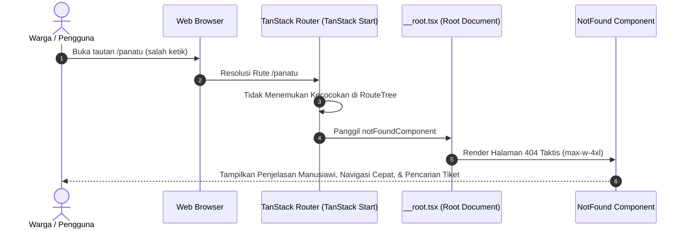
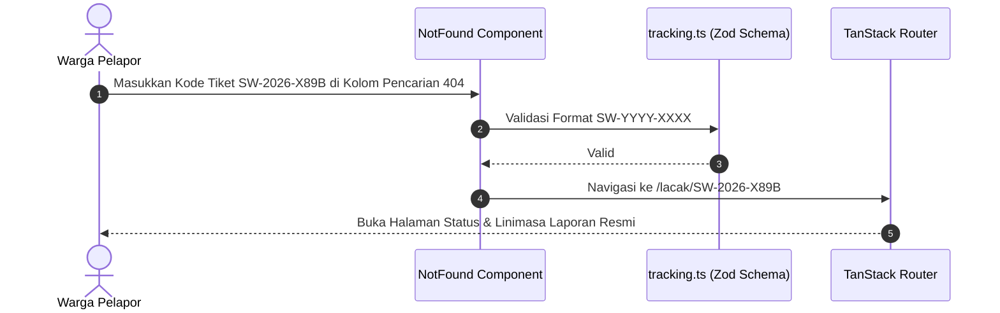

# Plan 15 — Custom 404 & Resilient Not Found Fallback

## 1. Scope & Objectives
- **Target:** Membangun halaman 404 kustom (*Not Found*) dan *Global Error Boundary* yang tangguh (*resilient*) untuk seluruh ekosistem TanStack Start / TanStack Router di SiagaWarga. Memastikan warga, relawan, dan operator yang mengakses tautan usang, salah ketik, atau tidak terdaftar tidak pernah mengalami tampilan layar putih kosong (*white screen of death*), melainkan disajikan antarmuka *Tactical Mission Control* yang elegan, informatif, dan menyediakan jalur navigasi pemulihan instan (pencarian tiket pelaporan, navigasi cepat ke peta/lapor, dan akses panggilan darurat 112/113).
- **Out of Scope:** Layanan pemendek tautan kustom (*custom URL shortener*) atau pelacakan analitik pihak ketiga yang memuat skrip pelacak eksternal.
- **Competition Alignment (WIA MIA 2026):**
  - **Fungsionalitas (25%):** Penanganan rute 404 dan galat tak terduga (*fallback boundary*) terintegrasi secara menyeluruh di tingkat *router* dan *root document layout*, mencegah kegagalan aplikasi saat peramban menerima rute antah berantah.
  - **Desain (20%):** Mematuhi standar estetika *Tactical Mission Control* (Rule 22: `max-w-4xl`), palet OKLCH solid tanpa gradien dekoratif (Rule 13), lencana status taktis, dan komposisi Base UI primitives (Rule 10 & 16).
  - **Konten (20%):** Panduan navigasi ramah warga dengan mikro-kopi Indonesia baku (*bahasa-website* dan *bahasa-inti*), tanpa jargon teknis membingungkan, tanpa nada menyalahkan pengguna, dan patuh mutlak pada Kebijakan Zero Emoji (Rule 14).
  - **Orisinalitas (20%):** Halaman 404 cerdas yang menyertakan input pelacakan instan untuk menangani salah ketik kode tiket pelaporan (`SW-YYYY-XXXX`) serta kartu kontak cepat darurat instansi terkait (Damkar 113 & Darurat 112).
  - **Kesesuaian Tema (15%):** *Public Service Tracking* — memastikan warga yang mencari layanan pelacakan insiden tidak tersesat dan tetap memiliki akses cepat ke jalur pelaporan kedaruratan.

---

## 2. PRD Reference & Dependencies
- **PRD Section:** Section 3 (Visi & Non-Goals 112/113), Section 4.1 (User Persona: Warga Pelapor), dan Rule 19 (Route Resilience: Pending Skeletons & Human Error Boundaries).
- **Preceding Plan Dependencies:**
  - `docs/plans/07-public-tracking-timeline.md` (Plan 07 — Public Tracking & Tiket `SW-YYYY-XXXX`)
  - `docs/plans/14-map-geolocation-and-proximity-tracking.md` (Plan 14 — Geolocation & Proximity)
- **Target Route(s):**
  - Global Router Fallback (`src/router.tsx`)
  - Root Layout Fallback (`src/routes/__root.tsx`)
  - Universal Not Found Handler untuk seluruh rute tidak dikenal (e.g. `/halaman-salah`, `/admin/unknown`, `/lacak/`)

---

## 3. Use Cases & Sequence Diagrams

### Use Case 1: Warga Mengakses URL yang Tidak Terdaftar atau Salah Ketik


### Use Case 2: Warga Memasukkan Kode Pelacakan dari Halaman 404


---

## 4. Data Models, Schemas & Server Functions

### 4.1 Skema Isomorfik Validasi Input (`src/lib/schema/tracking.ts`)
Menggunakan kembali skema validasi kode pelacakan yang telah teruji:
```typescript
export const getReportTrackingInputSchema = z.object({
  trackingCode: z
    .string()
    .trim()
    .toUpperCase()
    .regex(/^SW-\d{4}-[A-Z0-9]{4}$/, {
      message: 'Format kode pelacakan tidak valid. Contoh: SW-2026-X89B',
    }),
})
```

### 4.2 Router Fallback Configuration (`src/router.tsx`)
Mengonfigurasi `defaultNotFoundComponent` dan `defaultErrorComponent` pada instansiasi router TanStack:
```typescript
import { NotFound } from '@/components/shared/not-found'
import { GlobalErrorFallback } from '@/components/shared/global-error-fallback'

export function getRouter() {
  const context = getContext()

  const router = createTanStackRouter({
    routeTree,
    context,
    scrollRestoration: true,
    defaultPreload: 'intent',
    defaultPreloadStaleTime: 0,
    defaultNotFoundComponent: NotFound,
    defaultErrorComponent: GlobalErrorFallback,
  })

  setupRouterSsrQueryIntegration({ router, queryClient: context.queryClient })

  return router
}
```

### 4.3 Root Document Route Integration (`src/routes/__root.tsx`)
Menyediakan `notFoundComponent` dan `errorComponent` di tingkat rute akar:
```typescript
export const Route = createRootRouteWithContext<MyRouterContext>()({
  head: () => ({ ... }),
  shellComponent: RootDocument,
  notFoundComponent: NotFound,
  errorComponent: GlobalErrorFallback,
})
```

---

## 5. UI/UX Design & Microcopy Specification (DESIGN.md & bahasa-skills)

- **Surface Mode:** Operate & Recover (Pemulihan Navigasi)
- **Geometry:** Mengikuti standar desktop container geometry `max-w-4xl` (Rule 22: `<div className="mx-auto w-full max-w-4xl px-4 py-8 sm:px-6 lg:py-12">`).

### 5.1 Shadcn Component Mapping & Verification (Rule 16)

| UI Feature / Element | Shadcn Component (`docs/shadcn/components/base/`) | Status di `src/components/ui/` | Variants / Modifiers / Props |
| :--- | :--- | :--- | :--- |
| **Kartu Utama 404** | `card.md` (`Card`, `CardContent`, `CardHeader`) | Sudah Tersedia (`card.tsx`) | Variant `default`, `size="lg"` |
| **Lencana Status 404** | `badge.md` (`Badge`) | Sudah Tersedia (`badge.tsx`) | Variant `outline`, `size="sm"`, font-mono |
| **Tombol Navigasi** | `button.md` (`Button`) | Sudah Tersedia (`button.tsx`) | Variant `default` / `outline`, `size="default"` |
| **Input Pencarian Tiket**| `input.md` (`Input`) | Sudah Tersedia (`input.tsx`) | Variant `mono` / `default`, `type="text"` |
| **Peringatan & Saran** | `alert.md` (`Alert`, `AlertDescription`) | Sudah Tersedia (`alert.tsx`) | Variant `default` |
| **Pemisah Konten** | `separator.md` (`Separator`) | Sudah Tersedia (`separator.tsx`) | Horizontal divider |

### 5.2 Tata Letak & Visual Hierarchy Komponen
1. **Header Taktis 404:**
   - Ikon `SearchXIcon` atau `FileQuestionIcon` dalam lingkaran taktis bersudut lembut (`flex size-14 items-center justify-center rounded-2xl bg-muted text-muted-foreground ring-1 ring-border`).
   - Lencana kode status: `404 NOT FOUND` dalam format monospace.
   - Judul utama: `Halaman Tidak Ditemukan` (`text-2xl font-bold tracking-tight text-foreground sm:text-3xl`).
   - Deskripsi: Penjelasan transparan bahwa halaman mungkin telah dipindahkan atau alamat tautan salah ketik.
2. **Matriks Aksi Cepat (Quick Action Matrix):**
   - Tombol 1: **"Kembali ke Beranda"** (`HomeIcon`, variant `default`).
   - Tombol 2: **"Buka Peta Pantau"** (`MapIcon`, variant `outline`).
   - Tombol 3: **"Laporkan Titik Api"** (`FlameIcon`, variant `outline`).
3. **Kotak Pencarian Pelacakan Instan:**
   - Untuk warga yang bermaksud membuka laporan tetapi salah memasukkan tautan (misal `/lacak` tanpa kode), disediakan input kode tiket langsung dengan validasi instan (`SW-YYYY-XXXX`).
4. **Kartu Layanan Darurat Terintegrasi (112 & 113):**
   - Menegaskan kembali non-goals PRD Section 3 bahwa SiagaWarga mendukung keselamatan warga dengan menyediakan pintasan telepon langsung ke instansi pemadam dan nomor darurat bebas pulsa.

### 5.3 Microcopy & UI Text (bahasa-skills verified)
- **Judul Halaman:** "Halaman Tidak Ditemukan"
- **Lencana Status:** "404 NOT FOUND"
- **Penjelasan Utama:** "Tautan yang Anda tuju mungkin sudah dipindahkan, dihapus, atau alamat URL salah ketik. Seluruh layanan pemantauan dan pelaporan kebakaran SiagaWarga tetap aktif."
- **Label Tombol Utama:** "Kembali ke Beranda", "Buka Peta Pantau", "Laporkan Titik Api"
- **Formulir Tiket:**
  - Label: "Cari Status Laporan Kebakaran"
  - Placeholder: "Contoh: SW-2026-X89B"
  - Tombol: "Lacak Laporan"
  - Pesan Galat: "Format kode pelacakan tidak valid. Gunakan format resmi, contoh: SW-2026-X89B."
- **Kontak Darurat:**
  - "Butuh Bantuan Pemadaman Segera?"
  - "Hubungi Pemadam Kebakaran di 113 atau Layanan Kedaruratan Bebas Pulsa 112 jika berada di dekat api."
- **Global Error Boundary Text:**
  - Judul: "Terjadi Kendala pada Halaman"
  - Deskripsi: "Sistem mengalami kendala sementara saat memproses permintaan ini. Silakan muat ulang halaman atau kembali ke beranda."
  - Tombol Aksi: "Coba Lagi" dan "Kembali ke Beranda"

---

## 6. Implementation File List

### New Files
1. `src/components/shared/not-found.tsx`: Komponen halaman 404 taktis lengkap dengan matriks navigasi cepat, pencarian tiket instan, dan kontak darurat 112/113.
2. `src/components/shared/global-error-fallback.tsx`: Komponen batas galat global (*Global Error Boundary*) dengan tombol coba lagi (*retry*) dan kembali ke beranda.
3. `tests/not-found.test.ts`: Pengujian unit otomatis (Bun) untuk verifikasi komponen 404, validasi kode pelacakan cepat, dan kepatuhan kebijakan bebas emoji.

### Modified Files
1. `src/routes/__root.tsx`:
   - Mendaftarkan `notFoundComponent: NotFound`.
   - Mendaftarkan `errorComponent: GlobalErrorFallback`.
2. `src/router.tsx`:
   - Mendaftarkan `defaultNotFoundComponent: NotFound`.
   - Mendaftarkan `defaultErrorComponent: GlobalErrorFallback`.

---

## 7. Testing & Quality Gates (TDD with Bun)

### Test Scenarios (`tests/not-found.test.ts`)
1. **Validasi Format Kode Pelacakan Cepat:**
   - Memastikan format valid `SW-2026-X89B` diterima dan dinormalisasi (uppercase, trim).
   - Memastikan format tidak valid (tanpa strip, kode acak) ditolak dengan pesan kesalahan baku.
2. **Kepatuhan Teks & Aksesibilitas (Rule 14 & Rule 15):**
   - Memastikan seluruh salinan teks bebas emoji secara mutlak.
   - Memastikan teks tombol darurat mengarah ke `tel:112` dan `tel:113`.
   - Memastikan tautan navigasi utama mengarah ke `/`, `/pantau`, dan `/lapor`.
3. **Kepatuhan Penanganan Galat Global:**
   - Memastikan komponen `GlobalErrorFallback` menyediakan tombol "Coba Lagi" dan "Kembali ke Beranda".

### Quality Gates Checklist
1. `bun test tests/not-found.test.ts` dan seluruh test suite lulus 100% (target >175 passing tests).
2. `bun run lint` (ESLint) bersih tanpa kesalahan.
3. `bun run lint:design` (@shadcn/lint) bersih tanpa pelanggaran desain.
4. `bun run typecheck` (`tsc --noEmit`) tanpa kesalahan tipe.
5. `bun run build` sukses menghasilkan bundel produksi Cloudflare.
