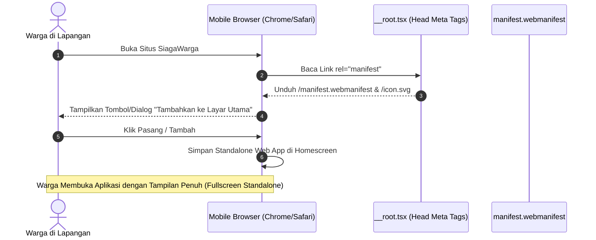
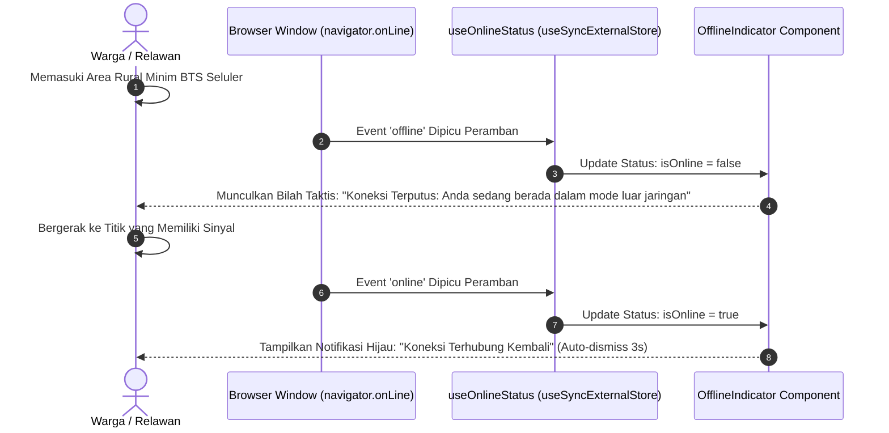

# Plan 16 — PWA Web App Manifest, App Icons & Offline Signal Indicator

## 1. Scope & Objectives
- **Target:** Memperkuat keandalan SiagaWarga sebagai platform tanggap darurat bencana di lapangan (*field-ready emergency platform*) melalui implementasi standar *Progressive Web App* (PWA) lengkap dengan Web App Manifest (`public/manifest.webmanifest`), pintasan aplikasi (*App Shortcuts* untuk Lapor, Pantau, dan Berita), ikon vektor adaptif (`public/icon.svg`), meta tags ramah perangkat bergerak (*mobile-optimized meta tags*), serta komponen indikator sinyal *offline* cerdas (`src/components/shared/offline-indicator.tsx`) berbasis React 19 `useSyncExternalStore`.
- **Out of Scope:** Sinkronisasi latar belakang menggunakan Service Worker Background Sync API yang membutuhkan instalasi modul peramban khusus (menjaga runtime tetap murni Standar Web ringan untuk ponsel berspesifikasi rendah).
- **Competition Alignment (WIA MIA 2026):**
  - **Fungsionalitas (25%):** Aplikasi dapat dipasang langsung (*add to home screen / 1-click install*) di Android dan iOS tanpa melalui toko aplikasi pihak ketiga, serta mendeteksi kehilangan sinyal internet (*offline state detection*) secara instan saat warga berada di area rural/hutan minim BTS seluler.
  - **Desain (20%):** Banner status offline taktis (*Tactical Mission Control*) yang tidak menghalangi tombol interaksi krusial (*non-blocking banner*), lencana status beranimasi halus, dan transisi pemulihan sinyal (*restoration toast/pill*).
  - **Konten (20%):** Pesan informatif berbasis *bahasa-website* dan *bahasa-inti* yang memberi ketenangan dan petunjuk solutif bagi warga tanpa kepanikan, bebas jargon teknis kode HTTP, dan patuh mutlak Kebijakan Zero Emoji (Rule 14).
  - **Orisinalitas (20%):** Integrasi PWA App Shortcuts untuk aksi cepat penanganan bencana: pintasan langsung ke formulir pelaporan titik api (`/lapor`), pemantauan peta interaktif (`/pantau`), dan kabar insiden terverifikasi (`/news`).
  - **Kesesuaian Tema (15%):** *Public Service Tracking* — memastikan akses pelacakan layanan publik tetap terpandu meski konektivitas seluler warga terganggu di lokasi kebakaran.

---

## 2. PRD Reference & Dependencies
- **PRD Section:** Section 3 (Metrik Keberhasilan MVP: Mobile FCP & Aksesibilitas), Section 4.1 (User Persona: Warga Pelapor di Lapangan), dan Rule 20 (Client-Side Pre-Compression & Rural Connectivity Resilience).
- **Preceding Plan Dependencies:**
  - `docs/plans/01-landing-and-emergency-banner.md` (Plan 01 — Emergency Banner & Header Layout)
  - `docs/plans/15-custom-404-and-resilient-not-found-fallback.md` (Plan 15 — Custom 404 & Router Resilience)
- **Target Route(s):**
  - Root Shell Layout (`src/routes/__root.tsx`)
  - Static Asset Delivery (`public/manifest.webmanifest` dan `public/icon.svg`)

---

## 3. Use Cases & Sequence Diagrams

### Use Case 1: Warga Menginstal SiagaWarga ke Layar Utama Ponsel (PWA Install)


### Use Case 2: Deteksi Kehilangan Sinyal di Area Bencana (Offline Indicator)


---

## 4. Data Models, Schemas & Web Standards

### 4.1 Web App Manifest Specification (`public/manifest.webmanifest`)
Format baku W3C Web App Manifest dalam JSON terstruktur:
```json
{
  "name": "SiagaWarga - Pelaporan & Pantau Kebakaran",
  "short_name": "SiagaWarga",
  "description": "Platform pelaporan kebakaran terbuka dengan tracking transparan dan verifikasi spasial bencana di Indonesia.",
  "start_url": "/",
  "scope": "/",
  "display": "standalone",
  "orientation": "portrait-primary",
  "background_color": "#ffffff",
  "theme_color": "#1b4d3e",
  "categories": ["government", "news", "utilities"],
  "icons": [
    {
      "src": "/icon.svg",
      "sizes": "any",
      "type": "image/svg+xml",
      "purpose": "any maskable"
    },
    {
      "src": "/favicon.ico",
      "sizes": "64x64 32x32 24x24 16x16",
      "type": "image/x-icon"
    }
  ],
  "shortcuts": [
    {
      "name": "Laporkan Kebakaran",
      "short_name": "Lapor",
      "description": "Kirim laporan kejadian kebakaran baru dengan bukti foto dan lokasi",
      "url": "/lapor"
    },
    {
      "name": "Peta Pemantauan",
      "short_name": "Pantau",
      "description": "Pantau sebaran titik api aktif dan hotspot satelit NASA FIRMS",
      "url": "/pantau"
    },
    {
      "name": "Berita Insiden",
      "short_name": "Kabar",
      "description": "Lihat kabar insiden kebakaran terverifikasi terkini",
      "url": "/news"
    }
  ]
}
```

### 4.2 React 19 Online Status Hook (`src/lib/use-online-status.ts`)
Menggunakan `useSyncExternalStore` murni Standar Web untuk sinkronisasi reaktif tanpa risiko *hydration mismatch*:
```typescript
import { useSyncExternalStore } from 'react'

function subscribe(callback: () => void) {
  window.addEventListener('online', callback)
  window.addEventListener('offline', callback)
  return () => {
    window.removeEventListener('online', callback)
    window.removeEventListener('offline', callback)
  }
}

function getSnapshot() {
  return navigator.onLine
}

function getServerSnapshot() {
  return true // SSR aman mengasumsikan online
}

export function useOnlineStatus(): boolean {
  return useSyncExternalStore(subscribe, getSnapshot, getServerSnapshot)
}
```

---

## 5. UI/UX Design & Microcopy Specification (DESIGN.md & bahasa-skills)

- **Surface Mode:** Tactical Alert & Awareness
- **Visual Style:** Mengikuti standar *Tactical Mission Control*, OKLCH color tokens solid tanpa gradien artifisial (Rule 13), dan bebas emoji mutlak (Rule 14).

### 5.1 Shadcn Component Mapping & Verification (Rule 16)

| UI Feature / Element | Shadcn Component (`docs/shadcn/components/base/`) | Status di `src/components/ui/` | Variants / Modifiers / Props |
| :--- | :--- | :--- | :--- |
| **Lencana Status Offline** | `badge.md` (`Badge`) | Sudah Tersedia (`badge.tsx`) | Variant `warning` / `destructive`, `size="xs"` |
| **Lencana Status Pulih** | `badge.md` (`Badge`) | Sudah Tersedia (`badge.tsx`) | Variant `success`, `size="xs"` |
| **Tombol Cek Koneksi** | `button.md` (`Button`) | Sudah Tersedia (`button.tsx`) | Variant `outline` / `ghost`, `size="icon-xs"` |

### 5.2 Tata Letak Indikator Sinyal Offline
- **Posisi:** Terletak persis di bawah `EmergencyBanner` dan di atas `HeaderNav` saat offline, atau mengambang taktis di bagian atas viewport.
- **Visual Saat Offline:**
  - Latar belakang: `--color-muted` dengan aksen garis bawah warna ambar atau crimson (`border-b border-amber-500/40 bg-amber-500/10`).
  - Ikon: `WifiOffIcon` warna ambar.
  - Teks: Jelas dan ramah warga.
- **Visual Saat Koneksi Pulih:**
  - Muncul sementara selama 3 detik.
  - Ikon: `WifiIcon` warna hijau (`text-[var(--success)]`).
  - Teks: "Koneksi Terhubung Kembali".

### 5.3 Microcopy & UI Text (bahasa-skills verified)
- **Status Offline:**
  - Judul: "Koneksi Terputus"
  - Deskripsi: "Anda sedang berada dalam mode luar jaringan (*offline*). Fitur pengiriman laporan dan sinkronisasi peta satelit membutuhkan koneksi internet aktif."
  - Tombol: "Periksa Sambungan"
- **Status Pulih:**
  - Judul: "Koneksi Terhubung Kembali"
  - Deskripsi: "Sinyal internet aktif. Seluruh fitur pelaporan dan pemantauan siap digunakan kembali."
- **PWA Meta Title & Description:**
  - Judul: "SiagaWarga - Platform Pelaporan & Tracking Kebakaran Terbuka"
  - Deskripsi: "Platform pelaporan kebakaran terbuka dengan tracking transparan dan verifikasi spasial bencana di Indonesia."

---

## 6. Implementation File List

### New Files
1. `public/manifest.webmanifest`: Spesifikasi W3C Web App Manifest dengan metadata nama, tema, orientasi, display standalone, dan 3 App Shortcuts.
2. `public/icon.svg`: Ikon vektor taktis SiagaWarga (emblem perisai dan titik api ember) beresolusi tajam di segala kerapatan layar.
3. `src/lib/use-online-status.ts`: Hook status konektivitas React 19 berbasis `useSyncExternalStore`.
4. `src/components/shared/offline-indicator.tsx`: Komponen bilah indikator sinyal offline & toast pulih.
5. `tests/offline-pwa.test.ts`: Pengujian unit otomatis (Bun) untuk validasi manifest JSON, rute pintasan, teks bebas emoji, dan ekspor komponen.

### Modified Files
1. `src/routes/__root.tsx`:
   - Menambahkan tag `<link rel="manifest" href="/manifest.webmanifest" />`.
   - Menambahkan tag meta PWA (`theme-color`, `apple-mobile-web-app-capable`, `apple-touch-icon`).
   - Menyisipkan `<OfflineIndicator />` di dalam kontainer utama `RootDocument`.

---

## 7. Testing & Quality Gates (TDD with Bun)

### Test Scenarios (`tests/offline-pwa.test.ts`)
1. **Integritas Berkas Web App Manifest (`public/manifest.webmanifest`):**
   - Berkas valid secara sintaksis JSON.
   - Mengandung properti wajib: `name`, `short_name`, `start_url`, `display: "standalone"`, `theme_color`, dan `icons`.
   - Mengandung 3 App Shortcuts valid menuju `/lapor`, `/pantau`, dan `/news`.
2. **Kepatuhan Teks & Kebijakan Bebas Emoji (Rule 14 & Rule 15):**
   - Seluruh teks manifest dan mikro-kopi offline indikator 100% bebas karakter emoji.
   - Menggunakan diksi baku ramah warga (*bahasa-website*).
3. **Verifikasi Komponen & Hook Ekspor:**
   - Memastikan `useOnlineStatus` dan `OfflineIndicator` terdefinisi dan dapat diuji.

### Quality Gates Checklist
1. `bun test tests/offline-pwa.test.ts` dan seluruh test suite lulus 100% (target >180 passing tests).
2. `bun run lint` (ESLint) bersih tanpa kesalahan.
3. `bun run lint:design` (@shadcn/lint) bersih tanpa pelanggaran desain.
4. `bun run typecheck` (`tsc --noEmit`) tanpa kesalahan tipe.
5. `bun run build` sukses menghasilkan bundel produksi Cloudflare.
